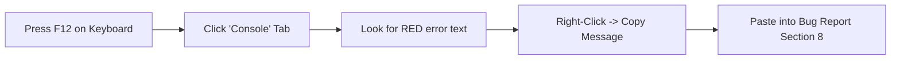

# Agrochemical ERP — Standard Bug & Defect Report Template

> [!NOTE]
> Use this standardized template to document any defects, calculation errors, permission leaks, or UI glitches encountered during manual or automated testing. Submit completed reports to the engineering team for rapid triage and resolution.

---

## 1. Defect Severity & Priority Classification Guide

Before logging a defect, classify its **Severity** (technical/business impact) and **Priority** (urgency of fix) using the criteria below:

| Severity Level | Definition | Impact on Agrochemical Operations | Example |
| :--- | :--- | :--- | :--- |
| **Blocker** | Complete system failure, database corruption, or fatal crash with no possible workaround. | Production halted; dispatch impossible; fatal data loss. | White-screen crash on login; database write failure corrupting inventory ledger. |
| **Critical** | Core business workflow broken; incorrect financial or stock calculation; security/permission leak. | Incorrect stock deduction; unauthorized cross-company data access; wrong tax calculation. | An order of 100 boxes deducts 200 boxes from inventory; Company B user views Company A sales. |
| **Major** | A major feature fails or produces an error, but a temporary manual workaround exists. | Operations delayed but manageable via secondary method. | Automated PDF invoice download button fails, but invoice displays on screen and can be printed. |
| **Minor** | Non-critical function issue, slow UI response, minor validation inconsistency, or alignment bug. | Inconvenience to operator; no data or calculation corruption. | Search filter requires pressing Enter instead of live filtering; pagination counter shows "1-10 of 9". |
| **Cosmetic** | Visual defect, typo, button styling, badge color variance, or text wrapping issue. | Zero functional or data impact; visual polish required. | Badge text overlaps border by 2px; misspelled chemical name in static helper text. |

| Priority Level | Resolution SLA | Action Required |
| :--- | :--- | :--- |
| **P1 — Urgent** | Immediate (Within 4 hours) | Must be resolved before any further testing or operational use. Blocks test execution. |
| **P2 — High** | Within 24 hours | Must be resolved before the current testing cycle or stage can be signed off. |
| **P3 — Medium** | Next Sprint / Scheduled Build | Fix scheduled in standard build cycle; workaround documented in test log. |
| **P4 — Low** | Backlog Polish | Aesthetic or non-critical enhancement addressed when time permits. |

---

## 2. Standard Defect Report Form

```markdown
### DEFECT REPORT: [BUG-ID] — [Short Descriptive Title]

#### 1. Identification & Metadata
* **Bug ID:** BUG-______ (e.g. BUG-PROD-001, BUG-INV-004, BUG-ORD-002)
* **Related Test Case ID:** TC-______ (Must reference a valid Test Case ID from ERP_COMPLETE_TESTING_HANDBOOK.md)
* **Date & Time Reported:** YYYY-MM-DD HH:MM (Local Time)
* **Reporter Name / Persona:** __________________
* **Environment:** [ ] Local Dev (`http://localhost:5174`)  [ ] Staging Server  [ ] Live Production Mirror
* **Application Build / Commit:** __________________
* **Browser & OS:** Google Chrome 124+ / Windows 11 (64-bit) [Specify if different]
* **Viewport Resolution:** [ ] Desktop (1920x1080)  [ ] Laptop (1366x768)  [ ] Tablet (768px)  [ ] Mobile (375px)

#### 2. Classification
* **Module:** __________________ (e.g. Inventory, Manufacturing, Orders, User Roles)
* **Page URL:** __________________ (e.g. `pages/production.html`, `pages/orders.html`)
* **Feature & Subfeature:** __________________ / __________________
* **Severity:** [ ] Blocker  [ ] Critical  [ ] Major  [ ] Minor  [ ] Cosmetic
* **Priority:** [ ] P1 (Urgent)  [ ] P2 (High)  [ ] P3 (Medium)  [ ] P4 (Low)
* **Reproduction Frequency:** [ ] Every time (100%)  [ ] Intermittent (~50%)  [ ] Occurred Once

#### 3. User & Organization Context
* **Active User Email & Role:** __________________ (e.g. `production@anjani.test` / Production Manager)
* **Active Company:** [ ] Anjani Agri Care - TEST (ID: 1)  [ ] Company A - TEST (ID: 2)  [ ] Other: ______
* **Active Branch & Warehouse:** __________________ (e.g. Main Plant / FG Warehouse WH-002)

#### 4. Preconditions & Starting State
* *List any records, inventory balances, or settings that must exist before reproducing the bug:*
  1. 
  2. 

#### 5. Step-by-Step Reproduction Procedure
* *Provide exact, numbered steps. Do not omit any clicks, inputs, or dropdown selections:*
  1. Navigate to `______`
  2. Click on `______`
  3. Enter `______` into field `______`
  4. Select `______` from dropdown `______`
  5. Click the `______` button

#### 6. Observed Behavior vs. Expected Behavior
* **Observed Result (What actually happened):**
  * 
* **Expected Result (What should have happened according to business rules):**
  * 

#### 7. Stock & Financial Impact Assessment
* **Inventory Impact:** [ ] None  [ ] Stock Over-Deducted  [ ] Stock Under-Deducted  [ ] Phantom Batch Created  
  * *Details:* Starting: _____ units | Expected: _____ units | Actual Recorded: _____ units | Variance: _____
* **Financial / Ledger Impact:** [ ] None  [ ] Incorrect Invoice Total  [ ] Tax Discrepancy  [ ] Ledger Mismatch  
  * *Details:* 

#### 8. Technical Evidence & Diagnostic Logs
* **Browser Developer Console Errors (F12 -> Console tab):**
  ```text
  [Paste any red error messages or stack traces here]
  ```
* **Network Request / API Error (F12 -> Network tab):**
  * *Failed Endpoint:* `POST /rest/v1/______`
  * *HTTP Status Code:* 400 Bad Request / 403 Forbidden / 500 Server Error
  * *Response Payload:* `{"code": "...", "message": "..."}`
* **Database Record IDs Involved:**
  * *Company ID:* _____ | *Item ID:* _____ | *Batch No:* _____ | *Order No:* _____
* **Screenshots / Video Recording Attached:**
  * `[Attach image or link to evidence file in tests/scratch/]`

#### 9. Temporary Workaround (If Known)
* 

#### 10. Developer Investigation & Fix Notes (Filled by Engineering)
* **Root Cause:** 
* **Files Modified:** 
* **Automated Regression Test Added:** `tests/______`
* **Fix Verified By:** __________________ on YYYY-MM-DD
* **Final Defect Status:** [ ] Open  [ ] In Progress  [ ] Resolved  [ ] Verified & Closed  [ ] Wont Fix / By Design
```

---

## 3. Practical Completed Examples

### Example 1: Critical Inventory Calculation Discrepancy

```markdown
### DEFECT REPORT: BUG-ORD-001 — Loose Units Not Deducted from Finished Goods Warehouse on Dispatch

#### 1. Identification & Metadata
* **Bug ID:** BUG-ORD-001
* **Related Test Case ID:** TC-ORD-002 (Partial Dispatch & Loose Unit Inventory Deduction)
* **Date & Time Reported:** 2026-10-16 10:30 IST
* **Reporter Name / Persona:** Vikram Patel (Senior QA Lead)
* **Environment:** Local Dev (`http://localhost:5174`)
* **Browser & OS:** Google Chrome 124 / Windows 11 Pro
* **Viewport Resolution:** Desktop (1920x1080)

#### 2. Classification
* **Module:** Orders & Dispatches
* **Page URL:** `pages/orders.html`
* **Feature & Subfeature:** Order Dispatch / Godown Verification Modal
* **Severity:** Critical (Core inventory calculation defect)
* **Priority:** P1 (Urgent — blocks manufacturing-to-sales reconciliation)
* **Reproduction Frequency:** Every time (100%)

#### 3. User & Organization Context
* **Active User Email & Role:** `store@anjani.test` (Warehouse & Store Manager)
* **Active Company:** Anjani Agri Care - TEST (ID: 1)
* **Active Branch & Warehouse:** Main Plant HO / Finished Goods Warehouse (WH-002)

#### 4. Preconditions & Starting State
1. Product `TEST-PROD-001` (Anjani Chlor-20 EC 500ml, 10 bottles/box) has batch `BAT-CHLOR-001` with exactly 100 boxes (1,000 bottles) in WH-002.
2. Sales Order `SO-2026-001` exists for customer `TEST-CUST-001` with an approved quantity of 5 boxes + 4 loose bottles (Total: 54 bottles).

#### 5. Step-by-Step Reproduction Procedure
1. Open `pages/orders.html` as Store Manager.
2. Locate order `SO-2026-001` in the table and click the blue "Dispatch Slip" button in row actions.
3. In the Dispatch Verification modal, enter:
   - Boxes to Dispatch: `5`
   - Loose Units to Dispatch: `4`
   - Dispatch Date: `2026-10-16`
4. Click "Confirm Godown Dispatch".
5. Observe the success toast message and navigate to `pages/inventory.html`.
6. Inspect the stock batch breakdown for `TEST-PROD-001`.

#### 6. Observed Behavior vs. Expected Behavior
* **Observed Result:** Batch `BAT-CHLOR-001` shows 95 boxes remaining (950 bottles). Only the 5 boxes were deducted; the 4 loose bottles were completely ignored by the decrement query.
* **Expected Result:** 5 boxes (50 bottles) + 4 loose bottles = 54 bottles total must be deducted. The remaining balance should be 946 bottles (94 boxes and 6 loose bottles).

#### 7. Stock & Financial Impact Assessment
* **Inventory Impact:** Stock Under-Deducted.
  * Starting: 1,000 bottles | Expected: 946 bottles | Actual: 950 bottles | Discrepancy: +4 phantom bottles in warehouse ledger.
* **Financial Impact:** Inventory overvalued by ₹800 (4 bottles × ₹200 cost price).

#### 8. Technical Evidence & Diagnostic Logs
* **Console Output:** None (request succeeded with HTTP 200).
* **Root Cause Clue:** In dispatch handler, payload calculation is `total_deducted = boxes * box_capacity`, omitting `+ loose_units`.
* **Screenshot:** Attached as `tests/scratch/evidence_BUG-ORD-001.png`.

#### 9. Temporary Workaround
Pack loose units into a full box prior to dispatch, or post a manual negative inventory adjustment on `pages/daily-transactions.html` for the 4 loose bottles.

#### 10. Developer Investigation & Fix Notes
* **Root Cause:** Line 342 in `assets/js/dispatch-ui.js` calculated `const deductQty = parseInt(boxesInput.value) * boxCap;` without reading `parseInt(looseInput.value || 0)`.
* **Files Modified:** `assets/js/dispatch-ui.js`, `assets/js/inventory-core.js`.
* **Automated Regression Test:** `tests/test_outside_click_and_orders_dispatches.js` (Test Case 4.2).
* **Fix Verified By:** Vikram Patel on 2026-10-16.
* **Final Defect Status:** Resolved.
```

---

### Example 2: Critical Multi-Company Isolation Leak

```markdown
### DEFECT REPORT: BUG-RBAC-002 — Company Switcher Dropdown Displays Other Tenant Warehouse Records

#### 1. Identification & Metadata
* **Bug ID:** BUG-RBAC-002
* **Related Test Case ID:** TC-COMP-002 (Multi-Company Tenant Boundary Enforcement)
* **Date & Time Reported:** 2026-10-16 11:45 IST
* **Reporter Name / Persona:** Sneha Verma (Security & Compliance Auditor)
* **Environment:** Local Dev (`http://localhost:5174`)
* **Browser & OS:** Mozilla Firefox 125 / Windows 11 Pro
* **Viewport Resolution:** Laptop (1366x768)

#### 2. Classification
* **Module:** Companies & Warehouses
* **Page URL:** `pages/warehouses.html`
* **Feature & Subfeature:** Warehouse Filtering / Multi-Company Isolation
* **Severity:** Critical (Cross-tenant data leakage)
* **Priority:** P1 (Urgent — violation of commercial data privacy)
* **Reproduction Frequency:** Every time (100%)

#### 3. User & Organization Context
* **Active User Email & Role:** `retail_owner@compb.test` (Company Owner — Company B)
* **Active Company:** Company B - TEST (ID: 3)
* **Active Branch & Warehouse:** Junagadh Depot / WH-COB-01

#### 4. Preconditions & Starting State
1. User is assigned strictly to Company B (ID: 3) with Company Scope authorization only.
2. Company 1 (Anjani Agri Care - TEST) has confidential central warehouses (Raw Materials WH-001).

#### 5. Step-by-Step Reproduction Procedure
1. Log in as `retail_owner@compb.test`.
2. Notice the topbar company pill correctly displays "Company B - TEST".
3. Navigate to `pages/warehouses.html`.
4. Inspect the warehouses table.

#### 6. Observed Behavior vs. Expected Behavior
* **Observed Result:** The table displays warehouses from ALL companies, including Anjani Agri Care Main Plant Warehouse (ID 1) and Company A Depot (ID 2).
* **Expected Result:** The table must strictly filter to warehouses where `company_id === 3`. Other companies' storage depots must be completely invisible.

#### 7. Stock & Financial Impact Assessment
* **Inventory Impact:** No physical stock altered, but confidential raw material inventory levels and warehouse capacities of competitor entities are exposed.
* **Financial Impact:** Commercial confidentiality breach.

#### 8. Technical Evidence & Diagnostic Logs
* **Network Log:** `GET /rest/v1/warehouses?select=*` was invoked without the `.eq('company_id', activeCompanyId)` query parameter.
* **Screenshot:** Attached as `tests/scratch/evidence_BUG-RBAC-002.png`.

#### 9. Temporary Workaround
None available for non-technical users.

#### 10. Developer Investigation & Fix Notes
* **Root Cause:** In `assets/js/warehouses.js`, query did not invoke `window.TENANT_CONTEXT.filter(query)`.
* **Files Modified:** `assets/js/warehouses.js`.
* **Automated Regression Test:** `tests/test_multi_company_isolation.js` (Test 3.1).
* **Fix Verified By:** Sneha Verma on 2026-10-16.
* **Final Defect Status:** Resolved.
```

---

## 4. How to Inspect Technical Evidence as a Non-Developer

If you encounter an unexpected error during testing, follow these 3 simple steps to collect evidence:



1. **Open Developer Tools:** Press `F12` (or Right-Click anywhere on the page and select **Inspect**).
2. **View Browser Errors:** Click on the **Console** tab at the top of the inspect panel. Any severe application failures will appear in **red text**.
3. **Capture Network Request Failures:** Click the **Network** tab. If a save or delete action failed, the endpoint name (e.g. `orders`, `stock_batches`) will appear in red with a status like `400`, `403`, or `500`. Click it and copy the response message.
4. **Take a Screenshot:** Press `Windows Key + Shift + S` to capture the area showing the error and paste it into your bug report.
