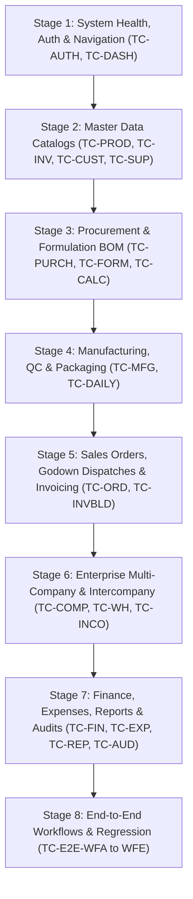

# Agrochemical Manufacturing ERP — Complete Master Testing Handbook & Quality Assurance System

> [!IMPORTANT]
> **Authoritative Operational Manual:** This comprehensive testing handbook is designed specifically for business owners, plant directors, quality assurance personnel, and commercial accountants. Every test case provides exact click-by-click instructions, concrete test values, chemical unit conversions, expected results, cross-module ledger verifications, and objective pass/fail criteria.
> **Current Application Branding:** **Anjani Agri Care** (ACC) — Central Agrochemical Manufacturing Legal Entity.

---

## TABLE OF CONTENTS

1. [Introduction & Manual Testing Framework for Non-Developers](#1-introduction--manual-testing-framework-for-non-developers)
2. [Test Environment Setup, Baseline Safety & Role Personas](#2-test-environment-setup-baseline-safety--role-personas)
3. [The 8-Stage Test Execution Plan](#3-the-8-stage-test-execution-plan)
4. [Module-by-Module & Page-by-Page Testing Manual](#4-module-by-module--page-by-page-testing-manual)
   * [Module 1: Authentication & Session Management (`login.html`, `index.html`)](#module-1-authentication--session-management)
   * [Module 2: Executive Dashboard & Topbar Controls (`pages/dashboard.html`)](#module-2-executive-dashboard--topbar-controls)
   * [Module 3: Product Masters & Packaging SKU Configurations (`pages/products.html`)](#module-3-product-masters--packaging-sku-configurations)
   * [Module 4: Raw Materials, Packaging Stock & Batch Tracking (`pages/inventory.html`)](#module-4-raw-materials-packaging-stock--batch-tracking)
   * [Module 5: Customer, Dealer & Farmer Network Master (`pages/clients.html`)](#module-5-customer-dealer--farmer-network-master)
   * [Module 6: Vendor & Technical Material Suppliers (`pages/suppliers.html`)](#module-6-vendor--technical-material-suppliers)
   * [Module 7: Procurement, Material Inward & GRN Receipts (`pages/purchases.html`)](#module-7-procurement-material-inward--grn-receipts)
   * [Module 8: Formulations & Recipe Bill of Materials (`pages/formulations.html`)](#module-8-formulations--recipe-bill-of-materials)
   * [Module 9: Manufacturing Runs, QC Quarantine & Finished Goods Packaging (`pages/production.html`)](#module-9-manufacturing-runs-qc-quarantine--finished-goods-packaging)
   * [Module 10: Shop-Floor Material Usage & Daily Consumption (`pages/daily-transactions.html`)](#module-10-shop-floor-material-usage--daily-consumption)
   * [Module 11: Technical Batch Calculation & Formulation Dilution Tools (`pages/batch-calculator.html`, `pages/calculator.html`)](#module-11-technical-batch-calculation--formulation-dilution-tools)
   * [Module 12: Sales Orders, Godown Verification & Dispatches (`pages/orders.html`)](#module-12-sales-orders-godown-verification--dispatches)
   * [Module 13: Enterprise Multi-Company & Branch Management (`pages/companies.html`)](#module-13-enterprise-multi-company--branch-management)
   * [Module 14: Central Warehouses & Storage Depots (`pages/warehouses.html`)](#module-14-central-warehouses--storage-depots)
   * [Module 15: Intercompany Supply Chains & Transfer Reconciliation (`pages/intercompany.html`)](#module-15-intercompany-supply-chains--transfer-reconciliation)
   * [Module 16: Commercial Cash & Bank Ledger (`pages/transactions.html`)](#module-16-commercial-cash--bank-ledger)
   * [Module 17: Operational Expenses & Overhead Allocation (`pages/expenses.html`)](#module-17-operational-expenses--overhead-allocation)
   * [Module 18: Commercial Tax Invoicing, GSTR & Customer Sales Reports (`pages/reports.html`)](#module-18-commercial-tax-invoicing-gstr--customer-sales-reports)
   * [Module 19: System Backups, Schema Snapshots & Data Exports (`pages/exports.html`)](#module-19-system-backups-schema-snapshots--data-exports)
   * [Module 20: Granular Roles, Permissions Matrix & Approvals (`pages/user-roles.html`)](#module-20-granular-roles-permissions-matrix--approvals)
   * [Module 21: Security & RBAC Immutable Audit Trail (`pages/audit-logs.html`)](#module-21-security--rbac-immutable-audit-trail)
   * [Module 22: Operator Profile & Session Authentication (`pages/profile.html`)](#module-22-operator-profile--session-authentication)
   * [Module 23: Independent Invoice Builder & PDF Tax Invoicing (`Invoice Builder/`)](#module-23-independent-invoice-builder--pdf-tax-invoicing)
5. [Connected End-to-End Business Workflows](#5-connected-end-to-end-business-workflows)
   * [Workflow A: Raw Materials to Production to Customer Dispatch & Sales Report](#workflow-a-raw-materials-to-production-to-customer-dispatch--sales-report)
   * [Workflow B: Anjani Supplies Another Company (Intercompany Transfer & Reconciliation)](#workflow-b-anjani-supplies-another-company-intercompany-transfer--reconciliation)
   * [Workflow C: Partial Dispatch, Split Challans & Order Cancellation](#workflow-c-partial-dispatch-split-challans--order-cancellation)
   * [Workflow D: Customer Returns, Damaged Goods & Restocking Adjustments](#workflow-d-customer-returns-damaged-goods--restocking-adjustments)
   * [Workflow E: Role Permissions, Multi-Company Isolation & Tamper Resistance](#workflow-e-role-permissions-multi-company-isolation--tamper-resistance)
6. [Comprehensive Feature Coverage & Traceability Matrix](#6-comprehensive-feature-coverage--traceability-matrix)

---

## 1. Introduction & Manual Testing Framework for Non-Developers

### 1.1 Purpose of this Handbook
This testing handbook provides a systematic, code-verified testing manual allowing business owners, plant operators, and QA auditors to thoroughly validate every page, form, button, calculation, inventory movement, and permission check in the ERP before operational go-live or commercial deployment.

### 1.2 How to Execute Tests
Every test case in this handbook follows a standardized structure:
1. **Locate the Test Case:** Look up the unique Test Case ID (e.g. `TC-PROD-001`, `TC-MFG-005`).
2. **Review Preconditions:** Confirm that the required records (e.g. products, materials, customers) exist in the test environment before starting.
3. **Assume the Required Persona:** Check the **Required User Role** and log in as that user, or use the role switcher to set the appropriate permission context.
4. **Follow Numbered Steps:** Execute the exact numbered actions step-by-step. Enter the concrete values provided; do not guess or use placeholder text.
5. **Verify the Expected Result:** Confirm that the on-screen alert, record insertion, and button transitions match the documented result.
6. **Inspect Cross-Module Impact:** Check secondary ledgers (e.g. verify that booking a dispatch on `pages/orders.html` decremented physical stock on `pages/inventory.html`).
7. **Record Result in `ERP_TEST_CASES.csv`:** Mark the test as `Pass` or `Fail`. If it fails, capture evidence and log a ticket using `ERP_BUG_REPORT_TEMPLATE.md`.

### 1.3 How to Capture Evidence
* **Screenshots:** Press `Windows Key + Shift + S` to capture the relevant screen area, showing the record, toast alert, and topbar. Save the image in `tests/scratch/`.
* **Browser Developer Console (F12):** If an action fails or a button does nothing, press `F12` on your keyboard, click the **Console** tab, and copy any red error text.
* **Network Failures:** In DevTools, click the **Network** tab to see if a red `400`, `403`, or `500` error occurred.

---

## 2. Test Environment Setup, Baseline Safety & Role Personas

### 2.1 Environmental Rules
* **Development Server URL:** `http://localhost:5174`
* **Master Test Dataset Guide:** Refer to `ERP_TEST_DATA_SETUP.md` for the complete list of test products, raw materials, formulations, customer accounts, and opening stock balances.
* **Safety Mandate:** Never run destructive database commands (`DROP`, `TRUNCATE`) against live business databases. Always maintain a restorable snapshot via `pages/exports.html`.

### 2.2 Standard Testing Personas

| Role Persona | Test Email | Default Password | Primary Authorization Scope |
| :--- | :--- | :--- | :--- |
| **Software Super Admin** | `admin@anjani.test` | `Test@Agro2026!` | Global (Full system configuration, role editing, audit logs) |
| **Company Owner / Director** | `owner@anjani.test` | `Test@Agro2026!` | Legal Entity Scope (Financial ledgers, executive approvals) |
| **Production Manager** | `production@anjani.test` | `Test@Agro2026!` | Plant Scope (Formulations, manufacturing batches, BOM) |
| **Warehouse & Store Manager** | `store@anjani.test` | `Test@Agro2026!` | Warehouse Scope (Goods receipt GRN, physical stock balance) |
| **QC Officer** | `qc@anjani.test` | `Test@Agro2026!` | Quality Scope (Specific gravity, assay analysis, batch release) |
| **Sales & Dispatch Executive** | `sales@anjani.test` | `Test@Agro2026!` | Commercial Scope (Customer orders, dispatch challans, invoices) |
| **Commercial Accountant** | `accounts@anjani.test` | `Test@Agro2026!` | Finance Scope (Cash & bank ledger, expense booking, GSTR) |
| **Compliance Auditor** | `auditor@anjani.test` | `Test@Agro2026!` | Read-Only Scope (Statutory review of ledgers and audit trails) |
| **Retail Subsidiary Owner** | `retail_owner@compb.test` | `Test@Agro2026!` | Company B Scope (Used to verify multi-company isolation) |

---

## 3. The 8-Stage Test Execution Plan

Organize manual testing into logical sequential stages. If a critical failure occurs in an early stage (e.g. Stage 1 or Stage 3), resolve it before proceeding to subsequent stages:



* **Stage 1: Application Health & Navigation:** Verify login, sessions, layout rendering, and topbar switchers.
* **Stage 2: Master Data Catalogs:** Verify products, packaging SKUs, chemical inventory, customers, and suppliers.
* **Stage 3: Procurement & Formulations:** Verify raw chemical purchase receipts (GRN), recipe BOMs, and scaling tools.
* **Stage 4: Manufacturing & Quality Control:** Verify production batch launch, QC analysis, batch quarantine release, and packaging runs.
* **Stage 5: Commercial Fulfillment:** Verify customer orders, credit limits, godown verification, dispatch challans, and invoices.
* **Stage 6: Enterprise Multi-Company:** Verify corporate legal entities, warehouses, and intercompany supply chains.
* **Stage 7: Financial Integrity & Auditing:** Verify cash/bank ledgers, expenses, tax reports, backups, and RBAC security logs.
* **Stage 8: End-to-End Regression:** Execute complete cross-module workflows A through E to prove system-wide harmony.

---

## 4. Module-by-Module & Page-by-Page Testing Manual

### Module 1: Authentication & Session
* **Primary Page:** `login.html`
* **Functional Scope:** Covers all independently verifiable controls, forms, tables, modals, calculations, and security guards in this module.

#### Test Case: TC-AUTH-001 — Super Admin Login & Automatic Dashboard Redirection

| Attribute | Details |
| :--- | :--- |
| **Test Case ID** | `TC-AUTH-001` |
| **Module & Page** | Authentication & Session (`login.html`) |
| **Main Feature** | Admin Login |
| **Subfeature** | Valid Credentials Submission |
| **Priority** | **P1** |
| **Required Role** | Software Super Admin |
| **Company Scope** | Anjani Agri Care - TEST (ACC) |
| **Dependencies** | None |

* **Business Objective:** Validate that valid credentials submission functions accurately in compliance with agrochemical business requirements.
* **Preconditions:** Vite server running at http://localhost:5174. User is logged out.
* **Exact Test Data:**
  ```text
  Email: admin@anjani.test | Password: Test@Agro2026! | Remember Me: Checked
  ```

* **Step-by-Step Execution Instructions:**
  1. Open http://localhost:5174/login.html in Google Chrome.
  2. Verify page title displays "Anjani Agri Care ERP - Admin Login".
  3. Enter "admin@anjani.test" into the User Email field.
  4. Enter "Test@Agro2026!" into the Password field.
  5. Check "Remember Me".
  6. Click the "Sign In" button.

* **Expected Result (Observable Behavior):**
  Green toast "Login successful! Redirecting to dashboard..." appears. System authenticates session, stores token in localStorage, and automatically redirects browser to pages/dashboard.html within 2 seconds.

* **Cross-Module Verification:**
  Check localStorage in DevTools (F12 -> Application -> Local Storage): erp_active_role="super_admin", erp_user_email="admin@anjani.test".

* **Pass / Fail Acceptance Criteria:**
  PASS if login succeeds and user lands on dashboard.html with topbar showing Rajesh Vora. FAIL if error occurs or user remains on login.html.

* **Evidence to Capture:** Screenshot of dashboard.html immediately after login with topbar user avatar.
* **Cleanup / Reset Procedure:** None required (valid active session needed for subsequent tests).
* **Technical Notes:** Verifies core session token issuance and auto-redirection.

---

#### Test Case: TC-AUTH-002 — Invalid Password Rejection & Rate Limiting Guard

| Attribute | Details |
| :--- | :--- |
| **Test Case ID** | `TC-AUTH-002` |
| **Module & Page** | Authentication & Session (`login.html`) |
| **Main Feature** | Security Guard |
| **Subfeature** | Invalid Credential Rejection |
| **Priority** | **P1** |
| **Required Role** | Unauthenticated User |
| **Company Scope** | N/A |
| **Dependencies** | None |

* **Business Objective:** Validate that invalid credential rejection functions accurately in compliance with agrochemical business requirements.
* **Preconditions:** Browser on login.html.
* **Exact Test Data:**
  ```text
  Email: admin@anjani.test | Password: WrongPassword999!
  ```

* **Step-by-Step Execution Instructions:**
  1. Navigate to login.html.
  2. Enter email "admin@anjani.test".
  3. Enter incorrect password "WrongPassword999!".
  4. Click "Sign In".

* **Expected Result (Observable Behavior):**
  Access blocked. Red error banner "#login-error-banner" displays "Invalid login credentials. Please check your email and password." User remains on login.html. No session tokens created.

* **Cross-Module Verification:**
  Inspect DevTools console: 401 Unauthorized captured. LocalStorage contains no auth token.

* **Pass / Fail Acceptance Criteria:**
  PASS if access denied and clear error displayed. FAIL if user is granted access or page white-screens.

* **Evidence to Capture:** Screenshot of login.html showing red error banner.
* **Cleanup / Reset Procedure:** None
* **Technical Notes:** Protects system boundary against unauthorized credential stuffing.

---

#### Test Case: TC-AUTH-003 — Password Masking & Reveal Toggle

| Attribute | Details |
| :--- | :--- |
| **Test Case ID** | `TC-AUTH-003` |
| **Module & Page** | Authentication & Session (`login.html`) |
| **Main Feature** | Password Visibility |
| **Subfeature** | Eye Icon Toggle |
| **Priority** | **P3** |
| **Required Role** | Any User |
| **Company Scope** | N/A |
| **Dependencies** | None |

* **Business Objective:** Validate that eye icon toggle functions accurately in compliance with agrochemical business requirements.
* **Preconditions:** Browser on login.html with text entered in password field.
* **Exact Test Data:**
  ```text
  Password: SecretPassword123!
  ```

* **Step-by-Step Execution Instructions:**
  1. Enter "SecretPassword123!" in Password field.
  2. Verify input type is "password" (bullets/dots displayed).
  3. Click the eye icon button inside password field.
  4. Observe input type changes to "text" (revealed).
  5. Click eye icon again.

* **Expected Result (Observable Behavior):**
  Clicking eye icon unmasks password to plain text; second click restores password masking bullets.

* **Cross-Module Verification:**
  None

* **Pass / Fail Acceptance Criteria:**
  PASS if password toggles smoothly between masked and unmasked. FAIL if input remains static.

* **Evidence to Capture:** Screenshot of revealed password text.
* **Cleanup / Reset Procedure:** Clear input field.
* **Technical Notes:** Accessibility and UX inspection.

---

#### Test Case: TC-AUTH-004 — Application Root Loader & Authenticated User Auto-Route

| Attribute | Details |
| :--- | :--- |
| **Test Case ID** | `TC-AUTH-004` |
| **Module & Page** | Authentication & Session (`index.html`) |
| **Main Feature** | Splash & Preloader |
| **Subfeature** | Session State Auto-Router |
| **Priority** | **P2** |
| **Required Role** | Authenticated User |
| **Company Scope** | Anjani Agri Care - TEST (ACC) |
| **Dependencies** | TC-AUTH-001 |

* **Business Objective:** Validate that session state auto-router functions accurately in compliance with agrochemical business requirements.
* **Preconditions:** User is authenticated (session token present in localStorage).
* **Exact Test Data:**
  ```text
  URL: http://localhost:5174/index.html
  ```

* **Step-by-Step Execution Instructions:**
  1. Navigate directly to http://localhost:5174/index.html.
  2. Observe initial splash screen with Anjani Agri Care logo and spinner.
  3. Watch browser URL bar.

* **Expected Result (Observable Behavior):**
  Splash loader checks session, detects active login, and seamlessly redirects to pages/dashboard.html within 1.5 seconds without requiring re-login.

* **Cross-Module Verification:**
  If user is logged out, index.html must redirect to login.html instead.

* **Pass / Fail Acceptance Criteria:**
  PASS if automatic routing completes without user interaction. FAIL if stuck on loading spinner.

* **Evidence to Capture:** Console network log showing redirect from index.html to dashboard.html.
* **Cleanup / Reset Procedure:** None
* **Technical Notes:** Verifies root application routing logic.

---


### Module 2: Executive Overview
* **Primary Page:** `pages/dashboard.html`
* **Functional Scope:** Covers all independently verifiable controls, forms, tables, modals, calculations, and security guards in this module.

#### Test Case: TC-DASH-001 — Executive KPI Metrics Aggregation & Stock Valuation

| Attribute | Details |
| :--- | :--- |
| **Test Case ID** | `TC-DASH-001` |
| **Module & Page** | Executive Overview (`pages/dashboard.html`) |
| **Main Feature** | KPI Summary Cards |
| **Subfeature** | Real-Time Operational Aggregation |
| **Priority** | **P1** |
| **Required Role** | Company Owner / Director |
| **Company Scope** | Anjani Agri Care - TEST (ACC) |
| **Dependencies** | TC-AUTH-001 |

* **Business Objective:** Validate that real-time operational aggregation functions accurately in compliance with agrochemical business requirements.
* **Preconditions:** Logged in on dashboard.html with baseline test dataset loaded.
* **Exact Test Data:**
  ```text
  Active Company: Anjani Agri Care (ACC)
  ```

* **Step-by-Step Execution Instructions:**
  1. Open pages/dashboard.html.
  2. Verify KPI cards: Finished Goods Stock Value, Low Stock Alert Items, Pending Orders, Today Sales.
  3. Compare values against underlying tables.

* **Expected Result (Observable Behavior):**
  KPI values match database aggregations: Finished Goods valuation matches sum of finished inventory batches; Low Stock card displays exact count of materials below threshold.

* **Cross-Module Verification:**
  Verify count of low stock items matches inventory items flagged on pages/inventory.html.

* **Pass / Fail Acceptance Criteria:**
  PASS if numbers are non-zero, formatted with Indian currency (₹), and accurate. FAIL if NaN, undefined, or zero when records exist.

* **Evidence to Capture:** Screenshot of dashboard top KPI metric row.
* **Cleanup / Reset Procedure:** None
* **Technical Notes:** Validates executive high-level visibility.

---

#### Test Case: TC-DASH-002 — Topbar Company Switcher Dynamic Entity Switch

| Attribute | Details |
| :--- | :--- |
| **Test Case ID** | `TC-DASH-002` |
| **Module & Page** | Executive Overview (`pages/dashboard.html`) |
| **Main Feature** | Company Switcher |
| **Subfeature** | Multi-Company Switch & Topbar Pill |
| **Priority** | **P1** |
| **Required Role** | Software Super Admin |
| **Company Scope** | Anjani Agri Care - TEST -> Company A - TEST |
| **Dependencies** | TC-DASH-001 |

* **Business Objective:** Validate that multi-company switch & topbar pill functions accurately in compliance with agrochemical business requirements.
* **Preconditions:** User on dashboard.html as Super Admin.
* **Exact Test Data:**
  ```text
  Switch target: Company A - TEST (CO-A, ID: 2)
  ```

* **Step-by-Step Execution Instructions:**
  1. Click topbar company pill "Anjani Agri Care ACC".
  2. Verify dropdown opens showing "Switch Active Company" with Anjani Agri Care marked active.
  3. Click "Company A - TEST".
  4. Observe page reload and topbar pill.

* **Expected Result (Observable Behavior):**
  Page reloads; topbar company pill updates to "🏢 Company A - TEST CO-A". Dashboard metrics strictly re-filter to Company A records. No Anjani Agri Care manufacturing data shown.

* **Cross-Module Verification:**
  Navigate to pages/inventory.html and pages/orders.html: verify only Company A records are displayed.

* **Pass / Fail Acceptance Criteria:**
  PASS if topbar pill updates, localStorage erp_active_company_id=2, and tenant context isolates data. FAIL if dropdown stuck on loading or records leak across companies.

* **Evidence to Capture:** Screenshot of topbar pill showing Company A - TEST.
* **Cleanup / Reset Procedure:** Switch back to Anjani Agri Care - TEST (ID: 1).
* **Technical Notes:** Verifies topbar dropdown fix and multi-tenant data boundary.

---

#### Test Case: TC-DASH-003 — Dashboard Operational Quick Actions (New Order, New Batch, Record GRN)

| Attribute | Details |
| :--- | :--- |
| **Test Case ID** | `TC-DASH-003` |
| **Module & Page** | Executive Overview (`pages/dashboard.html`) |
| **Main Feature** | Quick Action Buttons |
| **Subfeature** | Direct Modal Triggers |
| **Priority** | **P2** |
| **Required Role** | Production / Sales / Store Manager |
| **Company Scope** | Anjani Agri Care - TEST (ACC) |
| **Dependencies** | TC-DASH-001 |

* **Business Objective:** Validate that direct modal triggers functions accurately in compliance with agrochemical business requirements.
* **Preconditions:** User on dashboard.html.
* **Exact Test Data:**
  ```text
  Click buttons: "#btn-quick-order", "#btn-quick-batch", "#btn-quick-grn"
  ```

* **Step-by-Step Execution Instructions:**
  1. Click "New Order" quick action button. Verify modal opens or redirects to orders.html?action=new.
  2. Close modal.
  3. Click "New Production Batch".
  4. Verify batch modal triggers.
  5. Click "Record Receipt".

* **Expected Result (Observable Behavior):**
  Each quick action button immediately launches its corresponding operational form without page errors or broken script links.

* **Cross-Module Verification:**
  Inspect URL and target forms.

* **Pass / Fail Acceptance Criteria:**
  PASS if all 3 action shortcuts function properly. FAIL if any button is non-responsive.

* **Evidence to Capture:** Screenshot of order creation modal opened directly from dashboard.
* **Cleanup / Reset Procedure:** Close any open modals.
* **Technical Notes:** Validates operational shortcut routing.

---

#### Test Case: TC-DASH-004 — System Notification Center Inspection & Mark-All-Read

| Attribute | Details |
| :--- | :--- |
| **Test Case ID** | `TC-DASH-004` |
| **Module & Page** | Executive Overview (`pages/dashboard.html`) |
| **Main Feature** | Notification Center |
| **Subfeature** | Live Operational Notifications Dropdown |
| **Priority** | **P2** |
| **Required Role** | Any Staff User |
| **Company Scope** | Anjani Agri Care - TEST (ACC) |
| **Dependencies** | TC-DASH-001 |

* **Business Objective:** Validate that live operational notifications dropdown functions accurately in compliance with agrochemical business requirements.
* **Preconditions:** User on dashboard.html. Unread notifications exist.
* **Exact Test Data:**
  ```text
  Click "#notif-center-btn", Click "#notif-mark-all-btn"
  ```

* **Step-by-Step Execution Instructions:**
  1. Locate bell icon in topbar right. Observe unread badge count (e.g. "3").
  2. Click bell button.
  3. Verify dropdown displays notifications with timestamps and severity badges.
  4. Click "Mark all as read".
  5. Observe unread badge.

* **Expected Result (Observable Behavior):**
  Notification dropdown opens showing clean list of alerts. Clicking "Mark all as read" clears badge counter to 0 and marks items as read.

* **Cross-Module Verification:**
  Verify erp_system_notifications updated in localStorage.

* **Pass / Fail Acceptance Criteria:**
  PASS if notifications render cleanly and badge counter updates. FAIL if dropdown clips or errors.

* **Evidence to Capture:** Screenshot of notification center dropdown open.
* **Cleanup / Reset Procedure:** None
* **Technical Notes:** Verifies topbar notification engine.

---


### Module 3: Product Masters
* **Primary Page:** `pages/products.html`
* **Functional Scope:** Covers all independently verifiable controls, forms, tables, modals, calculations, and security guards in this module.

#### Test Case: TC-PROD-001 — Create Multi-SKU Insecticide Formulation Master

| Attribute | Details |
| :--- | :--- |
| **Test Case ID** | `TC-PROD-001` |
| **Module & Page** | Product Masters (`pages/products.html`) |
| **Main Feature** | Product Catalog |
| **Subfeature** | Create Multi-SKU Finished Product |
| **Priority** | **P1** |
| **Required Role** | Production Manager |
| **Company Scope** | Anjani Agri Care - TEST (ACC) |
| **Dependencies** | TC-AUTH-001 |

* **Business Objective:** Validate that create multi-sku finished product functions accurately in compliance with agrochemical business requirements.
* **Preconditions:** Logged in as Production Manager on pages/products.html.
* **Exact Test Data:**
  ```text
  Name: Anjani Chlor-20 EC | Code: TEST-PROD-001 | Category: Insecticide | GST: 18% | SKU 1: 500ml Bottle (10/box, MRP ₹350, Price ₹280) | SKU 2: 1 Litre Bottle (10/box, MRP ₹650, Price ₹520)
  ```

* **Step-by-Step Execution Instructions:**
  1. Open pages/products.html.
  2. Click "Add Product" button.
  3. Enter Product Name "Anjani Chlor-20 EC".
  4. Enter Product Code "TEST-PROD-001".
  5. Select Category "Insecticide".
  6. Set GST Rate to "18%".
  7. Add SKU 1: Size "500ml", Container "Bottle", Box Cap "10", MRP "350", Price "280".
  8. Click "+ Add Packaging SKU".
  9. Add SKU 2: Size "1 Litre", Container "Bottle", Box Cap "10", MRP "650", Price "520".
  1
  0. Click "Save Product".

* **Expected Result (Observable Behavior):**
  Success toast "Product created successfully!" appears. Modal closes. Product appears in table with two distinct packaging pills ("500ml", "1 Litre"). SKU data saved to Supabase/localStorage.

* **Cross-Module Verification:**
  Open pages/orders.html -> Click New Order: verify both 500ml and 1L SKUs are selectable in order item dropdown.

* **Pass / Fail Acceptance Criteria:**
  PASS if product created with both SKUs intact and visible in sales. FAIL if SKU data is dropped or save fails.

* **Evidence to Capture:** Screenshot of products table displaying TEST-PROD-001 with packaging badges.
* **Cleanup / Reset Procedure:** Keep product for subsequent formulation and sales tests.
* **Technical Notes:** Validates multi-SKU packaging architecture.

---

#### Test Case: TC-PROD-002 — Duplicate Product Code Collision Rejection Guard

| Attribute | Details |
| :--- | :--- |
| **Test Case ID** | `TC-PROD-002` |
| **Module & Page** | Product Masters (`pages/products.html`) |
| **Main Feature** | Validation Guard |
| **Subfeature** | Code Uniqueness Enforcement |
| **Priority** | **P2** |
| **Required Role** | Production Manager |
| **Company Scope** | Anjani Agri Care - TEST (ACC) |
| **Dependencies** | TC-PROD-001 |

* **Business Objective:** Validate that code uniqueness enforcement functions accurately in compliance with agrochemical business requirements.
* **Preconditions:** Product TEST-PROD-001 already exists in database.
* **Exact Test Data:**
  ```text
  Code: TEST-PROD-001 | Name: Duplicate Chlorpyrifos
  ```

* **Step-by-Step Execution Instructions:**
  1. On pages/products.html, click "Add Product".
  2. Enter Name "Duplicate Chlorpyrifos".
  3. Enter existing code "TEST-PROD-001".
  4. Fill required fields and click "Save Product".

* **Expected Result (Observable Behavior):**
  Validation error "Product code TEST-PROD-001 is already in use. Please enter a unique product code." displays. Record is blocked from saving. Table count remains unchanged.

* **Cross-Module Verification:**
  Check database products table: exactly one record exists with code TEST-PROD-001.

* **Pass / Fail Acceptance Criteria:**
  PASS if duplicate code is rejected. FAIL if duplicate row inserted or unhandled SQL exception.

* **Evidence to Capture:** Screenshot of modal showing duplicate code error toast.
* **Cleanup / Reset Procedure:** Close modal.
* **Technical Notes:** Prevents SKU code collisions.

---

#### Test Case: TC-PROD-003 — Edit Existing Product SKU Pricing & Technical Description

| Attribute | Details |
| :--- | :--- |
| **Test Case ID** | `TC-PROD-003` |
| **Module & Page** | Product Masters (`pages/products.html`) |
| **Main Feature** | Product Editing |
| **Subfeature** | SKU Pricing & Description Update |
| **Priority** | **P2** |
| **Required Role** | Production Manager / Director |
| **Company Scope** | Anjani Agri Care - TEST (ACC) |
| **Dependencies** | TC-PROD-001 |

* **Business Objective:** Validate that sku pricing & description update functions accurately in compliance with agrochemical business requirements.
* **Preconditions:** Product TEST-PROD-001 exists.
* **Exact Test Data:**
  ```text
  Updated Selling Price for 500ml SKU: ₹295.00 | Technical Spec: "High Efficacy Chlorpyrifos 20% EC with Stabilizer"
  ```

* **Step-by-Step Execution Instructions:**
  1. On pages/products.html, locate TEST-PROD-
  0
  0
  1.
  2. Click the pencil (Edit) icon in row actions.
  3. In edit modal, update Selling Price of 500ml SKU from 280 to
  2
  9
  5.
  4. Update Technical Spec field.
  5. Click "Update Product".

* **Expected Result (Observable Behavior):**
  Toast "Product updated successfully!" displays. Table row immediately updates to reflect new technical description. Edit modal closes cleanly.

* **Cross-Module Verification:**
  Navigate to pages/orders.html: create new order item for TEST-PROD-001 500ml; verify auto-filled unit price is now ₹295.00.

* **Pass / Fail Acceptance Criteria:**
  PASS if price updates in master and cascades to new order line items. FAIL if changes fail to persist on reload.

* **Evidence to Capture:** Screenshot of edited product details modal.
* **Cleanup / Reset Procedure:** Reset price to ₹280.00 if required.
* **Technical Notes:** Verifies price cascade from product master to sales.

---

#### Test Case: TC-PROD-004 — Prevent Deletion of Product with Active Stock Batches or Sales Orders

| Attribute | Details |
| :--- | :--- |
| **Test Case ID** | `TC-PROD-004` |
| **Module & Page** | Product Masters (`pages/products.html`) |
| **Main Feature** | Data Integrity Guard |
| **Subfeature** | Safe Cascade Delete Prevention |
| **Priority** | **P1** |
| **Required Role** | Software Super Admin |
| **Company Scope** | Anjani Agri Care - TEST (ACC) |
| **Dependencies** | TC-PROD-001 |

* **Business Objective:** Validate that safe cascade delete prevention functions accurately in compliance with agrochemical business requirements.
* **Preconditions:** TEST-PROD-001 has active finished goods batches in WH-002 or historical sales orders.
* **Exact Test Data:**
  ```text
  Target Product: TEST-PROD-001
  ```

* **Step-by-Step Execution Instructions:**
  1. Locate TEST-PROD-001 on pages/products.html.
  2. Click trash (Delete) icon in row actions.
  3. In confirmation dialog, click "Confirm Delete".

* **Expected Result (Observable Behavior):**
  Security rule alert displays: "Cannot delete product TEST-PROD-001 because active inventory batches or sales order history reference it. Archive product instead." Product is preserved in database.

* **Cross-Module Verification:**
  Verify product row remains in table; inventory batches on pages/inventory.html remain intact.

* **Pass / Fail Acceptance Criteria:**
  PASS if deletion blocked and safety alert displayed. FAIL if product deleted, leaving orphaned stock batches.

* **Evidence to Capture:** Screenshot of security rule blocking toast.
* **Cleanup / Reset Procedure:** None
* **Technical Notes:** Preserves relational referential integrity.

---

#### Test Case: TC-PROD-005 — Product Catalog Real-Time Filtering & Category Segmentation

| Attribute | Details |
| :--- | :--- |
| **Test Case ID** | `TC-PROD-005` |
| **Module & Page** | Product Masters (`pages/products.html`) |
| **Main Feature** | Search & Filtering |
| **Subfeature** | Live Filter by Category & Keyword |
| **Priority** | **P3** |
| **Required Role** | Any User |
| **Company Scope** | Anjani Agri Care - TEST (ACC) |
| **Dependencies** | TC-PROD-001 |

* **Business Objective:** Validate that live filter by category & keyword functions accurately in compliance with agrochemical business requirements.
* **Preconditions:** Multiple products exist across Insecticide, Fungicide, and Herbicide categories.
* **Exact Test Data:**
  ```text
  Filter Category: "Fungicide" | Search Query: "Tebuconazole"
  ```

* **Step-by-Step Execution Instructions:**
  1. Open pages/products.html.
  2. Select "Fungicide" from category dropdown. Verify table displays only fungicide products.
  3. Type "Tebuconazole" into search input.
  4. Clear search input and select "All Categories".

* **Expected Result (Observable Behavior):**
  Table updates dynamically in real-time without page reload. Category filtering and search input narrow rows accurately; clearing filters restores full product list.

* **Cross-Module Verification:**
  None

* **Pass / Fail Acceptance Criteria:**
  PASS if table filters instantly without console errors. FAIL if filtering returns blank table when records match.

* **Evidence to Capture:** Screenshot of filtered table showing only Fungicide rows.
* **Cleanup / Reset Procedure:** Reset filters to All.
* **Technical Notes:** Tests frontend table enhancer filtering.

---


### Module 4: Inventory & Materials
* **Primary Page:** `pages/inventory.html`
* **Functional Scope:** Covers all independently verifiable controls, forms, tables, modals, calculations, and security guards in this module.

#### Test Case: TC-INV-001 — Batch Breakdown Modal Inspection & CSS Status Dot Rendering

| Attribute | Details |
| :--- | :--- |
| **Test Case ID** | `TC-INV-001` |
| **Module & Page** | Inventory & Materials (`pages/inventory.html`) |
| **Main Feature** | Stock Master & Batches |
| **Subfeature** | Batch Breakdown Inspection & Status Dot |
| **Priority** | **P1** |
| **Required Role** | Warehouse & Store Manager |
| **Company Scope** | Anjani Agri Care - TEST (ACC) |
| **Dependencies** | TC-AUTH-001 |

* **Business Objective:** Validate that batch breakdown inspection & status dot functions accurately in compliance with agrochemical business requirements.
* **Preconditions:** Raw material TEST-RAW-001 (Chlorpyrifos Tech 98%) exists with opening batch BAT-RAW-CHLOR-01 (2,500 KG).
* **Exact Test Data:**
  ```text
  Item: TEST-RAW-001
  ```

* **Step-by-Step Execution Instructions:**
  1. Open pages/inventory.html.
  2. Locate Chlorpyrifos Tech in table.
  3. Inspect Status column: verify green status pill with pulsing status dot ("In Stock").
  4. Click "View Batches" button in row actions.
  5. In Batches modal, verify Batch No "BAT-RAW-CHLOR-01", Available Qty "2500 KG", Warehouse "Main Plant RM Store".

* **Expected Result (Observable Behavior):**
  Status column renders full pill with status dot without CSS text truncation. Batches modal displays complete batch metadata (supplier, receipt date, expiry, current quantity).

* **Cross-Module Verification:**
  Cross-reference total stock in table (2,500 KG) with sum of quantities in batch breakdown modal (2,500 KG).

* **Pass / Fail Acceptance Criteria:**
  PASS if status pill displays properly and batch modal breaks down quantity accurately. FAIL if status dot clipped or batches fail to load.

* **Evidence to Capture:** Screenshot of Batch Breakdown modal open over inventory table.
* **Cleanup / Reset Procedure:** Close modal.
* **Technical Notes:** Verifies CSS status dot fix and multi-batch breakdown.

---

#### Test Case: TC-INV-002 — Low Stock Deficit Alert Trigger on Minimum Level Breach

| Attribute | Details |
| :--- | :--- |
| **Test Case ID** | `TC-INV-002` |
| **Module & Page** | Inventory & Materials (`pages/inventory.html`) |
| **Main Feature** | Reorder Alerts |
| **Subfeature** | Low Stock Deficit Threshold Notification |
| **Priority** | **P2** |
| **Required Role** | Warehouse & Store Manager |
| **Company Scope** | Anjani Agri Care - TEST (ACC) |
| **Dependencies** | TC-INV-001 |

* **Business Objective:** Validate that low stock deficit threshold notification functions accurately in compliance with agrochemical business requirements.
* **Preconditions:** Item TEST-RAW-002 (Solvent C-IX) has reorder threshold 2,500 LTR and current stock 500 LTR.
* **Exact Test Data:**
  ```text
  Item: TEST-RAW-002 | Current: 500 LTR | Reorder Threshold: 2,500 LTR | Deficit: 2,000 LTR
  ```

* **Step-by-Step Execution Instructions:**
  1. On pages/inventory.html, click the "Low Stock Items" filter toggle.
  2. Locate Solvent C-IX in filtered table.
  3. Inspect status badge.

* **Expected Result (Observable Behavior):**
  Item is prominently flagged with an amber/red "Low Stock" warning badge. Deficit amount (2,000 LTR below minimum) is highlighted. Dashboard low stock counter reflects this item.

* **Cross-Module Verification:**
  Check pages/dashboard.html: "Low Stock Alert Items" KPI increments by 1.

* **Pass / Fail Acceptance Criteria:**
  PASS if low stock warning is triggered accurately. FAIL if item is incorrectly marked "In Stock".

* **Evidence to Capture:** Screenshot of Low Stock filter view showing Solvent C-IX.
* **Cleanup / Reset Procedure:** Reset filter to All Items.
* **Technical Notes:** Protects manufacturing continuity by flagging procurement deficits.

---

#### Test Case: TC-INV-003 — Category Tab Switching (Technical, Solvents, Packaging, Deficit)

| Attribute | Details |
| :--- | :--- |
| **Test Case ID** | `TC-INV-003` |
| **Module & Page** | Inventory & Materials (`pages/inventory.html`) |
| **Main Feature** | Inventory Segmentation |
| **Subfeature** | Category Tabs Filter |
| **Priority** | **P3** |
| **Required Role** | Warehouse & Store Manager |
| **Company Scope** | Anjani Agri Care - TEST (ACC) |
| **Dependencies** | TC-INV-001 |

* **Business Objective:** Validate that category tabs filter functions accurately in compliance with agrochemical business requirements.
* **Preconditions:** Inventory contains items across Technical Chemicals, Solvents, and Packaging materials.
* **Exact Test Data:**
  ```text
  Tabs: [Technical Grade], [Packaging Materials], [All Materials]
  ```

* **Step-by-Step Execution Instructions:**
  1. Click "Technical Grade" tab. Verify only active ingredients (Chlorpyrifos, Thiamethoxam) appear.
  2. Click "Packaging Materials" tab. Verify bottles, caps, and cartons appear.
  3. Click "All Materials" tab.

* **Expected Result (Observable Behavior):**
  Table filters instantaneously between material classifications without network lag. Record count badge updates on each tab.

* **Cross-Module Verification:**
  None

* **Pass / Fail Acceptance Criteria:**
  PASS if tabs correctly isolate chemical and packaging materials. FAIL if wrong categories leak.

* **Evidence to Capture:** Screenshot of Packaging Materials tab view.
* **Cleanup / Reset Procedure:** Return to All Materials.
* **Technical Notes:** Essential for godown operators managing separate physical chemical vs bottle warehouses.

---

#### Test Case: TC-INV-004 — Manual Physical Audit Stock Adjustment & Reason Logging

| Attribute | Details |
| :--- | :--- |
| **Test Case ID** | `TC-INV-004` |
| **Module & Page** | Inventory & Materials (`pages/inventory.html`) |
| **Main Feature** | Stock Reconciliation |
| **Subfeature** | Physical Audit Stock Adjustment |
| **Priority** | **P2** |
| **Required Role** | Warehouse & Store Manager / Director |
| **Company Scope** | Anjani Agri Care - TEST (ACC) |
| **Dependencies** | TC-INV-001 |

* **Business Objective:** Validate that physical audit stock adjustment functions accurately in compliance with agrochemical business requirements.
* **Preconditions:** Item TEST-RAW-003 (Emulsifier Blend Poly-70) has current stock 1,200 LTR.
* **Exact Test Data:**
  ```text
  Physical Count: 1,180 LTR | Variance: -20 LTR | Reason: "Drum puncture leakage during handling"
  ```

* **Step-by-Step Execution Instructions:**
  1. Locate Emulsifier Blend on pages/inventory.html.
  2. Click "Stock Adjustment" button in row actions.
  3. Select Batch "BAT-RAW-EMUL-01".
  4. Enter New Count "1180".
  5. Enter Adjustment Reason "Drum puncture leakage during handling".
  6. Click "Apply Adjustment".

* **Expected Result (Observable Behavior):**
  Toast "Stock adjusted successfully!" displays. Item total stock updates from 1,200 to 1,180 LTR. An immutable audit record is created in pages/audit-logs.html documenting the 20 LTR loss with the entered reason.

* **Cross-Module Verification:**
  Inspect pages/audit-logs.html: verify "STOCK_ADJUSTMENT" event logged by store@anjani.test.

* **Pass / Fail Acceptance Criteria:**
  PASS if stock decrements to 1,180 LTR and audit log is written. FAIL if balance does not change or reason is omitted.

* **Evidence to Capture:** Screenshot of updated inventory row and corresponding audit log entry.
* **Cleanup / Reset Procedure:** None (variance retained for reconciliation testing).
* **Technical Notes:** Auditable physical stock adjustment.

---

#### Test Case: TC-INV-005 — Negative Inventory Prevention Guard on Stock Movements

| Attribute | Details |
| :--- | :--- |
| **Test Case ID** | `TC-INV-005` |
| **Module & Page** | Inventory & Materials (`pages/inventory.html`) |
| **Main Feature** | Integrity Guard |
| **Subfeature** | Anti-Negative Stock Enforcement |
| **Priority** | **P1** |
| **Required Role** | Warehouse & Store Manager |
| **Company Scope** | Anjani Agri Care - TEST (ACC) |
| **Dependencies** | TC-INV-004 |

* **Business Objective:** Validate that anti-negative stock enforcement functions accurately in compliance with agrochemical business requirements.
* **Preconditions:** Batch BAT-RAW-EMUL-01 has remaining quantity 1,180 LTR.
* **Exact Test Data:**
  ```text
  Attempted Outward Adjustment: 1,500 LTR
  ```

* **Step-by-Step Execution Instructions:**
  1. On Stock Adjustment modal for BAT-RAW-EMUL-01, attempt to set new balance to "-100" or record deduction of 1,500 LTR.
  2. Click "Apply Adjustment".

* **Expected Result (Observable Behavior):**
  System rejects transaction: "Validation Error: Stock adjustment cannot result in negative inventory balance (Maximum available: 1180 LTR)." Batch balance remains 1,180 LTR.

* **Cross-Module Verification:**
  Check database stock_batches: current_qty is >= 0.

* **Pass / Fail Acceptance Criteria:**
  PASS if negative stock is strictly blocked. FAIL if negative balance allowed.

* **Evidence to Capture:** Screenshot of validation error toast.
* **Cleanup / Reset Procedure:** Close modal.
* **Technical Notes:** Guarantees zero negative stock batches.

---


### Module 5: Customer Directory
* **Primary Page:** `pages/clients.html`
* **Functional Scope:** Covers all independently verifiable controls, forms, tables, modals, calculations, and security guards in this module.

#### Test Case: TC-CUST-001 — Register Commercial Agrochemical Distributor with Credit Terms

| Attribute | Details |
| :--- | :--- |
| **Test Case ID** | `TC-CUST-001` |
| **Module & Page** | Customer Directory (`pages/clients.html`) |
| **Main Feature** | Customer Onboarding |
| **Subfeature** | Register Agrochemical Distributor |
| **Priority** | **P1** |
| **Required Role** | Sales & Dispatch Executive |
| **Company Scope** | Anjani Agri Care - TEST (ACC) |
| **Dependencies** | TC-AUTH-001 |

* **Business Objective:** Validate that register agrochemical distributor functions accurately in compliance with agrochemical business requirements.
* **Preconditions:** Logged in on pages/clients.html.
* **Exact Test Data:**
  ```text
  Firm Name: Kisan Agro Agency | Code: TEST-CUST-001 | Contact: Ramesh Patel | Phone: 9825277889 | GSTIN: 24AAAFK1122D1Z5 | State: Gujarat (24) | City: Rajkot | Credit Limit: 500000 | Terms: 30 Days
  ```

* **Step-by-Step Execution Instructions:**
  1. Open pages/clients.html.
  2. Click "Add Client" button.
  3. Enter Firm Name "Kisan Agro Agency".
  4. Enter Code "TEST-CUST-001".
  5. Enter Contact Person "Ramesh Patel".
  6. Enter Phone "9825277889" and Email "ramesh@kisanagro.test".
  7. Enter GSTIN "24AAAFK1122D1Z5".
  8. Set State to "Gujarat" (Code 24).
  9. Enter Credit Limit "500000".
  1
  0. Set Payment Terms to "30 Days".
  1
  1. Click "Save Client".

* **Expected Result (Observable Behavior):**
  Toast "Client saved successfully!" displays. Modal closes. Kisan Agro Agency appears in customer directory with active status badge, ₹5,00,000 credit limit, and ₹0.00 outstanding balance.

* **Cross-Module Verification:**
  Open pages/orders.html -> Click New Order: verify "Kisan Agro Agency" is selectable in customer dropdown.

* **Pass / Fail Acceptance Criteria:**
  PASS if client created with credit terms intact and available in orders. FAIL if save fails or phone/GSTIN validation errors inappropriately.

* **Evidence to Capture:** Screenshot of clients table showing Kisan Agro Agency row.
* **Cleanup / Reset Procedure:** Keep customer for sales order tests.
* **Technical Notes:** Foundational customer commercial onboarding.

---

#### Test Case: TC-CUST-002 — Invalid GSTIN Format & State Code Mismatch Validation Guard

| Attribute | Details |
| :--- | :--- |
| **Test Case ID** | `TC-CUST-002` |
| **Module & Page** | Customer Directory (`pages/clients.html`) |
| **Main Feature** | Validation Guard |
| **Subfeature** | Statutory GSTIN Format Validation |
| **Priority** | **P2** |
| **Required Role** | Sales & Dispatch Executive |
| **Company Scope** | Anjani Agri Care - TEST (ACC) |
| **Dependencies** | TC-CUST-001 |

* **Business Objective:** Validate that statutory gstin format validation functions accurately in compliance with agrochemical business requirements.
* **Preconditions:** On Add Client modal.
* **Exact Test Data:**
  ```text
  Invalid GSTIN: "INVALID_GST_123" | State: Gujarat (24)
  ```

* **Step-by-Step Execution Instructions:**
  1. Click "Add Client".
  2. Fill required name and phone.
  3. Enter malformed GSTIN "INVALID_GST_123".
  4. Click "Save Client".

* **Expected Result (Observable Behavior):**
  Validation error "Invalid GSTIN format. Must be a 15-character alphanumeric GSTIN (e.g. 24AAAFK1122D1Z5)." displays. Form submission is halted.

* **Cross-Module Verification:**
  None

* **Pass / Fail Acceptance Criteria:**
  PASS if invalid GSTIN is rejected. FAIL if malformed GSTIN is saved to database.

* **Evidence to Capture:** Screenshot of inline field validation error.
* **Cleanup / Reset Procedure:** Close modal.
* **Technical Notes:** Protects tax compliance and GSTR reporting.

---

#### Test Case: TC-CUST-003 — Customer Ledger Balance & Credit Limit Utilization Badge

| Attribute | Details |
| :--- | :--- |
| **Test Case ID** | `TC-CUST-003` |
| **Module & Page** | Customer Directory (`pages/clients.html`) |
| **Main Feature** | Credit Governance |
| **Subfeature** | Outstanding Balance & Credit Utilization |
| **Priority** | **P2** |
| **Required Role** | Sales Executive / Accountant |
| **Company Scope** | Anjani Agri Care - TEST (ACC) |
| **Dependencies** | TC-CUST-001 |

* **Business Objective:** Validate that outstanding balance & credit utilization functions accurately in compliance with agrochemical business requirements.
* **Preconditions:** Kisan Agro Agency has credit limit ₹5,00,000 and an unpaid invoice of ₹1,65,200.
* **Exact Test Data:**
  ```text
  Client: TEST-CUST-001 | Credit Limit: ₹5,00,000 | Current Outstanding: ₹1,65,200 | Utilization: 33.04%
  ```

* **Step-by-Step Execution Instructions:**
  1. Locate Kisan Agro Agency on pages/clients.html.
  2. Inspect "Outstanding Balance" and "Credit Limit" columns.
  3. Click "View Ledger" button in row actions.

* **Expected Result (Observable Behavior):**
  Table displays Outstanding Balance ₹1,65,200 with credit utilization indicator (33%). Ledger modal lists linked invoices and payments with running net balance.

* **Cross-Module Verification:**
  Compare balance against customer sales report on pages/reports.html.

* **Pass / Fail Acceptance Criteria:**
  PASS if outstanding balance matches posted invoices minus payments. FAIL if balance shows ₹0 when unpaid orders exist.

* **Evidence to Capture:** Screenshot of Customer Ledger modal.
* **Cleanup / Reset Procedure:** Close modal.
* **Technical Notes:** Commercial credit risk governance.

---

#### Test Case: TC-CUST-004 — Customer Directory Search by City & Account Deactivation

| Attribute | Details |
| :--- | :--- |
| **Test Case ID** | `TC-CUST-004` |
| **Module & Page** | Customer Directory (`pages/clients.html`) |
| **Main Feature** | Search & Status |
| **Subfeature** | Filter by State & Account Status |
| **Priority** | **P3** |
| **Required Role** | Sales & Dispatch Executive |
| **Company Scope** | Anjani Agri Care - TEST (ACC) |
| **Dependencies** | TC-CUST-001 |

* **Business Objective:** Validate that filter by state & account status functions accurately in compliance with agrochemical business requirements.
* **Preconditions:** Multiple customers registered across Rajkot, Junagadh, and Morbi.
* **Exact Test Data:**
  ```text
  Search Query: "Rajkot" | Target Customer: TEST-CUST-003
  ```

* **Step-by-Step Execution Instructions:**
  1. Enter "Rajkot" in customer search input. Verify table filters to Rajkot customers only.
  2. Clear search.
  3. Click status toggle for TEST-CUST-003 to change from "Active" to "Inactive".
  4. Confirm prompt.

* **Expected Result (Observable Behavior):**
  Search filters instantly. Deactivating customer sets status pill to "Inactive" (Amber/Grey); customer is flagged as unavailable for new sales orders.

* **Cross-Module Verification:**
  Verify deactivated customer does not appear in active customer dropdown on pages/orders.html.

* **Pass / Fail Acceptance Criteria:**
  PASS if inactive customer blocked from new orders. FAIL if inactive customer still selectable.

* **Evidence to Capture:** Screenshot of customer with Inactive status pill.
* **Cleanup / Reset Procedure:** Reactivate customer TEST-CUST-003.
* **Technical Notes:** Controls credit suspension on defaulting dealers.

---


### Module 6: Vendor Management
* **Primary Page:** `pages/suppliers.html`
* **Functional Scope:** Covers all independently verifiable controls, forms, tables, modals, calculations, and security guards in this module.

#### Test Case: TC-SUP-001 — Onboard Technical Chemical Supplier with Banking Coordinates

| Attribute | Details |
| :--- | :--- |
| **Test Case ID** | `TC-SUP-001` |
| **Module & Page** | Vendor Management (`pages/suppliers.html`) |
| **Main Feature** | Vendor Onboarding |
| **Subfeature** | Register Technical Material Vendor |
| **Priority** | **P1** |
| **Required Role** | Warehouse & Store Manager / Director |
| **Company Scope** | Anjani Agri Care - TEST (ACC) |
| **Dependencies** | TC-AUTH-001 |

* **Business Objective:** Validate that register technical material vendor functions accurately in compliance with agrochemical business requirements.
* **Preconditions:** Logged in on pages/suppliers.html.
* **Exact Test Data:**
  ```text
  Name: Gujarat Chemicals & Synthetics Ltd | Code: TEST-SUP-001 | Contact: Arvindbhai Mehta | Phone: 9825011223 | GSTIN: 24AAACG1122A1Z8 | Bank: State Bank of India | Account: 30112233445 | IFSC: SBIN0001234
  ```

* **Step-by-Step Execution Instructions:**
  1. Open pages/suppliers.html.
  2. Click "Add Supplier" button.
  3. Fill Supplier Name, Code, Contact Person, Phone, Email, and GSTIN.
  4. Enter Bank Details: Bank Name "State Bank of India", Account No "30112233445", IFSC "SBIN0001234".
  5. Click "Save Supplier".

* **Expected Result (Observable Behavior):**
  Toast "Supplier saved successfully!" appears. Modal closes. Gujarat Chemicals appears in directory with active status and banking details.

* **Cross-Module Verification:**
  Open pages/purchases.html -> Click New Purchase: verify "Gujarat Chemicals & Synthetics Ltd" is selectable in supplier dropdown.

* **Pass / Fail Acceptance Criteria:**
  PASS if supplier registered and available in purchase orders. FAIL if banking fields dropped or save fails.

* **Evidence to Capture:** Screenshot of suppliers table showing Gujarat Chemicals row.
* **Cleanup / Reset Procedure:** Keep supplier for purchase GRN tests.
* **Technical Notes:** Foundational supply chain vendor onboarding.

---

#### Test Case: TC-SUP-002 — Supplier Purchase History & Commercial Payables Inspection

| Attribute | Details |
| :--- | :--- |
| **Test Case ID** | `TC-SUP-002` |
| **Module & Page** | Vendor Management (`pages/suppliers.html`) |
| **Main Feature** | Purchase Tracking |
| **Subfeature** | Vendor Inward History Inspection |
| **Priority** | **P2** |
| **Required Role** | Warehouse Manager / Accountant |
| **Company Scope** | Anjani Agri Care - TEST (ACC) |
| **Dependencies** | TC-SUP-001 |

* **Business Objective:** Validate that vendor inward history inspection functions accurately in compliance with agrochemical business requirements.
* **Preconditions:** Supplier TEST-SUP-001 has linked purchase records.
* **Exact Test Data:**
  ```text
  Supplier: TEST-SUP-001
  ```

* **Step-by-Step Execution Instructions:**
  1. On pages/suppliers.html, locate Gujarat Chemicals.
  2. Click "View Inward History" in row actions.
  3. Inspect list of historical GRN receipts, dates, material quantities, and invoice values.

* **Expected Result (Observable Behavior):**
  Modal displays chronological ledger of all material receipts from this vendor with total cumulative purchases and outstanding payables.

* **Cross-Module Verification:**
  Cross-reference with purchases listed on pages/purchases.html.

* **Pass / Fail Acceptance Criteria:**
  PASS if inward history matches purchases table. FAIL if modal empty when purchases exist.

* **Evidence to Capture:** Screenshot of Supplier Inward History modal.
* **Cleanup / Reset Procedure:** Close modal.
* **Technical Notes:** Verifies supplier historical procurement audit.

---

#### Test Case: TC-SUP-003 — Supplier Archival & Purchase Blocking Verification

| Attribute | Details |
| :--- | :--- |
| **Test Case ID** | `TC-SUP-003` |
| **Module & Page** | Vendor Management (`pages/suppliers.html`) |
| **Main Feature** | Supplier Lifecycle |
| **Subfeature** | Vendor Archival & Reactivation |
| **Priority** | **P3** |
| **Required Role** | Store Manager / Director |
| **Company Scope** | Anjani Agri Care - TEST (ACC) |
| **Dependencies** | TC-SUP-001 |

* **Business Objective:** Validate that vendor archival & reactivation functions accurately in compliance with agrochemical business requirements.
* **Preconditions:** Supplier TEST-SUP-002 exists.
* **Exact Test Data:**
  ```text
  Supplier: TEST-SUP-002 (Apex Polymer Containers Ltd)
  ```

* **Step-by-Step Execution Instructions:**
  1. Locate Apex Polymer on pages/suppliers.html.
  2. Click Archive icon in row actions.
  3. Confirm prompt.
  4. Verify status badge changes to "Archived".
  5. Navigate to pages/purchases.html and click "New Purchase".

* **Expected Result (Observable Behavior):**
  Supplier status updates to Archived. On pages/purchases.html, archived supplier is excluded from active vendor dropdown, preventing accidental purchase orders.

* **Cross-Module Verification:**
  pages/purchases.html supplier dropdown check.

* **Pass / Fail Acceptance Criteria:**
  PASS if archived vendor excluded from procurement. FAIL if archived vendor still selectable for new orders.

* **Evidence to Capture:** Screenshot of purchase modal dropdown showing archived vendor excluded.
* **Cleanup / Reset Procedure:** Reactivate supplier TEST-SUP-002.
* **Technical Notes:** Controls procurement from blacklisted or suspended vendors.

---


### Module 7: Procurement & Inward
* **Primary Page:** `pages/purchases.html`
* **Functional Scope:** Covers all independently verifiable controls, forms, tables, modals, calculations, and security guards in this module.

#### Test Case: TC-PURCH-001 — Record Raw Chemical Purchase Inward (GRN) & Stock Batch Inward

| Attribute | Details |
| :--- | :--- |
| **Test Case ID** | `TC-PURCH-001` |
| **Module & Page** | Procurement & Inward (`pages/purchases.html`) |
| **Main Feature** | Goods Receipt Note (GRN) |
| **Subfeature** | Raw Chemical Inward & Batch Creation |
| **Priority** | **P1** |
| **Required Role** | Warehouse & Store Manager |
| **Company Scope** | Anjani Agri Care - TEST (ACC) |
| **Dependencies** | TC-SUP-001, TC-INV-001 |

* **Business Objective:** Validate that raw chemical inward & batch creation functions accurately in compliance with agrochemical business requirements.
* **Preconditions:** Supplier TEST-SUP-001 and Raw Material TEST-RAW-001 exist.
* **Exact Test Data:**
  ```text
  Supplier: Gujarat Chemicals | Target WH: Main Plant RM Store (WH-001) | Inward Date: 2026-10-16 | Bill No: INV-GC-8841 | Item: Chlorpyrifos Tech 98% | Batch: BAT-RAW-CHLOR-02 | Qty: 1000 KG | Unit Cost: ₹650 | GST: 18%
  ```

* **Step-by-Step Execution Instructions:**
  1. Open pages/purchases.html.
  2. Click "New Purchase / GRN".
  3. Select Supplier "Gujarat Chemicals & Synthetics Ltd".
  4. Select Target Warehouse "Main Plant RM Store".
  5. Enter Inward Date "2026-10-16".
  6. Enter Supplier Invoice "INV-GC-8841".
  7. Add Line: Select Item "Chlorpyrifos Tech 98%", enter Batch No "BAT-RAW-CHLOR-02", Qty "1000", Unit Cost "650", GST "18%".
  8. Verify Line Total: 1000 x 650 = ₹6,50,000 + 18% GST (₹1,17,000) = ₹7,67,
  0
  0
  0.
  9. Click "Save & Record Inward".

* **Expected Result (Observable Behavior):**
  Success toast displays. GRN record created with status "Received". Stock Inward Engine automatically creates batch BAT-RAW-CHLOR-02 with 1,000 KG in WH-001. Raw material stock increments by exactly 1,000 KG.

* **Cross-Module Verification:**
  Navigate to pages/inventory.html: verify Chlorpyrifos Tech total stock increased by 1,000 KG and BAT-RAW-CHLOR-02 is listed in batch breakdown modal.

* **Pass / Fail Acceptance Criteria:**
  PASS if GRN created and inventory increments exactly once without duplicates. FAIL if stock fails to increment or duplicates on refresh.

* **Evidence to Capture:** Screenshot of purchase table showing new GRN and inventory batch modal showing 1,000 KG.
* **Cleanup / Reset Procedure:** Keep stock for production batch tests.
* **Technical Notes:** Validates authoritative procurement inward engine.

---

#### Test Case: TC-PURCH-002 — Packaging Material Inward Receipt (Bottles, Caps, Cartons)

| Attribute | Details |
| :--- | :--- |
| **Test Case ID** | `TC-PURCH-002` |
| **Module & Page** | Procurement & Inward (`pages/purchases.html`) |
| **Main Feature** | Goods Receipt Note (GRN) |
| **Subfeature** | Packaging Material Inward |
| **Priority** | **P1** |
| **Required Role** | Warehouse & Store Manager |
| **Company Scope** | Anjani Agri Care - TEST (ACC) |
| **Dependencies** | TC-SUP-001, TC-INV-001 |

* **Business Objective:** Validate that packaging material inward functions accurately in compliance with agrochemical business requirements.
* **Preconditions:** Supplier TEST-SUP-002 and Packaging Items exist.
* **Exact Test Data:**
  ```text
  Supplier: Apex Polymer | Target WH: Main Plant Packaging Store (WH-003) | Bill No: INV-AP-3321 | Items: 500ml Bottles (5,000 Units @ ₹12.50) + 28mm Caps (5,000 Units @ ₹2.20)
  ```

* **Step-by-Step Execution Instructions:**
  1. On pages/purchases.html, click "New Purchase".
  2. Select Supplier "Apex Polymer Containers Ltd".
  3. Select Target Warehouse "Main Plant Packaging Store".
  4. Add Line 1: 500ml Bottle, Batch "LOT-BTL-02", Qty 5000, Cost 12.
  5
  0.
  5. Add Line 2: 28mm Cap, Batch "LOT-CAP-02", Qty 5000, Cost 2.
  2
  0.
  6. Click "Save & Record Inward".

* **Expected Result (Observable Behavior):**
  GRN saved. Inventory for 500ml bottles and 28mm caps in WH-003 increments by 5,000 units each.

* **Cross-Module Verification:**
  Check pages/inventory.html (Packaging tab): bottle and cap stock balances reflect addition.

* **Pass / Fail Acceptance Criteria:**
  PASS if packaging items correctly incremented in Packaging Store. FAIL if quantities allocated to wrong warehouse.

* **Evidence to Capture:** Screenshot of packaging inventory balances after receipt.
* **Cleanup / Reset Procedure:** Keep materials for finished goods packaging tests.
* **Technical Notes:** Verifies non-chemical packaging procurement.

---

#### Test Case: TC-PURCH-003 — Cancel Unverified Purchase & Reversal of Stock Addition

| Attribute | Details |
| :--- | :--- |
| **Test Case ID** | `TC-PURCH-003` |
| **Module & Page** | Procurement & Inward (`pages/purchases.html`) |
| **Main Feature** | Reversal & Cancellation |
| **Subfeature** | Unverified GRN Cancellation |
| **Priority** | **P2** |
| **Required Role** | Store Manager / Director |
| **Company Scope** | Anjani Agri Care - TEST (ACC) |
| **Dependencies** | TC-PURCH-001 |

* **Business Objective:** Validate that unverified grn cancellation functions accurately in compliance with agrochemical business requirements.
* **Preconditions:** A test GRN was created with 100 KG material that has not yet been consumed in production.
* **Exact Test Data:**
  ```text
  Target GRN to cancel: Test Purchase of 100 KG Solvent
  ```

* **Step-by-Step Execution Instructions:**
  1. On pages/purchases.html, locate test purchase record.
  2. Click "Cancel Inward" button in row actions.
  3. Enter cancellation reason "Invoice received in error by supplier".
  4. Click "Confirm Cancellation".

* **Expected Result (Observable Behavior):**
  Purchase status changes to "Cancelled". Stock addition is cleanly reversed; 100 KG is deducted from warehouse batch. No negative stock created.

* **Cross-Module Verification:**
  Check pages/inventory.html: stock balance returns to pre-purchase level. Check pages/audit-logs.html for GRN_CANCELLED audit entry.

* **Pass / Fail Acceptance Criteria:**
  PASS if purchase cancelled and stock reversed cleanly without residue. FAIL if stock remains added after cancellation.

* **Evidence to Capture:** Screenshot of cancelled purchase row with grey Cancelled badge.
* **Cleanup / Reset Procedure:** None
* **Technical Notes:** Prevents phantom stock when goods receipts are voided.

---

#### Test Case: TC-PURCH-004 — Purchase Filter by Receiving Warehouse & Financial Period

| Attribute | Details |
| :--- | :--- |
| **Test Case ID** | `TC-PURCH-004` |
| **Module & Page** | Procurement & Inward (`pages/purchases.html`) |
| **Main Feature** | Search & Filtering |
| **Subfeature** | Filter by Target Warehouse & Date Range |
| **Priority** | **P3** |
| **Required Role** | Warehouse & Store Manager |
| **Company Scope** | Anjani Agri Care - TEST (ACC) |
| **Dependencies** | TC-PURCH-001 |

* **Business Objective:** Validate that filter by target warehouse & date range functions accurately in compliance with agrochemical business requirements.
* **Preconditions:** Multiple purchases recorded across Raw Material Store and Packaging Store.
* **Exact Test Data:**
  ```text
  Warehouse Filter: "Main Plant Packaging Store (WH-003)"
  ```

* **Step-by-Step Execution Instructions:**
  1. Open pages/purchases.html.
  2. Select "Main Plant Packaging Store" from warehouse filter dropdown.
  3. Inspect filtered rows.
  4. Reset to "All Warehouses".

* **Expected Result (Observable Behavior):**
  Table filters strictly to purchases delivered to Packaging Store. Total purchase amount summary card recalculates for filtered rows.

* **Cross-Module Verification:**
  None

* **Pass / Fail Acceptance Criteria:**
  PASS if table filters accurately and summary cards match. FAIL if raw chemical purchases appear under packaging warehouse.

* **Evidence to Capture:** Screenshot of filtered purchases table.
* **Cleanup / Reset Procedure:** Reset filter to All.
* **Technical Notes:** Operational segregation of chemical vs packaging invoices.

---


### Module 8: Formulations & BOM
* **Primary Page:** `pages/formulations.html`
* **Functional Scope:** Covers all independently verifiable controls, forms, tables, modals, calculations, and security guards in this module.

#### Test Case: TC-FORM-001 — Define Standard 1,000L Pesticide Formulation Recipe BOM

| Attribute | Details |
| :--- | :--- |
| **Test Case ID** | `TC-FORM-001` |
| **Module & Page** | Formulations & BOM (`pages/formulations.html`) |
| **Main Feature** | Recipe Definition |
| **Subfeature** | Standard 1,000L Formulation BOM |
| **Priority** | **P1** |
| **Required Role** | Production & Plant Manager |
| **Company Scope** | Anjani Agri Care - TEST (ACC) |
| **Dependencies** | TC-PROD-001, TC-INV-001 |

* **Business Objective:** Validate that standard 1,000l formulation bom functions accurately in compliance with agrochemical business requirements.
* **Preconditions:** Product TEST-PROD-001 and Raw Materials TEST-RAW-001, 002, 003 exist.
* **Exact Test Data:**
  ```text
  Formulation Code: FORM-CHLOR-20EC | Product: TEST-PROD-001 | Standard Batch: 1,000 Litres | Ingredients: Chlorpyrifos Tech 98% (204.08 KG), Emulsifier Poly-70 (80.00 LTR), Solvent C-IX (715.92 LTR) | Density: 1.075 g/ml
  ```

* **Step-by-Step Execution Instructions:**
  1. Open pages/formulations.html.
  2. Click "New Formulation" button.
  3. Enter Formulation Code "FORM-CHLOR-20EC".
  4. Select Target Product "Anjani Chlor-20 EC (TEST-PROD-001)".
  5. Enter Standard Batch Size "1000" Litres.
  6. Enter Target Density "1.075".
  7. In BOM Table: Add Line 1: Select "Chlorpyrifos Tech 98%", enter Qty "204.08", Unit "KG".
  8. Add Line 2: Select "Emulsifier Blend Poly-70", enter Qty "80.00", Unit "LTR".
  9. Add Line 3: Select "Solvent C-IX", enter Qty "715.92", Unit "LTR".
  1
  0. Click "Save Formulation".

* **Expected Result (Observable Behavior):**
  Toast "Formulation saved successfully!" appears. Formulation displays in catalog with 3 ingredients, 1,000L batch size, and initial status "Under Development" or "Pending Approval".

* **Cross-Module Verification:**
  Open pages/batch-calculator.html: verify "FORM-CHLOR-20EC" appears in formulation selector.

* **Pass / Fail Acceptance Criteria:**
  PASS if formulation saved with exact ingredient ratios and density. FAIL if ingredient quantities rounded incorrectly or save errors.

* **Evidence to Capture:** Screenshot of formulation details modal showing 3-ingredient BOM table.
* **Cleanup / Reset Procedure:** Keep formulation for manufacturing batch tests.
* **Technical Notes:** Defines master chemical recipe BOM.

---

#### Test Case: TC-FORM-002 — Formulation BOM Ingredients & Volume Reconciliation Guard

| Attribute | Details |
| :--- | :--- |
| **Test Case ID** | `TC-FORM-002` |
| **Module & Page** | Formulations & BOM (`pages/formulations.html`) |
| **Main Feature** | Validation Guard |
| **Subfeature** | Recipe Composition Ratio Validation |
| **Priority** | **P2** |
| **Required Role** | Production & Plant Manager |
| **Company Scope** | Anjani Agri Care - TEST (ACC) |
| **Dependencies** | TC-FORM-001 |

* **Business Objective:** Validate that recipe composition ratio validation functions accurately in compliance with agrochemical business requirements.
* **Preconditions:** On New Formulation modal.
* **Exact Test Data:**
  ```text
  Batch Size: 1,000 Litres | Solvents & Emulsifiers sum: 500 Litres (Incomplete recipe)
  ```

* **Step-by-Step Execution Instructions:**
  1. Enter Batch Size "1000" Litres.
  2. Enter Active Ingredient 204.08 KG.
  3. Enter Solvent 300 LTR (leaving 500L deficit).
  4. Click "Save Formulation".

* **Expected Result (Observable Behavior):**
  Validation warning flags volume mismatch: "Total liquid ingredients do not match specified 1,000 Litre batch volume. Please verify formulation recipe balance." Allows review before commitment.

* **Cross-Module Verification:**
  None

* **Pass / Fail Acceptance Criteria:**
  PASS if volume mismatch is highlighted. FAIL if invalid recipe committed without warning.

* **Evidence to Capture:** Screenshot of BOM validation warning prompt.
* **Cleanup / Reset Procedure:** Close modal.
* **Technical Notes:** Prevents batch dilution errors.

---

#### Test Case: TC-FORM-003 — Approve Formulation for Commercial Manufacturing Operations

| Attribute | Details |
| :--- | :--- |
| **Test Case ID** | `TC-FORM-003` |
| **Module & Page** | Formulations & BOM (`pages/formulations.html`) |
| **Main Feature** | Approval Lifecycle |
| **Subfeature** | Commercial Production Authorization |
| **Priority** | **P1** |
| **Required Role** | Production Manager / Director |
| **Company Scope** | Anjani Agri Care - TEST (ACC) |
| **Dependencies** | TC-FORM-001 |

* **Business Objective:** Validate that commercial production authorization functions accurately in compliance with agrochemical business requirements.
* **Preconditions:** Formulation FORM-CHLOR-20EC exists in Draft/Pending status.
* **Exact Test Data:**
  ```text
  Formulation: FORM-CHLOR-20EC
  ```

* **Step-by-Step Execution Instructions:**
  1. Locate FORM-CHLOR-20EC on pages/formulations.html.
  2. Click "Approve Formulation" button in row actions.
  3. Enter approval note: "Laboratory trials and active ingredient stability verified."
  4. Click "Confirm Approval".

* **Expected Result (Observable Behavior):**
  Status badge updates to "Approved" (Green). Formulation is now authorized for production runs on pages/production.html.

* **Cross-Module Verification:**
  Open pages/production.html -> Click New Batch: verify FORM-CHLOR-20EC is now selectable in approved formulation dropdown.

* **Pass / Fail Acceptance Criteria:**
  PASS if formulation approved and unlocked for production scheduling. FAIL if unapproved formulation can be launched.

* **Evidence to Capture:** Screenshot of formulation with Approved status pill.
* **Cleanup / Reset Procedure:** None
* **Technical Notes:** Ensures only validated, lab-tested recipes are launched in factory.

---

#### Test Case: TC-FORM-004 — Formulation BOM Specification Card Print & Export View

| Attribute | Details |
| :--- | :--- |
| **Test Case ID** | `TC-FORM-004` |
| **Module & Page** | Formulations & BOM (`pages/formulations.html`) |
| **Main Feature** | Search & Export |
| **Subfeature** | BOM Specification Export |
| **Priority** | **P3** |
| **Required Role** | Production Manager |
| **Company Scope** | Anjani Agri Care - TEST (ACC) |
| **Dependencies** | TC-FORM-001 |

* **Business Objective:** Validate that bom specification export functions accurately in compliance with agrochemical business requirements.
* **Preconditions:** Formulation FORM-CHLOR-20EC exists.
* **Exact Test Data:**
  ```text
  Formulation: FORM-CHLOR-20EC
  ```

* **Step-by-Step Execution Instructions:**
  1. Locate FORM-CHLOR-20EC.
  2. Click "Print BOM / Specification Sheet" button.
  3. Inspect generated preview layout.

* **Expected Result (Observable Behavior):**
  Print-ready specification card opens showing batch size, density, safety warnings, and step-by-step chemical addition sequence.

* **Cross-Module Verification:**
  None

* **Pass / Fail Acceptance Criteria:**
  PASS if print view renders cleanly with company header Anjani Agri Care. FAIL if layout breaks or ingredients omitted.

* **Evidence to Capture:** Screenshot of formulation print specification view.
* **Cleanup / Reset Procedure:** Close print window.
* **Technical Notes:** Shop-floor manufacturing instruction sheet.

---


### Module 9: Manufacturing & QC
* **Primary Page:** `pages/production.html`
* **Functional Scope:** Covers all independently verifiable controls, forms, tables, modals, calculations, and security guards in this module.

#### Test Case: TC-MFG-001 — Launch 1,000L Production Batch with Live Stock Check & Deduction

| Attribute | Details |
| :--- | :--- |
| **Test Case ID** | `TC-MFG-001` |
| **Module & Page** | Manufacturing & QC (`pages/production.html`) |
| **Main Feature** | Batch Launch |
| **Subfeature** | Raw Material Consumption & Quarantine Batch |
| **Priority** | **P1** |
| **Required Role** | Production & Plant Manager |
| **Company Scope** | Anjani Agri Care - TEST (ACC) |
| **Dependencies** | TC-FORM-003, TC-PURCH-001 |

* **Business Objective:** Validate that raw material consumption & quarantine batch functions accurately in compliance with agrochemical business requirements.
* **Preconditions:** Approved formulation FORM-CHLOR-20EC exists. Sufficient raw materials in WH-001.
* **Exact Test Data:**
  ```text
  Batch No: BAT-2026-CHLOR-002 | Formulation: FORM-CHLOR-20EC | Batch Size: 1,000 Litres | Shift: Day Shift A | Supervisor: Dr. Haresh Joshi | Mfg Date: 2026-10-16 | Exp Date: 2028-10-15
  ```

* **Step-by-Step Execution Instructions:**
  1. Open pages/production.html.
  2. Click "New Production Batch".
  3. Enter Batch No "BAT-2026-CHLOR-002".
  4. Select Formulation "Chlorpyrifos 20% EC (FORM-CHLOR-20EC)".
  5. Target Quantity defaults to "1000" Litres.
  6. Observe BOM preview: Chlorpyrifos Tech (204.08 KG), Emulsifier (80 LTR), Solvent (715.92 LTR).
  7. Select Shift "Shift A".
  8. Click "Launch Batch & Consume Materials".

* **Expected Result (Observable Behavior):**
  Success toast "Production batch launched! Raw materials deducted." displays. Batch BAT-2026-CHLOR-002 created with status "In-Process" / "Quarantine". Stock Inward Engine automatically deducts 204.08 KG Chlorpyrifos, 80L Emulsifier, and 715.92L Solvent from WH-001 stock batches.

* **Cross-Module Verification:**
  Navigate to pages/inventory.html: verify stock balances for all 3 raw materials decremented by exact BOM amounts. Check pages/audit-logs.html for BATCH_LAUNCHED event.

* **Pass / Fail Acceptance Criteria:**
  PASS if batch created and exact raw materials deducted. FAIL if stock not deducted or batch fails to launch.

* **Evidence to Capture:** Screenshot of production table showing new batch and inventory table showing decremented chemical balances.
* **Cleanup / Reset Procedure:** Keep batch for QC approval test.
* **Technical Notes:** Core chemical manufacturing consumption engine.

---

#### Test Case: TC-MFG-002 — Insufficient Raw Material Stock Launch Blocking Guard

| Attribute | Details |
| :--- | :--- |
| **Test Case ID** | `TC-MFG-002` |
| **Module & Page** | Manufacturing & QC (`pages/production.html`) |
| **Main Feature** | Stock Guard |
| **Subfeature** | Deficient Raw Material Prevention |
| **Priority** | **P1** |
| **Required Role** | Production & Plant Manager |
| **Company Scope** | Anjani Agri Care - TEST (ACC) |
| **Dependencies** | TC-MFG-001 |

* **Business Objective:** Validate that deficient raw material prevention functions accurately in compliance with agrochemical business requirements.
* **Preconditions:** Raw material stock is insufficient for a 50,000 Litre batch.
* **Exact Test Data:**
  ```text
  Attempted Batch Size: 50,000 Litres (Requires 10,204 KG Chlorpyrifos Tech; only 2,500 KG in stock)
  ```

* **Step-by-Step Execution Instructions:**
  1. On New Production Batch modal, enter Batch Size "50000" Litres.
  2. Click "Launch Batch & Consume Materials".

* **Expected Result (Observable Behavior):**
  Launch blocked: "Insufficient Stock Error: Chlorpyrifos Tech 98% has 2,500 KG available, but 10,204 KG is required for this batch size. Please procure materials before launching." No raw materials deducted; no phantom batch created.

* **Cross-Module Verification:**
  Check pages/inventory.html: raw material stocks unchanged.

* **Pass / Fail Acceptance Criteria:**
  PASS if launch is blocked and deficit clearly itemized. FAIL if batch launched with negative stock.

* **Evidence to Capture:** Screenshot of insufficient stock blocking alert.
* **Cleanup / Reset Procedure:** Close modal.
* **Technical Notes:** Prevents launching un-resourced production.

---

#### Test Case: TC-MFG-003 — QC Inspection, Chemical Assay Analysis & Quarantine Approval

| Attribute | Details |
| :--- | :--- |
| **Test Case ID** | `TC-MFG-003` |
| **Module & Page** | Manufacturing & QC (`pages/production.html`) |
| **Main Feature** | Quality Control |
| **Subfeature** | Batch Inspection & Quarantine Approval |
| **Priority** | **P1** |
| **Required Role** | QC Officer |
| **Company Scope** | Anjani Agri Care - TEST (ACC) |
| **Dependencies** | TC-MFG-001 |

* **Business Objective:** Validate that batch inspection & quarantine approval functions accurately in compliance with agrochemical business requirements.
* **Preconditions:** Batch BAT-2026-CHLOR-002 exists in "Quarantine" status.
* **Exact Test Data:**
  ```text
  Specific Gravity: 1.076 g/ml (Spec: 1.075 +/- 0.005) | Active Ingredient Assay: 20.15% (Spec: 20.0% +/- 0.5%) | Acidity: 0.08% | Appearance: Clear Pale Amber Liquid | QC Decision: APPROVED
  ```

* **Step-by-Step Execution Instructions:**
  1. Log in as QC Officer (qc@anjani.test).
  2. On pages/production.html, locate batch BAT-2026-CHLOR-
  0
  0
  2.
  3. Click "QC Inspection" button in row actions.
  4. In QC Inspection modal, enter: Specific Gravity "1.076", Active Ingredient Assay "20.15", Acidity "0.08", Appearance "Clear Pale Amber Liquid".
  5. Select Decision "QC Approved".
  6. Enter Officer Remarks: "Conforms to IS 8944 specifications. Approved for packaging."
  7. Click "Submit QC Decision".

* **Expected Result (Observable Behavior):**
  Toast "QC Approval recorded! Batch released for packaging." displays. Batch status updates to "QC Approved" (Green badge). Batch is now unlocked for packaging into finished goods containers.

* **Cross-Module Verification:**
  Check pages/audit-logs.html: QC_BATCH_APPROVED event logged by qc@anjani.test with entered test parameters.

* **Pass / Fail Acceptance Criteria:**
  PASS if batch status changes to QC Approved and packaging button unlocked. FAIL if batch remains in quarantine.

* **Evidence to Capture:** Screenshot of batch row showing green QC Approved badge.
* **Cleanup / Reset Procedure:** Keep batch for packaging run test.
* **Technical Notes:** Regulatory statutory compliance for agrochemical release.

---

#### Test Case: TC-MFG-004 — QC Rejection Workflow: Off-Spec Batch Quarantine Isolation

| Attribute | Details |
| :--- | :--- |
| **Test Case ID** | `TC-MFG-004` |
| **Module & Page** | Manufacturing & QC (`pages/production.html`) |
| **Main Feature** | Quality Control |
| **Subfeature** | Sub-Standard Batch Rejection |
| **Priority** | **P2** |
| **Required Role** | QC Officer |
| **Company Scope** | Anjani Agri Care - TEST (ACC) |
| **Dependencies** | TC-MFG-001 |

* **Business Objective:** Validate that sub-standard batch rejection functions accurately in compliance with agrochemical business requirements.
* **Preconditions:** A test batch exists with failed active ingredient assay (15.2% instead of 20%).
* **Exact Test Data:**
  ```text
  Batch: BAT-TEST-FAIL | Assay: 15.20% | Decision: QC REJECTED | Reason: "Sub-potent active ingredient content. Do not pack."
  ```

* **Step-by-Step Execution Instructions:**
  1. Open QC Inspection modal for failed batch.
  2. Enter Assay "15.20".
  3. Select Decision "QC Rejected".
  4. Enter Reason "Sub-potent active ingredient content. Move to re-processing tank."
  5. Click "Submit QC Decision".

* **Expected Result (Observable Behavior):**
  Batch status permanently marked "QC Rejected" (Red badge). Packaging button is disabled. Batch cannot be packaged or dispatched to customers.

* **Cross-Module Verification:**
  Verify batch does not appear in packaging run selector or sales order dispatch selector.

* **Pass / Fail Acceptance Criteria:**
  PASS if rejected batch is isolated and packaging disabled. FAIL if rejected batch can be packed or sold.

* **Evidence to Capture:** Screenshot of QC Rejected batch with disabled packaging button.
* **Cleanup / Reset Procedure:** None
* **Technical Notes:** Prevents contaminated or off-spec chemical distribution.

---

#### Test Case: TC-MFG-005 — Package Bulk Batch into Finished Goods SKU Boxes & Loose Units

| Attribute | Details |
| :--- | :--- |
| **Test Case ID** | `TC-MFG-005` |
| **Module & Page** | Manufacturing & QC (`pages/production.html`) |
| **Main Feature** | Finished Goods Packaging |
| **Subfeature** | Bottling Run & Box Allocation |
| **Priority** | **P1** |
| **Required Role** | Packaging / Godown Operator |
| **Company Scope** | Anjani Agri Care - TEST (ACC) |
| **Dependencies** | TC-MFG-003, TC-PURCH-002 |

* **Business Objective:** Validate that bottling run & box allocation functions accurately in compliance with agrochemical business requirements.
* **Preconditions:** Batch BAT-2026-CHLOR-002 is QC Approved (1,000 Litres bulk available). Packaging materials in WH-003.
* **Exact Test Data:**
  ```text
  SKU: 500ml Bottle (10/box) | Boxes to Pack: 180 Boxes (= 1,800 bottles = 900 Litres) | Loose Bottles: 20 Bottles (= 10 Litres) | Total Packed: 1,820 Bottles (910 Litres) | Target WH: Finished Goods Store (WH-002)
  ```

* **Step-by-Step Execution Instructions:**
  1. On pages/production.html, locate approved batch BAT-2026-CHLOR-
  0
  0
  2.
  2. Click "Package Goods" button in row actions.
  3. In Packaging modal, select SKU "500ml Bottle (10 bottles/box)".
  4. Enter Boxes Packed "180".
  5. Enter Loose Bottles "20".
  6. Total Litres auto-calculates: (180 x 10 x 0.5) + (20 x 0.5) = 900 + 10 = 910 Litres.
  7. Select Target Warehouse "Main Plant Finished Goods Store (WH-002)".
  8. Click "Complete Packaging Run".

* **Expected Result (Observable Behavior):**
  Toast "Packaging completed! Finished goods added to inventory." displays. Bulk batch remaining volume updates from 1,000L to 90L. New finished goods batch BAT-2026-CHLOR-002 is created in WH-002 containing 180 Boxes and 20 Loose Bottles (1,820 bottles total = 910 Litres).

* **Cross-Module Verification:**
  Navigate to pages/inventory.html: verify TEST-PROD-001 (500ml) shows 1,820 bottles in Finished Goods Warehouse WH-002.

* **Pass / Fail Acceptance Criteria:**
  PASS if finished goods stock accurately credited with boxes and loose units. FAIL if calculation incorrect or bulk stock not deducted.

* **Evidence to Capture:** Screenshot of Packaging modal calculation and updated finished goods stock row.
* **Cleanup / Reset Procedure:** Keep finished goods for customer dispatch tests.
* **Technical Notes:** Handles box and loose-bottle SKU unit conversions.

---

#### Test Case: TC-MFG-006 — Automated Deduction of Bottles, Caps, Labels & Cartons during Packaging Run

| Attribute | Details |
| :--- | :--- |
| **Test Case ID** | `TC-MFG-006` |
| **Module & Page** | Manufacturing & QC (`pages/production.html`) |
| **Main Feature** | Packaging BOM Deduction |
| **Subfeature** | Automated Packaging Material Decrement |
| **Priority** | **P1** |
| **Required Role** | Warehouse & Store Manager |
| **Company Scope** | Anjani Agri Care - TEST (ACC) |
| **Dependencies** | TC-MFG-005 |

* **Business Objective:** Validate that automated packaging material decrement functions accurately in compliance with agrochemical business requirements.
* **Preconditions:** Packaging run of 1,820 bottles (180 boxes + 20 loose) completed in TC-MFG-005.
* **Exact Test Data:**
  ```text
  Expected Packaging Consumption: 500ml Bottles: 1,820 Units | 28mm Caps: 1,820 Units | Labels: 1,820 Units | Master Cartons: 180 Boxes
  ```

* **Step-by-Step Execution Instructions:**
  1. Navigate to pages/inventory.html.
  2. Click "Packaging Materials" category tab.
  3. Inspect current stock for: 500ml HDPE Bottle (TEST-PKG-001), 28mm Cap (TEST-PKG-002), 500ml Label (TEST-PKG-003), and Outer Carton (TEST-PKG-004).

* **Expected Result (Observable Behavior):**
  Each packaging item has decremented by exactly its required quantity: Bottles: -1,820 units; Caps: -1,820 units; Labels: -1,820 units; Outer Boxes: -180 units. (Loose bottles do not consume master outer boxes).

* **Cross-Module Verification:**
  Check pages/daily-transactions.html: automated packaging consumption log entries created.

* **Pass / Fail Acceptance Criteria:**
  PASS if packaging inventory decremented accurately with loose-unit logic. FAIL if cartons decremented for loose units or items not deducted.

* **Evidence to Capture:** Screenshot of packaging inventory balances showing exact deductions.
* **Cleanup / Reset Procedure:** None
* **Technical Notes:** Validates packaging Bill of Materials automated cascade.

---


### Module 10: Shop-Floor Operations
* **Primary Page:** `pages/daily-transactions.html`
* **Functional Scope:** Covers all independently verifiable controls, forms, tables, modals, calculations, and security guards in this module.

#### Test Case: TC-DAILY-001 — Record Daily Shop-Floor Material Usage & Equipment Purge Loss

| Attribute | Details |
| :--- | :--- |
| **Test Case ID** | `TC-DAILY-001` |
| **Module & Page** | Shop-Floor Operations (`pages/daily-transactions.html`) |
| **Main Feature** | Material Consumption Log |
| **Subfeature** | Operational Line Loss & Purge Entry |
| **Priority** | **P2** |
| **Required Role** | Factory Operator / Supervisor |
| **Company Scope** | Anjani Agri Care - TEST (ACC) |
| **Dependencies** | TC-AUTH-001 |

* **Business Objective:** Validate that operational line loss & purge entry functions accurately in compliance with agrochemical business requirements.
* **Preconditions:** Logged in on pages/daily-transactions.html.
* **Exact Test Data:**
  ```text
  Date: 2026-10-16 | Department: Formulation Plant | Material: Solvent C-IX (TEST-RAW-002) | Qty: 25.0 LTR | Purpose: "Tank flushing & pipe cleaning after batch run" | Operator: Sanjay Rathod
  ```

* **Step-by-Step Execution Instructions:**
  1. Open pages/daily-transactions.html.
  2. Click "New Daily Usage Entry".
  3. Select Department "Formulation Plant".
  4. Select Material "Solvent C-IX".
  5. Enter Quantity "25.0" LTR.
  6. Enter Purpose "Tank flushing & pipe cleaning after batch run".
  7. Click "Record Usage".

* **Expected Result (Observable Behavior):**
  Toast "Daily usage recorded!" displays. Log entry added to table. Solvent C-IX stock in WH-001 automatically decrements by 25.0 LTR.

* **Cross-Module Verification:**
  Check pages/inventory.html: Solvent C-IX stock reduced by 25 LTR.

* **Pass / Fail Acceptance Criteria:**
  PASS if entry logged and warehouse stock updated. FAIL if stock unchanged.

* **Evidence to Capture:** Screenshot of daily usage table showing new entry.
* **Cleanup / Reset Procedure:** None
* **Technical Notes:** Captures off-batch shop-floor chemical usage.

---

#### Test Case: TC-DAILY-002 — Daily Material Usage Reconciliation & Monthly Scrap Aggregation

| Attribute | Details |
| :--- | :--- |
| **Test Case ID** | `TC-DAILY-002` |
| **Module & Page** | Shop-Floor Operations (`pages/daily-transactions.html`) |
| **Main Feature** | Reconciliation |
| **Subfeature** | Daily Scrap & Loss Summary |
| **Priority** | **P3** |
| **Required Role** | Production Manager |
| **Company Scope** | Anjani Agri Care - TEST (ACC) |
| **Dependencies** | TC-DAILY-001 |

* **Business Objective:** Validate that daily scrap & loss summary functions accurately in compliance with agrochemical business requirements.
* **Preconditions:** Multiple daily usage entries recorded across shifts.
* **Exact Test Data:**
  ```text
  Date Range: Current Month
  ```

* **Step-by-Step Execution Instructions:**
  1. On pages/daily-transactions.html, inspect top summary cards: "Total Monthly Solvent Usage", "Total Packaging Scrap", "Flushing Loss".
  2. Verify values match table rows.

* **Expected Result (Observable Behavior):**
  Summary cards accurately aggregate all non-production line losses, enabling monthly material balance yield calculation.

* **Cross-Module Verification:**
  None

* **Pass / Fail Acceptance Criteria:**
  PASS if summary metrics aggregate table correctly. FAIL if discrepancies found.

* **Evidence to Capture:** Screenshot of daily transactions summary cards.
* **Cleanup / Reset Procedure:** None
* **Technical Notes:** Material yield accounting.

---

#### Test Case: TC-DAILY-003 — Historical Daily Usage Filtering by Department & Shift

| Attribute | Details |
| :--- | :--- |
| **Test Case ID** | `TC-DAILY-003` |
| **Module & Page** | Shop-Floor Operations (`pages/daily-transactions.html`) |
| **Main Feature** | Filter & Search |
| **Subfeature** | Department & Date Filter |
| **Priority** | **P3** |
| **Required Role** | Factory Operator / Supervisor |
| **Company Scope** | Anjani Agri Care - TEST (ACC) |
| **Dependencies** | TC-DAILY-001 |

* **Business Objective:** Validate that department & date filter functions accurately in compliance with agrochemical business requirements.
* **Preconditions:** Daily entries exist for Formulation Plant and Bottling Plant.
* **Exact Test Data:**
  ```text
  Department Filter: "Bottling Plant"
  ```

* **Step-by-Step Execution Instructions:**
  1. Select "Bottling Plant" from department dropdown.
  2. Verify table isolates packaging breakage and bottle cap losses.

* **Expected Result (Observable Behavior):**
  Table filters dynamically; displays only Bottling Plant entries.

* **Cross-Module Verification:**
  None

* **Pass / Fail Acceptance Criteria:**
  PASS if filter works cleanly. FAIL if wrong departments displayed.

* **Evidence to Capture:** Screenshot of filtered table view.
* **Cleanup / Reset Procedure:** Reset filter to All Departments.
* **Technical Notes:** Shift supervisor review tool.

---


### Module 11: Formulation Tools
* **Primary Page:** `pages/batch-calculator.html`
* **Functional Scope:** Covers all independently verifiable controls, forms, tables, modals, calculations, and security guards in this module.

#### Test Case: TC-CALC-001 — Dynamic Recipe Scaling for Non-Standard Batch Volume (2,500L Batch)

| Attribute | Details |
| :--- | :--- |
| **Test Case ID** | `TC-CALC-001` |
| **Module & Page** | Formulation Tools (`pages/batch-calculator.html`) |
| **Main Feature** | Batch Scaling |
| **Subfeature** | Dynamic Formulation BOM Scaling |
| **Priority** | **P2** |
| **Required Role** | Production & Plant Manager |
| **Company Scope** | Anjani Agri Care - TEST (ACC) |
| **Dependencies** | TC-FORM-001 |

* **Business Objective:** Validate that dynamic formulation bom scaling functions accurately in compliance with agrochemical business requirements.
* **Preconditions:** Formulation FORM-CHLOR-20EC (Standard 1,000L) exists.
* **Exact Test Data:**
  ```text
  Selected Formulation: FORM-CHLOR-20EC | Target Batch Volume: 2,500 Litres (Scale Factor = 2.5)
  ```

* **Step-by-Step Execution Instructions:**
  1. Open pages/batch-calculator.html.
  2. Select Formulation "Chlorpyrifos 20% EC (FORM-CHLOR-20EC)".
  3. Standard 1,000L recipe loads.
  4. Change "Batch Volume" input from 1000 to 2500 Litres.
  5. Observe scaled ingredients table.

* **Expected Result (Observable Behavior):**
  All ingredient requirements scale automatically by 2.5x: Chlorpyrifos Tech 98%: 204.08 x 2.5 = 510.20 KG; Emulsifier Poly-70: 80.00 x 2.5 = 200.00 LTR; Solvent C-IX: 715.92 x 2.5 = 1,789.80 LTR. Total Volume = 2,500.00 Litres.

* **Cross-Module Verification:**
  Inspect packaging requirements section: displays 5,000 x 500ml bottles or 2,500 x 1L bottles needed.

* **Pass / Fail Acceptance Criteria:**
  PASS if exact linear scaling computed with correct decimal precision. FAIL if rounding errors or ingredients fail to update.

* **Evidence to Capture:** Screenshot of scaled 2,500L BOM calculation table.
* **Cleanup / Reset Procedure:** None
* **Technical Notes:** Essential tool for plant mixing tank capacity optimization.

---

#### Test Case: TC-CALC-002 — Active Ingredient Technical Purity Dilution & EC Volume Calculator

| Attribute | Details |
| :--- | :--- |
| **Test Case ID** | `TC-CALC-002` |
| **Module & Page** | Formulation Tools (`pages/calculator.html`) |
| **Main Feature** | Active Ingredient Math |
| **Subfeature** | Purity Dilution Calculation |
| **Priority** | **P3** |
| **Required Role** | QC Officer / Chemist |
| **Company Scope** | Anjani Agri Care - TEST (ACC) |
| **Dependencies** | None |

* **Business Objective:** Validate that purity dilution calculation functions accurately in compliance with agrochemical business requirements.
* **Preconditions:** Browser on pages/calculator.html.
* **Exact Test Data:**
  ```text
  Technical Purity: 97.5% | Desired Formulation: 20.0% w/v | Batch Volume: 1,000 Litres
  ```

* **Step-by-Step Execution Instructions:**
  1. Open pages/calculator.html.
  2. In Dilution Calculator card, enter Technical Purity "97.5".
  3. Enter Desired Concentration "20.0".
  4. Enter Target Volume "1000" Litres.
  5. Click "Calculate Required Technical".

* **Expected Result (Observable Behavior):**
  Calculator outputs: Required Technical Grade = (20 / 97.5) x 1000 = 205.13 KG of active ingredient required.

* **Cross-Module Verification:**
  None

* **Pass / Fail Acceptance Criteria:**
  PASS if formula calculates 205.13 KG accurately. FAIL if wrong formula used.

* **Evidence to Capture:** Screenshot of calculator result card.
* **Cleanup / Reset Procedure:** None
* **Technical Notes:** Standard agrochemical chemical assay calculation.

---


### Module 12: Sales & Distribution
* **Primary Page:** `pages/orders.html`
* **Functional Scope:** Covers all independently verifiable controls, forms, tables, modals, calculations, and security guards in this module.

#### Test Case: TC-ORD-001 — Create Commercial Multi-SKU Sales Order with Automatic Tax & Pricing

| Attribute | Details |
| :--- | :--- |
| **Test Case ID** | `TC-ORD-001` |
| **Module & Page** | Sales & Distribution (`pages/orders.html`) |
| **Main Feature** | Sales Order Booking |
| **Subfeature** | Multi-SKU Customer Order Creation |
| **Priority** | **P1** |
| **Required Role** | Sales & Dispatch Executive |
| **Company Scope** | Anjani Agri Care - TEST (ACC) |
| **Dependencies** | TC-CUST-001, TC-PROD-001 |

* **Business Objective:** Validate that multi-sku customer order creation functions accurately in compliance with agrochemical business requirements.
* **Preconditions:** Customer TEST-CUST-001 and Product TEST-PROD-001 exist.
* **Exact Test Data:**
  ```text
  Customer: Kisan Agro Agency | Order Date: 2026-10-16 | Items: 10 Boxes of 500ml SKU (100 bottles @ ₹280 = ₹28,000) + 5 Boxes of 1L SKU (50 bottles @ ₹520 = ₹26,000) | GST: 18%
  ```

* **Step-by-Step Execution Instructions:**
  1. Open pages/orders.html.
  2. Click "New Sales Order" button.
  3. Select Customer "Kisan Agro Agency".
  4. Select Dispatch Warehouse "Main Plant Finished Goods Store (WH-002)".
  5. Add Line 1: Select "Anjani Chlor-20 EC", SKU "500ml", enter Boxes "10", Loose Units "0". Unit Price auto-fills "₹280.00". Line Subtotal = ₹28,
  0
  0
  0.
  6. Add Line 2: Select "Anjani Chlor-20 EC", SKU "1 Litre", enter Boxes "5", Loose Units "0". Unit Price auto-fills "₹520.00". Line Subtotal = ₹26,
  0
  0
  0.
  7. Verify Order Totals: Subtotal: ₹54,000.00; CGST 9%: ₹4,860.00; SGST 9%: ₹4,860.00; Grand Total: ₹63,720.
  0
  0.
  8. Click "Create Sales Order".

* **Expected Result (Observable Behavior):**
  Toast "Sales order created successfully!" displays. Order appears in table with status "Pending" or "Approved", Order No "SO-2026-001", and Total "₹63,720.00". Customer outstanding balance is flagged.

* **Cross-Module Verification:**
  Check pages/clients.html: Kisan Agro Agency displays pending order commitment of ₹63,720.

* **Pass / Fail Acceptance Criteria:**
  PASS if order booked with exact prices and tax calculations. FAIL if calculations wrong or order save fails.

* **Evidence to Capture:** Screenshot of orders table showing new order SO-2026-001.
* **Cleanup / Reset Procedure:** Keep order for dispatch verification tests.
* **Technical Notes:** Validates commercial order booking with multi-SKU tax calculation.

---

#### Test Case: TC-ORD-002 — Customer Credit Limit Exceeded Warning Prompt

| Attribute | Details |
| :--- | :--- |
| **Test Case ID** | `TC-ORD-002` |
| **Module & Page** | Sales & Distribution (`pages/orders.html`) |
| **Main Feature** | Credit Governance |
| **Subfeature** | Credit Limit Breach Warning |
| **Priority** | **P2** |
| **Required Role** | Sales & Dispatch Executive |
| **Company Scope** | Anjani Agri Care - TEST (ACC) |
| **Dependencies** | TC-ORD-001 |

* **Business Objective:** Validate that credit limit breach warning functions accurately in compliance with agrochemical business requirements.
* **Preconditions:** Customer TEST-CUST-003 has credit limit ₹2,00,000 and current balance ₹1,80,000.
* **Exact Test Data:**
  ```text
  New Order Total: ₹50,000 (Exceeds remaining credit limit of ₹20,000)
  ```

* **Step-by-Step Execution Instructions:**
  1. On New Sales Order modal, select customer "Shree Ram Fertilizer & Agro (TEST-CUST-003)".
  2. Add product items totaling ₹50,
  0
  0
  0.
  3. Click "Create Sales Order".

* **Expected Result (Observable Behavior):**
  Credit warning banner triggers: "Credit Limit Warning: Customer credit limit (₹2,00,000) will be exceeded by ₹30,000 with this order. Director approval required." Allows submitting for dual-custody approval or canceling.

* **Cross-Module Verification:**
  Check pages/user-roles.html (Approvals tab): credit breach approval request generated.

* **Pass / Fail Acceptance Criteria:**
  PASS if credit limit breach warning triggered. FAIL if order bypasses credit controls silently.

* **Evidence to Capture:** Screenshot of credit limit breach warning dialog.
* **Cleanup / Reset Procedure:** Cancel modal.
* **Technical Notes:** Financial credit risk mitigation.

---

#### Test Case: TC-ORD-003 — Godown Verification & Partial Dispatch Challan Generation

| Attribute | Details |
| :--- | :--- |
| **Test Case ID** | `TC-ORD-003` |
| **Module & Page** | Sales & Distribution (`pages/orders.html`) |
| **Main Feature** | Godown Verification |
| **Subfeature** | Partial Dispatch Challan |
| **Priority** | **P1** |
| **Required Role** | Sales Executive / Godown Operator |
| **Company Scope** | Anjani Agri Care - TEST (ACC) |
| **Dependencies** | TC-ORD-001, TC-MFG-005 |

* **Business Objective:** Validate that partial dispatch challan functions accurately in compliance with agrochemical business requirements.
* **Preconditions:** Order SO-2026-001 has 10 boxes of 500ml ordered. WH-002 has stock.
* **Exact Test Data:**
  ```text
  Dispatch Quantity: 6 Boxes (4 Boxes remaining)
  ```

* **Step-by-Step Execution Instructions:**
  1. Locate order SO-2026-001 on pages/orders.html.
  2. Click "Dispatch Slip / Godown Check" button.
  3. In Godown modal, for 500ml SKU, enter "6" Boxes to dispatch (leaving 4 boxes).
  4. Enter Vehicle No "GJ-03-BW-4411" and Driver Name "Kishorbhai".
  5. Click "Confirm Partial Dispatch".

* **Expected Result (Observable Behavior):**
  Toast "Partial dispatch confirmed! Dispatch Challan generated." displays. Order status updates to "Partially Dispatched". Exactly 6 boxes (60 bottles = 30L) are deducted from WH-002. Dispatch Challan slip generated showing 6 boxes dispatched and 4 boxes pending.

* **Cross-Module Verification:**
  Check pages/inventory.html: Finished goods stock for 500ml SKU decrements by exactly 60 bottles (6 boxes).

* **Pass / Fail Acceptance Criteria:**
  PASS if partial stock deducted and remaining balance tracked accurately. FAIL if entire order deducted or zero stock deducted.

* **Evidence to Capture:** Screenshot of Dispatch Challan modal showing partial quantities and vehicle number.
* **Cleanup / Reset Procedure:** Keep order for full dispatch test.
* **Technical Notes:** Handles multi-shipment dispatch workflows.

---

#### Test Case: TC-ORD-004 — Complete Order Fulfillment, Final Dispatch & Automatic Invoice Linking

| Attribute | Details |
| :--- | :--- |
| **Test Case ID** | `TC-ORD-004` |
| **Module & Page** | Sales & Distribution (`pages/orders.html`) |
| **Main Feature** | Final Dispatch |
| **Subfeature** | Complete Fulfillment & Invoice Lock |
| **Priority** | **P1** |
| **Required Role** | Sales Executive / Godown Operator |
| **Company Scope** | Anjani Agri Care - TEST (ACC) |
| **Dependencies** | TC-ORD-003 |

* **Business Objective:** Validate that complete fulfillment & invoice lock functions accurately in compliance with agrochemical business requirements.
* **Preconditions:** Order SO-2026-001 has remaining 4 boxes of 500ml and 5 boxes of 1L.
* **Exact Test Data:**
  ```text
  Remaining Boxes Dispatched: 4 boxes (500ml) + 5 boxes (1L)
  ```

* **Step-by-Step Execution Instructions:**
  1. Click "Dispatch Slip" on SO-2026-
  0
  0
  1.
  2. Confirm dispatch of all remaining 4 boxes (500ml) and 5 boxes (1L).
  3. Enter Vehicle No "GJ-03-BW-4411".
  4. Click "Confirm Final Dispatch".

* **Expected Result (Observable Behavior):**
  Order status transitions to "Dispatched" (Green badge). All remaining inventory is deducted from WH-002. Order is locked from further dispatch. Button "Generate Tax Invoice" appears in row actions.

* **Cross-Module Verification:**
  Check pages/inventory.html: total finished goods deducted matches full order quantity (10 boxes 500ml + 5 boxes 1L).

* **Pass / Fail Acceptance Criteria:**
  PASS if order status is Dispatched and stock deducted cleanly. FAIL if status remains Partial or stock over-deducted.

* **Evidence to Capture:** Screenshot of order table showing status Dispatched.
* **Cleanup / Reset Procedure:** Keep order for reporting and invoice tests.
* **Technical Notes:** Full commercial sales fulfillment cycle.

---

#### Test Case: TC-ORD-005 — Cancel Dispatched Order & Inventory Restocking without Double Counting

| Attribute | Details |
| :--- | :--- |
| **Test Case ID** | `TC-ORD-005` |
| **Module & Page** | Sales & Distribution (`pages/orders.html`) |
| **Main Feature** | Reversal Guard |
| **Subfeature** | Order Cancellation & Anti-Double Deduction |
| **Priority** | **P1** |
| **Required Role** | Company Owner / Super Admin |
| **Company Scope** | Anjani Agri Care - TEST (ACC) |
| **Dependencies** | TC-ORD-001 |

* **Business Objective:** Validate that order cancellation & anti-double deduction functions accurately in compliance with agrochemical business requirements.
* **Preconditions:** A test order with 2 boxes dispatched was booked incorrectly.
* **Exact Test Data:**
  ```text
  Target Order: Test Order SO-TEST-REVERSE (20 bottles dispatched)
  ```

* **Step-by-Step Execution Instructions:**
  1. Locate test order on pages/orders.html.
  2. Click "Cancel & Reverse Order" in row actions.
  3. Enter Reason "Customer cancelled truck at gate; goods returned to warehouse".
  4. Confirm cancellation.

* **Expected Result (Observable Behavior):**
  Order status changes to "Cancelled / Reversed". The 20 bottles (2 boxes) are returned to WH-002 stock. Customer balance is credited. Re-opening or refreshing the page does not add the 20 bottles a second time.

* **Cross-Module Verification:**
  Check pages/inventory.html: finished goods stock increased by exactly 20 bottles. Check pages/audit-logs.html for ORDER_REVERSED event.

* **Pass / Fail Acceptance Criteria:**
  PASS if stock restored exactly once with idempotency. FAIL if stock doubled or fails to restore.

* **Evidence to Capture:** Screenshot of cancelled order row and audit log entry.
* **Cleanup / Reset Procedure:** None
* **Technical Notes:** Validates anti-duplicate stock reversal logic.

---

#### Test Case: TC-ORD-006 — Search Orders by Order ID, Customer Name & Dispatch Status Filter

| Attribute | Details |
| :--- | :--- |
| **Test Case ID** | `TC-ORD-006` |
| **Module & Page** | Sales & Distribution (`pages/orders.html`) |
| **Main Feature** | Search & Status |
| **Subfeature** | Filter by Order Status & Customer |
| **Priority** | **P3** |
| **Required Role** | Sales Executive |
| **Company Scope** | Anjani Agri Care - TEST (ACC) |
| **Dependencies** | TC-ORD-001 |

* **Business Objective:** Validate that filter by order status & customer functions accurately in compliance with agrochemical business requirements.
* **Preconditions:** Multiple orders exist in Pending, Partially Dispatched, and Dispatched states.
* **Exact Test Data:**
  ```text
  Status Filter: "Dispatched" | Search: "Kisan Agro"
  ```

* **Step-by-Step Execution Instructions:**
  1. Select "Dispatched" from status filter dropdown. Verify table displays only fully dispatched orders.
  2. Enter "Kisan Agro" in search input.
  3. Verify only Kisan Agro Agency dispatched orders appear.

* **Expected Result (Observable Behavior):**
  Table filters accurately in real time without lag.

* **Cross-Module Verification:**
  None

* **Pass / Fail Acceptance Criteria:**
  PASS if table filters cleanly. FAIL if wrong statuses displayed.

* **Evidence to Capture:** Screenshot of filtered orders table.
* **Cleanup / Reset Procedure:** Reset filter to All Statuses.
* **Technical Notes:** Operational order dispatch tracking.

---


### Module 13: Enterprise Multi-Company
* **Primary Page:** `pages/companies.html`
* **Functional Scope:** Covers all independently verifiable controls, forms, tables, modals, calculations, and security guards in this module.

#### Test Case: TC-COMP-001 — Register Subsidiary Legal Entity & Assign Operating Branch

| Attribute | Details |
| :--- | :--- |
| **Test Case ID** | `TC-COMP-001` |
| **Module & Page** | Enterprise Multi-Company (`pages/companies.html`) |
| **Main Feature** | Entity Management |
| **Subfeature** | Register Subsidiary Legal Entity & Branch |
| **Priority** | **P1** |
| **Required Role** | Software Super Admin |
| **Company Scope** | Anjani Corporate Group (Tenant) |
| **Dependencies** | TC-AUTH-001 |

* **Business Objective:** Validate that register subsidiary legal entity & branch functions accurately in compliance with agrochemical business requirements.
* **Preconditions:** Logged in as Super Admin on pages/companies.html.
* **Exact Test Data:**
  ```text
  Company Name: Company D - TEST (Agro Tech) | Code: CO-D | Type: Trading / Retail | City: Surat | State: Gujarat (24) | GSTIN: 24AAACD9988E1Z1 | Branch: Surat South Branch (CO-D-BR01)
  ```

* **Step-by-Step Execution Instructions:**
  1. Open pages/companies.html.
  2. Click "Add Company" button.
  3. Enter Name "Company D - TEST (Agro Tech)".
  4. Enter Code "CO-D".
  5. Select Type "Trading / Distribution".
  6. Fill City "Surat", State "Gujarat", GSTIN "24AAACD9988E1Z1".
  7. Click "Save Company".
  8. In Branches section, click "Add Branch".
  9. Enter Branch Name "Surat South Branch", Code "CO-D-BR01", assign to Company D.
  1
  0. Click "Save Branch".

* **Expected Result (Observable Behavior):**
  Success toast displays. Company D appears in companies table with Trading badge. Branch CO-D-BR01 appears in branch list. Company D is now selectable in topbar company switcher.

* **Cross-Module Verification:**
  Click topbar company switcher: verify Company D appears in list of authorized companies.

* **Pass / Fail Acceptance Criteria:**
  PASS if company and branch created and visible in switcher. FAIL if save errors or multi-company link breaks.

* **Evidence to Capture:** Screenshot of companies table showing Company D row.
* **Cleanup / Reset Procedure:** Keep or delete after isolation test.
* **Technical Notes:** Multi-company organizational structure expansion.

---

#### Test Case: TC-COMP-002 — Root Company Anjani Agri Care Deletion & Archival Protection Guard

| Attribute | Details |
| :--- | :--- |
| **Test Case ID** | `TC-COMP-002` |
| **Module & Page** | Enterprise Multi-Company (`pages/companies.html`) |
| **Main Feature** | Security Rule |
| **Subfeature** | Root Entity Deletion Protection |
| **Priority** | **P1** |
| **Required Role** | Software Super Admin |
| **Company Scope** | Anjani Agri Care - TEST (ACC) |
| **Dependencies** | TC-COMP-001 |

* **Business Objective:** Validate that root entity deletion protection functions accurately in compliance with agrochemical business requirements.
* **Preconditions:** Root Company Anjani Agri Care (ID 1) displayed on pages/companies.html.
* **Exact Test Data:**
  ```text
  Target: Anjani Agri Care (ID: 1)
  ```

* **Step-by-Step Execution Instructions:**
  1. Locate Anjani Agri Care (ID 1) in companies table.
  2. Attempt to click Delete (trash) icon or Archive toggle.

* **Expected Result (Observable Behavior):**
  System strictly blocks operation with error: "Security Rule: Anjani Agri Care (ID 1) is the primary manufacturing company and root legal entity, and cannot be deleted or archived." Action is halted.

* **Cross-Module Verification:**
  Verify Company ID 1 remains active in database and topbar.

* **Pass / Fail Acceptance Criteria:**
  PASS if root entity is immutably protected. FAIL if root company can be deleted or archived.

* **Evidence to Capture:** Screenshot of security rule blocking toast.
* **Cleanup / Reset Procedure:** None
* **Technical Notes:** Guarantees primary manufacturing legal entity stability.

---

#### Test Case: TC-COMP-003 — Multi-Company Scope Enforcement: Cross-Tenant Data Boundary

| Attribute | Details |
| :--- | :--- |
| **Test Case ID** | `TC-COMP-003` |
| **Module & Page** | Enterprise Multi-Company (`pages/companies.html`) |
| **Main Feature** | Tenant Isolation |
| **Subfeature** | Cross-Company Data Partitioning |
| **Priority** | **P1** |
| **Required Role** | Company Owner (Company B) |
| **Company Scope** | Company B - TEST (CO-B, ID: 3) |
| **Dependencies** | TC-COMP-001 |

* **Business Objective:** Validate that cross-company data partitioning functions accurately in compliance with agrochemical business requirements.
* **Preconditions:** User retail_owner@compb.test logged in with Company B scope.
* **Exact Test Data:**
  ```text
  Active Company: Company B - TEST
  ```

* **Step-by-Step Execution Instructions:**
  1. Log in as retail_owner@compb.test.
  2. Verify topbar displays "Company B - TEST".
  3. Navigate to pages/orders.html.
  4. Inspect sales orders table.

* **Expected Result (Observable Behavior):**
  Table displays ONLY orders belonging to Company B. All confidential manufacturing orders, recipes, and dispatches of Anjani Agri Care (Company 1) are completely invisible.

* **Cross-Module Verification:**
  Navigate to pages/warehouses.html: verify only Company B warehouses (WH-COB-01) are displayed.

* **Pass / Fail Acceptance Criteria:**
  PASS if 100% data isolation maintained with zero cross-tenant leakage. FAIL if competitor or parent records visible.

* **Evidence to Capture:** Screenshot of orders table under Company B user showing zero parent company orders.
* **Cleanup / Reset Procedure:** Log back in as Super Admin.
* **Technical Notes:** Verifies server-level multi-tenant data partitioning.

---


### Module 14: Storage Locations
* **Primary Page:** `pages/warehouses.html`
* **Functional Scope:** Covers all independently verifiable controls, forms, tables, modals, calculations, and security guards in this module.

#### Test Case: TC-WH-001 — Create Central Chemical Depot with Supervisor Assignment

| Attribute | Details |
| :--- | :--- |
| **Test Case ID** | `TC-WH-001` |
| **Module & Page** | Storage Locations (`pages/warehouses.html`) |
| **Main Feature** | Warehouse Management |
| **Subfeature** | Create Central Chemical Depot |
| **Priority** | **P1** |
| **Required Role** | Warehouse & Store Manager / Director |
| **Company Scope** | Anjani Agri Care - TEST (ACC) |
| **Dependencies** | TC-COMP-001 |

* **Business Objective:** Validate that create central chemical depot functions accurately in compliance with agrochemical business requirements.
* **Preconditions:** Logged in on pages/warehouses.html.
* **Exact Test Data:**
  ```text
  Name: North GIDC Chemical Storage Depot | Code: WH-ACC-04 | Company: Anjani Agri Care (ID: 1) | Branch: Main Plant HO | Type: Raw Materials | Capacity: 30,000 KG | Supervisor: Mukesh Dave
  ```

* **Step-by-Step Execution Instructions:**
  1. Open pages/warehouses.html.
  2. Click "Add Warehouse" button.
  3. Enter Name "North GIDC Chemical Storage Depot".
  4. Enter Code "WH-ACC-04".
  5. Select Company "Anjani Agri Care".
  6. Select Branch "Main Plant HO".
  7. Select Type "Raw Materials & Solvents".
  8. Enter Capacity "30000".
  9. Click "Save Warehouse".

* **Expected Result (Observable Behavior):**
  Toast "Warehouse saved successfully!" appears. New warehouse displays in table with Active badge and assigned supervisor. Selectable in purchase GRN and transfer modals.

* **Cross-Module Verification:**
  Open pages/purchases.html: verify WH-ACC-04 appears in target warehouse dropdown.

* **Pass / Fail Acceptance Criteria:**
  PASS if warehouse saved and linked to company and branch. FAIL if save errors or company link lost.

* **Evidence to Capture:** Screenshot of warehouses table showing WH-ACC-04 row.
* **Cleanup / Reset Procedure:** Keep or delete in safe deletion test.
* **Technical Notes:** Warehouse location hierarchy setup.

---

#### Test Case: TC-WH-002 — Filter Warehouses by Company Context & Type

| Attribute | Details |
| :--- | :--- |
| **Test Case ID** | `TC-WH-002` |
| **Module & Page** | Storage Locations (`pages/warehouses.html`) |
| **Main Feature** | Warehouse Filtering |
| **Subfeature** | Filter by Authorized Company |
| **Priority** | **P2** |
| **Required Role** | Warehouse & Store Manager |
| **Company Scope** | Anjani Agri Care - TEST (ACC) |
| **Dependencies** | TC-WH-001 |

* **Business Objective:** Validate that filter by authorized company functions accurately in compliance with agrochemical business requirements.
* **Preconditions:** Warehouses exist for Company 1, Company 2, and Company 3.
* **Exact Test Data:**
  ```text
  Company Filter: "Anjani Agri Care (ACC)" | Type Filter: "Finished Goods"
  ```

* **Step-by-Step Execution Instructions:**
  1. Open pages/warehouses.html.
  2. Select "Anjani Agri Care" in company filter dropdown.
  3. Select "Finished Goods" in type filter.
  4. Observe filtered table.

* **Expected Result (Observable Behavior):**
  Table displays only Finished Goods stores belonging to Anjani Agri Care (e.g. WH-002). Warehouses from other companies or other storage types are filtered out.

* **Cross-Module Verification:**
  None

* **Pass / Fail Acceptance Criteria:**
  PASS if filtering isolates warehouse records accurately. FAIL if cross-company warehouses appear.

* **Evidence to Capture:** Screenshot of filtered warehouses table.
* **Cleanup / Reset Procedure:** Reset filters to All.
* **Technical Notes:** Multi-warehouse multi-company navigation.

---

#### Test Case: TC-WH-003 — Safe Deletion Guard: Block Deletion of Warehouse with Active Batches

| Attribute | Details |
| :--- | :--- |
| **Test Case ID** | `TC-WH-003` |
| **Module & Page** | Storage Locations (`pages/warehouses.html`) |
| **Main Feature** | Integrity Guard |
| **Subfeature** | Prevent Deletion of Warehouse with Active Stock |
| **Priority** | **P1** |
| **Required Role** | Software Super Admin |
| **Company Scope** | Anjani Agri Care - TEST (ACC) |
| **Dependencies** | TC-WH-001 |

* **Business Objective:** Validate that prevent deletion of warehouse with active stock functions accurately in compliance with agrochemical business requirements.
* **Preconditions:** Warehouse WH-001 has active raw material inventory batches.
* **Exact Test Data:**
  ```text
  Target Warehouse: Main Plant RM Store (WH-001)
  ```

* **Step-by-Step Execution Instructions:**
  1. On pages/warehouses.html, locate WH-
  0
  0
  1.
  2. Click Delete (trash) icon.
  3. In confirmation prompt, click "Confirm Delete".

* **Expected Result (Observable Behavior):**
  System blocks deletion: "Cannot delete warehouse WH-001 because active inventory batches are currently stored in it. Transfer or dispose of all stock before deleting." Warehouse is preserved.

* **Cross-Module Verification:**
  Verify WH-001 remains in table and stock batches in WH-001 remain intact on pages/inventory.html.

* **Pass / Fail Acceptance Criteria:**
  PASS if deletion blocked and stock protected. FAIL if warehouse deleted, orphaning active stock batches.

* **Evidence to Capture:** Screenshot of error toast preventing warehouse deletion.
* **Cleanup / Reset Procedure:** None
* **Technical Notes:** Protects physical storage location referential integrity.

---


### Module 15: Intercompany Operations
* **Primary Page:** `pages/intercompany.html`
* **Functional Scope:** Covers all independently verifiable controls, forms, tables, modals, calculations, and security guards in this module.

#### Test Case: TC-INCO-001 — Authorize Intercompany Supply Link (Manufacturer to Retail Subsidiary)

| Attribute | Details |
| :--- | :--- |
| **Test Case ID** | `TC-INCO-001` |
| **Module & Page** | Intercompany Operations (`pages/intercompany.html`) |
| **Main Feature** | Commercial Agreements |
| **Subfeature** | Authorize Supply Link & Pricing Tier |
| **Priority** | **P1** |
| **Required Role** | Company Owner / Director |
| **Company Scope** | Anjani Agri Care - TEST (ACC) |
| **Dependencies** | TC-COMP-001 |

* **Business Objective:** Validate that authorize supply link & pricing tier functions accurately in compliance with agrochemical business requirements.
* **Preconditions:** Logged in as Director on pages/intercompany.html.
* **Exact Test Data:**
  ```text
  Source Company: Anjani Agri Care (ID: 1) | Recipient Company: Company A - TEST (ID: 2) | Supply Type: Intercompany Transfer | Pricing Tier: Cost + 8% Handling | Status: Active
  ```

* **Step-by-Step Execution Instructions:**
  1. Open pages/intercompany.html.
  2. Click "New Intercompany Link".
  3. Select Source Company "Anjani Agri Care".
  4. Select Recipient Company "Company A - TEST (Agro Retail)".
  5. Select Supply Type "Intercompany Transfer".
  6. Set Pricing Tier to "Cost + 8% Handling".
  7. Click "Authorize Supply Link".

* **Expected Result (Observable Behavior):**
  Toast "Intercompany link authorized!" appears. Active agreement row displays in Authorized Links table. Intercompany transfer orders between ACC and Company A are now enabled.

* **Cross-Module Verification:**
  Verify link is selectable in transfer modal.

* **Pass / Fail Acceptance Criteria:**
  PASS if intercompany link authorized and active. FAIL if agreement fails to save.

* **Evidence to Capture:** Screenshot of intercompany links table showing ACC -> Company A row.
* **Cleanup / Reset Procedure:** Keep link for transfer tests.
* **Technical Notes:** Foundational intercompany commercial governance.

---

#### Test Case: TC-INCO-002 — Initiate Intercompany Stock Transfer Dispatch & In-Transit Isolation

| Attribute | Details |
| :--- | :--- |
| **Test Case ID** | `TC-INCO-002` |
| **Module & Page** | Intercompany Operations (`pages/intercompany.html`) |
| **Main Feature** | Stock Transfer Dispatch |
| **Subfeature** | Dispatch Outward & In-Transit Tracking |
| **Priority** | **P1** |
| **Required Role** | Warehouse & Store Manager (ACC) |
| **Company Scope** | Anjani Agri Care - TEST (ACC) |
| **Dependencies** | TC-INCO-001, TC-MFG-005 |

* **Business Objective:** Validate that dispatch outward & in-transit tracking functions accurately in compliance with agrochemical business requirements.
* **Preconditions:** Authorized link exists between ACC and Company A. WH-002 has stock of Anjani Chlor-20 EC (500ml).
* **Exact Test Data:**
  ```text
  Transfer No: ICT-2026-001 | Source WH: Main Plant FG Store (WH-002) | Destination WH: Company A Central Depot (WH-COA-01) | Item: Anjani Chlor-20 EC (500ml) | Qty: 20 Boxes (200 bottles) | Transfer Price: ₹220/bottle
  ```

* **Step-by-Step Execution Instructions:**
  1. On pages/intercompany.html, click "New Stock Transfer".
  2. Select Source "Anjani Agri Care - FG Store (WH-002)".
  3. Select Recipient "Company A - Central Depot (WH-COA-01)".
  4. Add Line: Anjani Chlor-20 EC 500ml, Qty "20 Boxes" (200 bottles).
  5. Enter Transfer Price "₹220.00".
  6. Click "Dispatch Intercompany Transfer".

* **Expected Result (Observable Behavior):**
  Toast "Transfer dispatched! Goods marked In-Transit." displays. Transfer record ICT-2026-001 created with status "In-Transit". Exactly 20 boxes (200 bottles) are deducted from ACC WH-002. Goods are held in In-Transit virtual ledger and NOT yet credited to Company A until received.

* **Cross-Module Verification:**
  Check pages/inventory.html: ACC WH-002 stock reduced by 200 bottles. Check Company A inventory: stock NOT yet added (prevents premature revenue/stock booking).

* **Pass / Fail Acceptance Criteria:**
  PASS if stock deducted from source and held In-Transit. FAIL if stock immediately credited to destination before receipt.

* **Evidence to Capture:** Screenshot of intercompany transfers table showing ICT-2026-001 with In-Transit badge.
* **Cleanup / Reset Procedure:** Keep transfer for receipt test.
* **Technical Notes:** Prevents double-counting and phantom stock during transport.

---

#### Test Case: TC-INCO-003 — Recipient Depot Inward Acceptance & Intercompany Transfer Reconciliation

| Attribute | Details |
| :--- | :--- |
| **Test Case ID** | `TC-INCO-003` |
| **Module & Page** | Intercompany Operations (`pages/intercompany.html`) |
| **Main Feature** | Inward Receipt |
| **Subfeature** | Recipient Depot Inward & Transfer Reconciliation |
| **Priority** | **P1** |
| **Required Role** | Warehouse Manager (Company A) |
| **Company Scope** | Company A - TEST (CO-A, ID: 2) |
| **Dependencies** | TC-INCO-002 |

* **Business Objective:** Validate that recipient depot inward & transfer reconciliation functions accurately in compliance with agrochemical business requirements.
* **Preconditions:** Transfer ICT-2026-001 is In-Transit (20 boxes / 200 bottles).
* **Exact Test Data:**
  ```text
  Received Qty: 20 Boxes (Zero transit damage) | Destination WH: WH-COA-01
  ```

* **Step-by-Step Execution Instructions:**
  1. Switch company context to "Company A - TEST" via topbar switcher.
  2. Navigate to pages/intercompany.html.
  3. Locate pending transfer ICT-2026-001 under Inbound Shipments tab.
  4. Click "Accept Inbound Delivery" button.
  5. Verify quantities (20 boxes).
  6. Click "Confirm Delivery Receipt".

* **Expected Result (Observable Behavior):**
  Toast "Transfer accepted! Stock credited to Company A Central Depot." displays. Transfer status transitions to "Completed / Reconciled". 20 boxes (200 bottles) are credited to WH-COA-01. In-Transit balance clears to zero.

* **Cross-Module Verification:**
  Check pages/inventory.html under Company A context: verify 20 boxes of Anjani Chlor-20 EC now present in WH-COA-01.

* **Pass / Fail Acceptance Criteria:**
  PASS if transfer completes, In-Transit clears, and recipient warehouse credited. FAIL if stock credited twice or fails to reconcile.

* **Evidence to Capture:** Screenshot of Completed transfer row with green Reconciled badge.
* **Cleanup / Reset Procedure:** Switch back to Anjani Agri Care.
* **Technical Notes:** Dual-custody supply chain reconciliation.

---

#### Test Case: TC-INCO-004 — Consignment Supply Agreement & Legal Ownership Protection

| Attribute | Details |
| :--- | :--- |
| **Test Case ID** | `TC-INCO-004` |
| **Module & Page** | Intercompany Operations (`pages/intercompany.html`) |
| **Main Feature** | Consignment Stock |
| **Subfeature** | Consignment Inventory Ownership Notice |
| **Priority** | **P2** |
| **Required Role** | Company Owner / Director |
| **Company Scope** | Anjani Agri Care - TEST (ACC) |
| **Dependencies** | TC-INCO-001 |

* **Business Objective:** Validate that consignment inventory ownership notice functions accurately in compliance with agrochemical business requirements.
* **Preconditions:** Consignment transfer agreement exists with Company B (Junagadh Depot).
* **Exact Test Data:**
  ```text
  Supply Type: CONSIGNMENT | Item: Anjani Chlor-20 EC
  ```

* **Step-by-Step Execution Instructions:**
  1. On pages/intercompany.html, create Consignment transfer to Company B.
  2. Observe Consignment Notice on transfer documentation.

* **Expected Result (Observable Behavior):**
  Notice displays prominently: "CONSIGNMENT NOTICE: Goods will be stored at recipient depot but remain legally owned by Anjani Agri Care until sold to end farmer." Stock is classified as Consignment Inventory on financial statements.

* **Cross-Module Verification:**
  Check pages/reports.html: consignment stock reported under Anjani Agri Care assets.

* **Pass / Fail Acceptance Criteria:**
  PASS if consignment ownership clearly identified. FAIL if consignment treated as outright sale.

* **Evidence to Capture:** Screenshot of consignment dispatch slip with legal ownership notice.
* **Cleanup / Reset Procedure:** None
* **Technical Notes:** Legal compliance for agrochemical dealer consignment arrangements.

---


### Module 16: Finance & Accounts
* **Primary Page:** `pages/transactions.html`
* **Functional Scope:** Covers all independently verifiable controls, forms, tables, modals, calculations, and security guards in this module.

#### Test Case: TC-FIN-001 — Record Customer Commercial Payment Receipt Against Open Invoice

| Attribute | Details |
| :--- | :--- |
| **Test Case ID** | `TC-FIN-001` |
| **Module & Page** | Finance & Accounts (`pages/transactions.html`) |
| **Main Feature** | Cash & Bank Ledger |
| **Subfeature** | Customer Payment Receipt Posting |
| **Priority** | **P1** |
| **Required Role** | Commercial Accountant |
| **Company Scope** | Anjani Agri Care - TEST (ACC) |
| **Dependencies** | TC-ORD-004 |

* **Business Objective:** Validate that customer payment receipt posting functions accurately in compliance with agrochemical business requirements.
* **Preconditions:** Customer Kisan Agro Agency has outstanding invoice SO-2026-001 (₹63,720.00).
* **Exact Test Data:**
  ```text
  Transaction Type: Receipt (Credit) | Customer: Kisan Agro Agency | Amount: ₹63,720.00 | Payment Mode: NEFT / Bank Transfer | Bank: Punjab National Bank (A/c: 9178002100002019) | UTR Reference: UTR-PUNB-998822 | Date: 2026-10-16
  ```

* **Step-by-Step Execution Instructions:**
  1. Open pages/transactions.html.
  2. Click "New Transaction" button.
  3. Select Type "Customer Receipt (Inflow)".
  4. Select Customer "Kisan Agro Agency".
  5. Select Linked Invoice "SO-2026-001 (₹63,720.00)".
  6. Enter Amount "63720.00".
  7. Select Bank "Punjab National Bank".
  8. Enter UTR Ref "UTR-PUNB-998822".
  9. Click "Post Transaction".

* **Expected Result (Observable Behavior):**
  Toast "Payment receipt posted successfully!" displays. Ledger row added showing +₹63,720.00 credited to Punjab National Bank account. Running bank balance increases by ₹63,720.00. Invoice SO-2026-001 marked as "Paid". Customer outstanding balance reduced to ₹0.00.

* **Cross-Module Verification:**
  Check pages/clients.html: Kisan Agro Agency outstanding balance updates to ₹0.00. Check pages/orders.html: order payment status shows "Paid".

* **Pass / Fail Acceptance Criteria:**
  PASS if ledger balance increments, invoice marked paid, and customer balance cleared. FAIL if duplicate receipt posted or balance calculation incorrect.

* **Evidence to Capture:** Screenshot of transactions ledger showing customer receipt row.
* **Cleanup / Reset Procedure:** Keep transaction for financial reporting tests.
* **Technical Notes:** Dual-entry commercial receivables accounting.

---

#### Test Case: TC-FIN-002 — Record Supplier Raw Material Payment Disbursement with Bank Details

| Attribute | Details |
| :--- | :--- |
| **Test Case ID** | `TC-FIN-002` |
| **Module & Page** | Finance & Accounts (`pages/transactions.html`) |
| **Main Feature** | Cash & Bank Ledger |
| **Subfeature** | Vendor Payment Disbursement |
| **Priority** | **P1** |
| **Required Role** | Commercial Accountant |
| **Company Scope** | Anjani Agri Care - TEST (ACC) |
| **Dependencies** | TC-PURCH-001 |

* **Business Objective:** Validate that vendor payment disbursement functions accurately in compliance with agrochemical business requirements.
* **Preconditions:** Supplier Gujarat Chemicals has open purchase invoice INV-GC-8841 (₹7,67,000.00).
* **Exact Test Data:**
  ```text
  Transaction Type: Payment (Debit) | Supplier: Gujarat Chemicals | Amount: ₹7,67,000.00 | Mode: RTGS | Bank: State Bank of India | Cheque/UTR: RTGS-SBIN-445511 | Date: 2026-10-16
  ```

* **Step-by-Step Execution Instructions:**
  1. On pages/transactions.html, click "New Transaction".
  2. Select Type "Supplier Payment (Outflow)".
  3. Select Supplier "Gujarat Chemicals & Synthetics Ltd".
  4. Select Linked Purchase "INV-GC-8841".
  5. Enter Amount "767000.00".
  6. Select Bank "State Bank of India".
  7. Enter UTR "RTGS-SBIN-445511".
  8. Click "Post Transaction".

* **Expected Result (Observable Behavior):**
  Toast "Payment disbursement posted!" displays. Bank ledger debited by ₹7,67,000.00. Running bank balance decrements. Supplier open payable is cleared.

* **Cross-Module Verification:**
  Check pages/suppliers.html: Gujarat Chemicals outstanding payable clears.

* **Pass / Fail Acceptance Criteria:**
  PASS if payment debited cleanly and supplier payable cleared. FAIL if ledger balance drops below minimum without warning.

* **Evidence to Capture:** Screenshot of transactions ledger showing supplier debit entry.
* **Cleanup / Reset Procedure:** None
* **Technical Notes:** Disbursement payables settlement.

---

#### Test Case: TC-FIN-003 — Bank Ledger Running Balance Reconciliation & Filter by Account

| Attribute | Details |
| :--- | :--- |
| **Test Case ID** | `TC-FIN-003` |
| **Module & Page** | Finance & Accounts (`pages/transactions.html`) |
| **Main Feature** | Reconciliation |
| **Subfeature** | Bank Ledger Balance Integrity |
| **Priority** | **P2** |
| **Required Role** | Commercial Accountant / Auditor |
| **Company Scope** | Anjani Agri Care - TEST (ACC) |
| **Dependencies** | TC-FIN-001, TC-FIN-002 |

* **Business Objective:** Validate that bank ledger balance integrity functions accurately in compliance with agrochemical business requirements.
* **Preconditions:** Multiple receipts and payments posted.
* **Exact Test Data:**
  ```text
  Account Filter: "Punjab National Bank"
  ```

* **Step-by-Step Execution Instructions:**
  1. Select "Punjab National Bank" in account filter dropdown.
  2. Verify all listed rows belong to PNB.
  3. Verify running balance formula: Starting Balance + Total Receipts - Total Payments = Current Balance.

* **Expected Result (Observable Behavior):**
  Running balance column reconciles mathematically row by row with zero mathematical variance.

* **Cross-Module Verification:**
  None

* **Pass / Fail Acceptance Criteria:**
  PASS if mathematical balance integrity holds 100%. FAIL if running balance deviates from receipts minus payments.

* **Evidence to Capture:** Screenshot of bank ledger statement showing reconciled balance column.
* **Cleanup / Reset Procedure:** Reset filter to All Accounts.
* **Technical Notes:** Statutory financial ledger audit integrity.

---


### Module 17: Operational Expenses
* **Primary Page:** `pages/expenses.html`
* **Functional Scope:** Covers all independently verifiable controls, forms, tables, modals, calculations, and security guards in this module.

#### Test Case: TC-EXP-001 — Book Factory Operational Expense with Cost Center Allocation

| Attribute | Details |
| :--- | :--- |
| **Test Case ID** | `TC-EXP-001` |
| **Module & Page** | Operational Expenses (`pages/expenses.html`) |
| **Main Feature** | Expense Booking |
| **Subfeature** | Direct Cost Center Allocation |
| **Priority** | **P2** |
| **Required Role** | Commercial Accountant |
| **Company Scope** | Anjani Agri Care - TEST (ACC) |
| **Dependencies** | TC-AUTH-001 |

* **Business Objective:** Validate that direct cost center allocation functions accurately in compliance with agrochemical business requirements.
* **Preconditions:** Logged in on pages/expenses.html.
* **Exact Test Data:**
  ```text
  Category: Freight & Cartage | Amount: ₹14,500.00 | Date: 2026-10-16 | Cost Center: Virva Formulation Plant | Vendor: Marutinandan Roadlines | Ref: LR-MR-8812 | Mode: Bank Transfer
  ```

* **Step-by-Step Execution Instructions:**
  1. Open pages/expenses.html.
  2. Click "Add Expense" button.
  3. Select Category "Freight & Transportation".
  4. Enter Amount "14500.00".
  5. Select Cost Center "Virva Formulation Plant".
  6. Enter Vendor/Payee "Marutinandan Roadlines".
  7. Enter Ref "LR-MR-8812".
  8. Click "Save Expense".

* **Expected Result (Observable Behavior):**
  Toast "Expense recorded successfully!" displays. Expense row appears in table. Factory overhead summary updates immediately.

* **Cross-Module Verification:**
  Check pages/dashboard.html: monthly operational expenses KPI updates.

* **Pass / Fail Acceptance Criteria:**
  PASS if expense booked with cost center and reflected in totals. FAIL if save fails.

* **Evidence to Capture:** Screenshot of expenses table showing new freight entry.
* **Cleanup / Reset Procedure:** Keep for financial reporting tests.
* **Technical Notes:** Captures factory overhead and transportation costs.

---

#### Test Case: TC-EXP-002 — Monthly Expense Category Breakdown & Overhead Summary

| Attribute | Details |
| :--- | :--- |
| **Test Case ID** | `TC-EXP-002` |
| **Module & Page** | Operational Expenses (`pages/expenses.html`) |
| **Main Feature** | Expense Analytics |
| **Subfeature** | Category Breakdown & Monthly Budget |
| **Priority** | **P3** |
| **Required Role** | Company Owner / Accountant |
| **Company Scope** | Anjani Agri Care - TEST (ACC) |
| **Dependencies** | TC-EXP-001 |

* **Business Objective:** Validate that category breakdown & monthly budget functions accurately in compliance with agrochemical business requirements.
* **Preconditions:** Expenses booked across Freight, Utilities, Lab Consumables, and Factory Spares.
* **Exact Test Data:**
  ```text
  Category Filter: "Utilities / Electricity"
  ```

* **Step-by-Step Execution Instructions:**
  1. Select "Utilities / Electricity" from category filter.
  2. Inspect filtered rows and category sum.
  3. Reset filter to All Categories.

* **Expected Result (Observable Behavior):**
  Table filters accurately; overhead metric cards reflect exact category expenditure.

* **Cross-Module Verification:**
  None

* **Pass / Fail Acceptance Criteria:**
  PASS if category filtering works cleanly. FAIL if totals mismatch table rows.

* **Evidence to Capture:** Screenshot of expense category breakdown chart.
* **Cleanup / Reset Procedure:** Reset filter to All.
* **Technical Notes:** Operational overhead budget tracking.

---


### Module 18: Commercial Reports
* **Primary Page:** `pages/reports.html`
* **Functional Scope:** Covers all independently verifiable controls, forms, tables, modals, calculations, and security guards in this module.

#### Test Case: TC-REP-001 — Generate Customer Sales & Dispatch Performance Report

| Attribute | Details |
| :--- | :--- |
| **Test Case ID** | `TC-REP-001` |
| **Module & Page** | Commercial Reports (`pages/reports.html`) |
| **Main Feature** | Sales Reporting |
| **Subfeature** | Customer Sales & Dispatch Summary |
| **Priority** | **P1** |
| **Required Role** | Company Owner / Sales Executive |
| **Company Scope** | Anjani Agri Care - TEST (ACC) |
| **Dependencies** | TC-ORD-004 |

* **Business Objective:** Validate that customer sales & dispatch summary functions accurately in compliance with agrochemical business requirements.
* **Preconditions:** Sales orders and dispatches completed in Module 12.
* **Exact Test Data:**
  ```text
  Report Type: Customer Sales Summary | Date Range: Current Month | Customer: All Customers
  ```

* **Step-by-Step Execution Instructions:**
  1. Open pages/reports.html.
  2. Select Report Type "Customer Sales & Dispatch Summary".
  3. Select Date Range "This Month".
  4. Click "Generate Report".
  5. Inspect report table.

* **Expected Result (Observable Behavior):**
  Report generates with rows for each customer: Customer Name, Total Orders, Units Dispatched, Taxable Sales Value, GST Collected, Total Invoiced Value, Outstanding Balance. Kisan Agro Agency displays ₹54,000 taxable + ₹9,720 GST = ₹63,720 total sales.

* **Cross-Module Verification:**
  Cross-reference total sales against orders listed on pages/orders.html.

* **Pass / Fail Acceptance Criteria:**
  PASS if report matches underlying dispatches with 100% mathematical accuracy. FAIL if orders missing or totals incorrect.

* **Evidence to Capture:** Screenshot of Customer Sales Summary report table.
* **Cleanup / Reset Procedure:** None
* **Technical Notes:** Core commercial revenue intelligence.

---

#### Test Case: TC-REP-002 — Finished Goods & Raw Material Inventory Valuation Ledger

| Attribute | Details |
| :--- | :--- |
| **Test Case ID** | `TC-REP-002` |
| **Module & Page** | Commercial Reports (`pages/reports.html`) |
| **Main Feature** | Inventory Valuation |
| **Subfeature** | Finished Goods Stock Valuation Ledger |
| **Priority** | **P1** |
| **Required Role** | Company Owner / Auditor |
| **Company Scope** | Anjani Agri Care - TEST (ACC) |
| **Dependencies** | TC-INV-001, TC-MFG-005 |

* **Business Objective:** Validate that finished goods stock valuation ledger functions accurately in compliance with agrochemical business requirements.
* **Preconditions:** Physical stock batches present in WH-001, WH-002, and WH-003.
* **Exact Test Data:**
  ```text
  Report Type: Inventory Stock Valuation | Valuation Method: Weighted Average Cost
  ```

* **Step-by-Step Execution Instructions:**
  1. On pages/reports.html, select Report Type "Stock Valuation Ledger".
  2. Click "Generate Report".
  3. Inspect columns: Item Code, Category, Batch No, Warehouse, Current Qty, Unit Cost, Total Valuation.

* **Expected Result (Observable Behavior):**
  Valuation report lists every batch with exact formula: Qty x Unit Cost = Total Value. Grand Total Valuation matches sum of individual batch values.

* **Cross-Module Verification:**
  Cross-reference with total inventory count on pages/inventory.html.

* **Pass / Fail Acceptance Criteria:**
  PASS if valuation reconciles with physical batches to the rupee. FAIL if valuation formula incorrect.

* **Evidence to Capture:** Screenshot of Inventory Stock Valuation report.
* **Cleanup / Reset Procedure:** None
* **Technical Notes:** Statutory balance sheet inventory valuation.

---

#### Test Case: TC-REP-003 — GST Tax Summary Report (GSTR-1 Outward B2B Sales Verification)

| Attribute | Details |
| :--- | :--- |
| **Test Case ID** | `TC-REP-003` |
| **Module & Page** | Commercial Reports (`pages/reports.html`) |
| **Main Feature** | Tax Compliance |
| **Subfeature** | GST Summary Report (GSTR-1 Outward) |
| **Priority** | **P1** |
| **Required Role** | Commercial Accountant / Auditor |
| **Company Scope** | Anjani Agri Care - TEST (ACC) |
| **Dependencies** | TC-ORD-004 |

* **Business Objective:** Validate that gst summary report (gstr-1 outward) functions accurately in compliance with agrochemical business requirements.
* **Preconditions:** Taxable sales orders dispatched.
* **Exact Test Data:**
  ```text
  Report Type: GST Outward Tax Summary (GSTR-1 Format) | Tax Period: Current Month
  ```

* **Step-by-Step Execution Instructions:**
  1. Select "GST Outward Tax Summary".
  2. Click "Generate Report".
  3. Inspect tax breakdown: Gross Taxable Value, CGST (9%), SGST (9%), IGST (18%), Total Tax.

* **Expected Result (Observable Behavior):**
  Report groups sales into Intra-State (CGST + SGST) vs Inter-State (IGST) accurately based on customer GSTIN state code (24 = Gujarat Intra-State). Tax amounts match posted invoice figures.

* **Cross-Module Verification:**
  Check SO-2026-001: CGST ₹4,860.00 and SGST ₹4,860.00 correctly aggregated in Intra-State bucket.

* **Pass / Fail Acceptance Criteria:**
  PASS if tax classification and totals match GSTR statutory rules. FAIL if tax rates miscalculated.

* **Evidence to Capture:** Screenshot of GST Outward Tax Summary table.
* **Cleanup / Reset Procedure:** None
* **Technical Notes:** Statutory tax return filing reconciliation.

---

#### Test Case: TC-REP-004 — Export Commercial Report to Formatted CSV / Excel

| Attribute | Details |
| :--- | :--- |
| **Test Case ID** | `TC-REP-004` |
| **Module & Page** | Commercial Reports (`pages/reports.html`) |
| **Main Feature** | Export |
| **Subfeature** | Excel / CSV Report Download |
| **Priority** | **P2** |
| **Required Role** | Company Owner / Sales Executive |
| **Company Scope** | Anjani Agri Care - TEST (ACC) |
| **Dependencies** | TC-REP-001 |

* **Business Objective:** Validate that excel / csv report download functions accurately in compliance with agrochemical business requirements.
* **Preconditions:** A report has been generated on screen.
* **Exact Test Data:**
  ```text
  Click "Export to CSV" button
  ```

* **Step-by-Step Execution Instructions:**
  1. On active report view, click "Export to CSV" button.
  2. Verify file downloads with filename format "sales_summary_YYYY-MM-DD.csv".
  3. Open downloaded CSV in Excel or Notepad.

* **Expected Result (Observable Behavior):**
  CSV file opens cleanly without UTF-8 encoding errors or missing headers. Numeric values, dates, and currency amounts format cleanly into separate columns.

* **Cross-Module Verification:**
  None

* **Pass / Fail Acceptance Criteria:**
  PASS if CSV downloads and matches screen data. FAIL if download blocked or data garbled.

* **Evidence to Capture:** Screenshot of downloaded CSV opened in spreadsheet viewer.
* **Cleanup / Reset Procedure:** Delete downloaded test file.
* **Technical Notes:** External accounting export verification.

---


### Module 19: System Administration
* **Primary Page:** `pages/exports.html`
* **Functional Scope:** Covers all independently verifiable controls, forms, tables, modals, calculations, and security guards in this module.

#### Test Case: TC-EXP-001-BKP — Extract Complete Non-Destructive JSON Database Backup

| Attribute | Details |
| :--- | :--- |
| **Test Case ID** | `TC-EXP-001-BKP` |
| **Module & Page** | System Administration (`pages/exports.html`) |
| **Main Feature** | Data Protection |
| **Subfeature** | Full JSON Database Snapshot Extraction |
| **Priority** | **P1** |
| **Required Role** | Software Super Admin |
| **Company Scope** | Anjani Corporate Group (Tenant) |
| **Dependencies** | TC-AUTH-001 |

* **Business Objective:** Validate that full json database snapshot extraction functions accurately in compliance with agrochemical business requirements.
* **Preconditions:** Logged in as Super Admin on pages/exports.html.
* **Exact Test Data:**
  ```text
  Click "Download Full JSON Backup"
  ```

* **Step-by-Step Execution Instructions:**
  1. Open pages/exports.html.
  2. Click "Download Full JSON Backup" button.
  3. Observe browser download dialog.
  4. Open downloaded JSON file in text editor.

* **Expected Result (Observable Behavior):**
  Complete database snapshot file (e.g. "erp_backup_2026-10-16.json") downloads cleanly. File contains valid JSON structure with tables: companies, warehouses, products, inventory_items, stock_batches, orders, roles.

* **Cross-Module Verification:**
  Verify JSON file passes syntax validation (JSON.parse returns true).

* **Pass / Fail Acceptance Criteria:**
  PASS if valid JSON backup generated containing all tables. FAIL if file empty or corrupted.

* **Evidence to Capture:** Screenshot of downloaded JSON file structure in editor.
* **Cleanup / Reset Procedure:** Keep backup file as baseline restore snapshot.
* **Technical Notes:** Disaster recovery and safe snapshot extraction.

---

#### Test Case: TC-EXP-002-CSV — Export Individual Database Tables to Standalone CSV (Inventory, Orders)

| Attribute | Details |
| :--- | :--- |
| **Test Case ID** | `TC-EXP-002-CSV` |
| **Module & Page** | System Administration (`pages/exports.html`) |
| **Main Feature** | Table Data Export |
| **Subfeature** | Individual Table CSV Extraction |
| **Priority** | **P2** |
| **Required Role** | Software Super Admin / Director |
| **Company Scope** | Anjani Agri Care - TEST (ACC) |
| **Dependencies** | TC-EXP-001-BKP |

* **Business Objective:** Validate that individual table csv extraction functions accurately in compliance with agrochemical business requirements.
* **Preconditions:** On pages/exports.html.
* **Exact Test Data:**
  ```text
  Select Table: "inventory_items" and "orders"
  ```

* **Step-by-Step Execution Instructions:**
  1. In "Export Specific Tables" section, locate "Inventory Master" and click "Download CSV".
  2. Locate "Sales Orders" and click "Download CSV".
  3. Verify both CSV files download.

* **Expected Result (Observable Behavior):**
  Individual CSV files download containing exact table columns and row data with correct headers.

* **Cross-Module Verification:**
  Compare row count in inventory CSV against table on pages/inventory.html.

* **Pass / Fail Acceptance Criteria:**
  PASS if CSVs download cleanly with exact row data. FAIL if files fail to download.

* **Evidence to Capture:** Screenshot of downloaded CSV files in Downloads folder.
* **Cleanup / Reset Procedure:** Delete downloaded CSV files.
* **Technical Notes:** Targeted data migration and external reporting exports.

---

#### Test Case: TC-EXP-003-REST — Verify Database Snapshot Restore without Primary Key Collision

| Attribute | Details |
| :--- | :--- |
| **Test Case ID** | `TC-EXP-003-REST` |
| **Module & Page** | System Administration (`pages/exports.html`) |
| **Main Feature** | Data Recovery |
| **Subfeature** | JSON Snapshot Restore Validation |
| **Priority** | **P1** |
| **Required Role** | Software Super Admin |
| **Company Scope** | Anjani Corporate Group (Tenant) |
| **Dependencies** | TC-EXP-001-BKP |

* **Business Objective:** Validate that json snapshot restore validation functions accurately in compliance with agrochemical business requirements.
* **Preconditions:** A valid baseline JSON backup file exists.
* **Exact Test Data:**
  ```text
  File: erp_backup_baseline.json
  ```

* **Step-by-Step Execution Instructions:**
  1. On pages/exports.html, locate "Restore Database from Snapshot".
  2. Choose valid JSON backup file.
  3. Click "Validate & Restore Snapshot".
  4. Confirm warning prompt.
  5. Wait for restore completion toast.

* **Expected Result (Observable Behavior):**
  System validates schema, restores tables cleanly using upsert (ON CONFLICT DO UPDATE), displays success toast "Database restored from snapshot successfully!", and refreshes UI with restored state.

* **Cross-Module Verification:**
  Verify records across inventory, products, and orders match backup snapshot.

* **Pass / Fail Acceptance Criteria:**
  PASS if restore completes with 100% record integrity. FAIL if primary key collisions or errors occur.

* **Evidence to Capture:** Screenshot of Restore Success alert banner.
* **Cleanup / Reset Procedure:** None
* **Technical Notes:** Verifies disaster recovery pipeline.

---


### Module 20: Roles & Access Control
* **Primary Page:** `pages/user-roles.html`
* **Functional Scope:** Covers all independently verifiable controls, forms, tables, modals, calculations, and security guards in this module.

#### Test Case: TC-RBAC-001 — Inspect Standard System Roles Catalog & Dark Green #0C3925 Role Avatars

| Attribute | Details |
| :--- | :--- |
| **Test Case ID** | `TC-RBAC-001` |
| **Module & Page** | Roles & Access Control (`pages/user-roles.html`) |
| **Main Feature** | Role Catalog Display |
| **Subfeature** | Dark Green #0C3925 Role Avatar Standardization |
| **Priority** | **P1** |
| **Required Role** | Software Super Admin |
| **Company Scope** | Anjani Agri Care - TEST (ACC) |
| **Dependencies** | TC-AUTH-001 |

* **Business Objective:** Validate that dark green #0c3925 role avatar standardization functions accurately in compliance with agrochemical business requirements.
* **Preconditions:** Logged in as Super Admin on pages/user-roles.html.
* **Exact Test Data:**
  ```text
  Inspect: All 10 System Role letter/avatar boxes
  ```

* **Step-by-Step Execution Instructions:**
  1. Open pages/user-roles.html.
  2. Click "System Roles" tab.
  3. Inspect the roles directory table.
  4. Verify role letter avatar boxes for Super Admin, Company Owner, Production Manager, QC Officer, Store Manager, etc.
  5. Inspect computed background color.

* **Expected Result (Observable Behavior):**
  Every role letter/avatar box consistently displays the primary dark green background color "#0C3925" with white bold typography. No blue, orange, or purple legacy avatar boxes remain.

* **Cross-Module Verification:**
  Inspect computed CSS style: background-color is rgb(12, 57, 37) / #0C3925.

* **Pass / Fail Acceptance Criteria:**
  PASS if 100% of role letter boxes render #0C3925. FAIL if multi-color variance exists.

* **Evidence to Capture:** Screenshot of System Roles catalog showing uniform dark green avatar boxes.
* **Cleanup / Reset Procedure:** None
* **Technical Notes:** Verifies Issue 2 avatar styling standardization.

---

#### Test Case: TC-RBAC-002 — Create Custom Enterprise Role with Scoped Functional Domain

| Attribute | Details |
| :--- | :--- |
| **Test Case ID** | `TC-RBAC-002` |
| **Module & Page** | Roles & Access Control (`pages/user-roles.html`) |
| **Main Feature** | Custom Role Creation |
| **Subfeature** | Create Enterprise Custom Role |
| **Priority** | **P1** |
| **Required Role** | Software Super Admin |
| **Company Scope** | Anjani Agri Care - TEST (ACC) |
| **Dependencies** | TC-RBAC-001 |

* **Business Objective:** Validate that create enterprise custom role functions accurately in compliance with agrochemical business requirements.
* **Preconditions:** On pages/user-roles.html as Super Admin.
* **Exact Test Data:**
  ```text
  Role Name: Field Trials Agronomist | Code: field_agronomist (auto-slugged) | Domain: Field crop efficacy trials & farmer verification | Scope: Field & Operations | Access: Operational Access
  ```

* **Step-by-Step Execution Instructions:**
  1. Click "Create Role" button.
  2. Enter Role Name "Field Trials Agronomist".
  3. Observe Role Code auto-slugs to "field_agronomist".
  4. Enter Domain "Field crop efficacy trials & farmer verification".
  5. Set Access Scope to "Field & Operations".
  6. Click "Create Role".

* **Expected Result (Observable Behavior):**
  Success toast "Custom role created successfully!" displays. New role appears in System Roles catalog with Dark Green "#0C3925" avatar "FA", role code "field_agronomist", and Custom badge. Role counter increments.

* **Cross-Module Verification:**
  Open "Assign Role" modal: verify "Field Trials Agronomist" appears in Assigned Role dropdown.

* **Pass / Fail Acceptance Criteria:**
  PASS if custom role created and selectable in user assignment dropdowns. FAIL if code collision or save fails.

* **Evidence to Capture:** Screenshot of System Roles table displaying the new custom role.
* **Cleanup / Reset Procedure:** Keep for safe deletion test.
* **Technical Notes:** Verifies custom RBAC role onboarding.

---

#### Test Case: TC-RBAC-003 — Assign User to Role with Company, Branch & Warehouse Scope Limits

| Attribute | Details |
| :--- | :--- |
| **Test Case ID** | `TC-RBAC-003` |
| **Module & Page** | Roles & Access Control (`pages/user-roles.html`) |
| **Main Feature** | User Role Assignment |
| **Subfeature** | Multi-Scope User Assignment |
| **Priority** | **P1** |
| **Required Role** | Software Super Admin |
| **Company Scope** | Anjani Agri Care - TEST (ACC) |
| **Dependencies** | TC-RBAC-002 |

* **Business Objective:** Validate that multi-scope user assignment functions accurately in compliance with agrochemical business requirements.
* **Preconditions:** On "User Assignments" tab of pages/user-roles.html.
* **Exact Test Data:**
  ```text
  Email: trial_officer@anjani.test | Full Name: Nitinbhai Vaghani | Role: Field Trials Agronomist | Company: Anjani Agri Care | Branch: Main Plant HO | Warehouse: All Warehouses
  ```

* **Step-by-Step Execution Instructions:**
  1. Click "Assign User Role" button.
  2. Enter User Email "trial_officer@anjani.test".
  3. Enter Full Name "Nitinbhai Vaghani".
  4. Select Assigned Role "Field Trials Agronomist".
  5. Select Authorized Company "Anjani Agri Care".
  6. Select Branch "Main Plant HO".
  7. Select Warehouse "All Warehouses".
  8. Click "Save Assignment".

* **Expected Result (Observable Behavior):**
  Toast "User role assignment saved successfully!" displays. User appears in Active User Assignments table with Active badge, avatar, and explicit company/branch scopes. Active users counter increments.

* **Cross-Module Verification:**
  Check pages/audit-logs.html: ROLE_ASSIGNMENT_CREATED event logged for trial_officer@anjani.test.

* **Pass / Fail Acceptance Criteria:**
  PASS if user assignment saved and displayed in table. FAIL if assignment fails to appear or scope dropped.

* **Evidence to Capture:** Screenshot of User Assignments table showing new user row.
* **Cleanup / Reset Procedure:** Keep user for role edit test.
* **Technical Notes:** Multi-scope user assignment architecture.

---

#### Test Case: TC-RBAC-004 — Edit Existing User Role Assignment & Scope Promotion

| Attribute | Details |
| :--- | :--- |
| **Test Case ID** | `TC-RBAC-004` |
| **Module & Page** | Roles & Access Control (`pages/user-roles.html`) |
| **Main Feature** | Assignment Maintenance |
| **Subfeature** | Edit User Assignment & Scope Update |
| **Priority** | **P2** |
| **Required Role** | Software Super Admin |
| **Company Scope** | Anjani Agri Care - TEST (ACC) |
| **Dependencies** | TC-RBAC-003 |

* **Business Objective:** Validate that edit user assignment & scope update functions accurately in compliance with agrochemical business requirements.
* **Preconditions:** User trial_officer@anjani.test exists in assignments table.
* **Exact Test Data:**
  ```text
  Promote Role from Field Trials Agronomist to: QC Officer | Warehouse Scope: WH-001
  ```

* **Step-by-Step Execution Instructions:**
  1. On User Assignments table, locate trial_officer@anjani.test.
  2. Click the pencil (Edit) icon in row actions.
  3. In edit modal, change Assigned Role to "QC Officer".
  4. Change Warehouse Scope to "Main Plant RM Store (WH-001)".
  5. Click "Save Assignment".

* **Expected Result (Observable Behavior):**
  Toast "User role assignment saved successfully!" displays. Table row immediately updates: role badge updates to "QC Officer" and warehouse scope reflects WH-001.

* **Cross-Module Verification:**
  Inspect localStorage erp_user_roles: assignment object reflects updated role_id.

* **Pass / Fail Acceptance Criteria:**
  PASS if role promotion and scope updates persist across page reloads. FAIL if edit button non-functional (Issue 3 regression check).

* **Evidence to Capture:** Screenshot of edited user assignment row.
* **Cleanup / Reset Procedure:** Keep user for revocation test.
* **Technical Notes:** Verifies user role edit modal fix.

---

#### Test Case: TC-RBAC-005 — Delete Custom Role with Explicit Confirmation Dialog

| Attribute | Details |
| :--- | :--- |
| **Test Case ID** | `TC-RBAC-005` |
| **Module & Page** | Roles & Access Control (`pages/user-roles.html`) |
| **Main Feature** | Safe Role Deletion |
| **Subfeature** | Custom Role Deletion Confirmation |
| **Priority** | **P1** |
| **Required Role** | Software Super Admin |
| **Company Scope** | Anjani Agri Care - TEST (ACC) |
| **Dependencies** | TC-RBAC-002 |

* **Business Objective:** Validate that custom role deletion confirmation functions accurately in compliance with agrochemical business requirements.
* **Preconditions:** Custom role field_agronomist has 0 assigned active users.
* **Exact Test Data:**
  ```text
  Target Role: Field Trials Agronomist (field_agronomist)
  ```

* **Step-by-Step Execution Instructions:**
  1. On System Roles tab, locate "Field Trials Agronomist".
  2. Click the red trash (Delete) icon in row actions.
  3. Verify confirmation prompt: "Are you sure you want to delete role Field Trials Agronomist?"
  4. Click "OK" / "Confirm".

* **Expected Result (Observable Behavior):**
  Toast "Role deleted successfully!" displays. Role is removed from table and dropdowns. Total System Roles counter decrements by 1.

* **Cross-Module Verification:**
  Check Assign User modal: "Field Trials Agronomist" is no longer selectable in role dropdown.

* **Pass / Fail Acceptance Criteria:**
  PASS if role deleted cleanly and removed from dropdowns. FAIL if role remains or delete errors.

* **Evidence to Capture:** Screenshot of confirmation prompt and updated roles table.
* **Cleanup / Reset Procedure:** None
* **Technical Notes:** Verifies safe role deletion implementation.

---

#### Test Case: TC-RBAC-006 — Root Super Admin Role Deletion for Fresh Scratch Testing & Empty State

| Attribute | Details |
| :--- | :--- |
| **Test Case ID** | `TC-RBAC-006` |
| **Module & Page** | Roles & Access Control (`pages/user-roles.html`) |
| **Main Feature** | Testing from Scratch |
| **Subfeature** | Root Role Deletion & Empty State Handling |
| **Priority** | **P1** |
| **Required Role** | Software Super Admin |
| **Company Scope** | Anjani Agri Care - TEST (ACC) |
| **Dependencies** | TC-RBAC-001 |

* **Business Objective:** Validate that root role deletion & empty state handling functions accurately in compliance with agrochemical business requirements.
* **Preconditions:** Testing scratch environment. Super Admin role displayed in table.
* **Exact Test Data:**
  ```text
  Target Role: Software Super Admin (super_admin)
  ```

* **Step-by-Step Execution Instructions:**
  1. On System Roles tab, locate "Software Super Admin".
  2. Click trash (Delete) icon.
  3. Observe explicit warning dialog: "Warning: Software Super Admin is the root governance role. Deleting it will leave 0 configured roles for testing from scratch. Are you sure you want to proceed and permanently delete this role?"
  4. Click "OK" / "Confirm".

* **Expected Result (Observable Behavior):**
  Software Super Admin is deleted. Table transitions to dedicated Zero-Role Empty State: "🛡️ No System Roles Configured - All system roles have been removed for fresh testing. You can create custom roles anytime." Counters reflect 0 ("Configured System Roles (0)"). Dropdowns across the application handle 0 available roles without JavaScript null crashes.

* **Cross-Module Verification:**
  Inspect topbar role impersonation dropdown and user-roles dropdowns: shows "(No roles configured)" placeholder option without console crashes.

* **Pass / Fail Acceptance Criteria:**
  PASS if root role deleted upon confirmation and clean empty state rendered with zero crashes. FAIL if hard-blocked or page crashes.

* **Evidence to Capture:** Screenshot of Zero-Role Empty State with Create Role button.
* **Cleanup / Reset Procedure:** Create a new custom Super Admin role or re-seed baseline roles to continue operational tests.
* **Technical Notes:** Validates scratch testing autonomy feature.

---

#### Test Case: TC-RBAC-007 — Permission Matrix: Configure Module Action Toggles (View, Create, Edit, Delete)

| Attribute | Details |
| :--- | :--- |
| **Test Case ID** | `TC-RBAC-007` |
| **Module & Page** | Roles & Access Control (`pages/user-roles.html`) |
| **Main Feature** | Permission Matrix |
| **Subfeature** | Granular Action Privilege Toggles |
| **Priority** | **P2** |
| **Required Role** | Software Super Admin |
| **Company Scope** | Anjani Agri Care - TEST (ACC) |
| **Dependencies** | TC-RBAC-001 |

* **Business Objective:** Validate that granular action privilege toggles functions accurately in compliance with agrochemical business requirements.
* **Preconditions:** On "Permission Matrix" tab of pages/user-roles.html.
* **Exact Test Data:**
  ```text
  Role: Factory Operator | Module: Formulations | Actions: View = Allowed, Create = Blocked, Delete = Blocked
  ```

* **Step-by-Step Execution Instructions:**
  1. Click "Permission Matrix" tab.
  2. Select Role "Factory Operator" from role selector dropdown.
  3. Locate module "Formulations & Recipe BOM".
  4. Verify checkbox states: "Can View" is checked; "Can Create", "Can Edit", "Can Delete" are unchecked.
  5. Check "Can Create" and click "Save Permission Matrix".

* **Expected Result (Observable Behavior):**
  Toast "Permissions updated successfully!" displays. Changes persist to role permission matrix. Operator role now authorized to create draft formulation records.

* **Cross-Module Verification:**
  Log in as Factory Operator: verify "New Formulation" button is now visible on pages/formulations.html.

* **Pass / Fail Acceptance Criteria:**
  PASS if granular action toggles accurately control UI button visibility and execution. FAIL if permissions fail to apply.

* **Evidence to Capture:** Screenshot of Permission Matrix table for Factory Operator.
* **Cleanup / Reset Procedure:** Uncheck Can Create to restore default security baseline.
* **Technical Notes:** Granular functional action permissioning.

---

#### Test Case: TC-RBAC-008 — Dual-Custody Approval Request Workflow for Sensitive Role Changes

| Attribute | Details |
| :--- | :--- |
| **Test Case ID** | `TC-RBAC-008` |
| **Module & Page** | Roles & Access Control (`pages/user-roles.html`) |
| **Main Feature** | Dual-Custody Approvals |
| **Subfeature** | Approval Request Workflow |
| **Priority** | **P2** |
| **Required Role** | Software Super Admin / Director |
| **Company Scope** | Anjani Agri Care - TEST (ACC) |
| **Dependencies** | TC-RBAC-003 |

* **Business Objective:** Validate that approval request workflow functions accurately in compliance with agrochemical business requirements.
* **Preconditions:** A pending approval request exists on the "Approval Requests" tab.
* **Exact Test Data:**
  ```text
  Request: Promote user to Company Owner | Requester: admin@anjani.test
  ```

* **Step-by-Step Execution Instructions:**
  1. Click "Approval Requests" tab on pages/user-roles.html.
  2. Inspect pending request row.
  3. Click "Approve Request" button in row actions.
  4. Enter decision notes: "Authorized by Board Resolution #2026-10-A."
  5. Click "Confirm Decision".

* **Expected Result (Observable Behavior):**
  Status badge updates from "Pending" to "Approved" (Green). Target user assignment is activated. Dual-custody audit log is recorded.

* **Cross-Module Verification:**
  Check pages/audit-logs.html: APPROVAL_GRANTED event logged with decision notes.

* **Pass / Fail Acceptance Criteria:**
  PASS if approval updates status and applies change. FAIL if approval rejected or fails to execute.

* **Evidence to Capture:** Screenshot of Approvals table showing approved request.
* **Cleanup / Reset Procedure:** None
* **Technical Notes:** Dual-custody separation of duties compliance.

---


### Module 21: Audit & Compliance
* **Primary Page:** `pages/audit-logs.html`
* **Functional Scope:** Covers all independently verifiable controls, forms, tables, modals, calculations, and security guards in this module.

#### Test Case: TC-AUD-001 — Immutable Security Audit Trail Event Logging on Critical Transactions

| Attribute | Details |
| :--- | :--- |
| **Test Case ID** | `TC-AUD-001` |
| **Module & Page** | Audit & Compliance (`pages/audit-logs.html`) |
| **Main Feature** | Security Audit Trail |
| **Subfeature** | Immutable Action Logging |
| **Priority** | **P1** |
| **Required Role** | Compliance Auditor / Super Admin |
| **Company Scope** | Anjani Agri Care - TEST (ACC) |
| **Dependencies** | TC-AUTH-001 |

* **Business Objective:** Validate that immutable action logging functions accurately in compliance with agrochemical business requirements.
* **Preconditions:** Actions executed across user roles, inventory, and orders.
* **Exact Test Data:**
  ```text
  Inspect: Recent audit events table
  ```

* **Step-by-Step Execution Instructions:**
  1. Open pages/audit-logs.html.
  2. Verify audit table columns: Timestamp, User Email, Action Type, Target Entity, IP/Session Context, Details JSON.
  3. Locate recent events: ROLE_CREATED, BATCH_LAUNCHED, ORDER_DISPATCHED.

* **Expected Result (Observable Behavior):**
  Every critical transaction is recorded chronologically with exact timestamp, executing user email, action category, and detailed payload JSON. Logs are append-only and cannot be edited or deleted by operators.

* **Cross-Module Verification:**
  Verify timestamps align with operational transaction execution times.

* **Pass / Fail Acceptance Criteria:**
  PASS if all critical operations logged with full contextual detail. FAIL if audit logs missing or mutable.

* **Evidence to Capture:** Screenshot of audit logs table showing detailed JSON inspection popup.
* **Cleanup / Reset Procedure:** None
* **Technical Notes:** Regulatory compliance statutory audit trail.

---

#### Test Case: TC-AUD-002 — Filter Audit Trail by Action Category, User Email & Date Range

| Attribute | Details |
| :--- | :--- |
| **Test Case ID** | `TC-AUD-002` |
| **Module & Page** | Audit & Compliance (`pages/audit-logs.html`) |
| **Main Feature** | Audit Investigation |
| **Subfeature** | Filter by Action Category & User Email |
| **Priority** | **P2** |
| **Required Role** | Compliance Auditor |
| **Company Scope** | Anjani Agri Care - TEST (ACC) |
| **Dependencies** | TC-AUD-001 |

* **Business Objective:** Validate that filter by action category & user email functions accurately in compliance with agrochemical business requirements.
* **Preconditions:** Audit trail contains multiple events from various users.
* **Exact Test Data:**
  ```text
  User Filter: "admin@anjani.test" | Action Category: "ROLE_DELETED"
  ```

* **Step-by-Step Execution Instructions:**
  1. Select "admin@anjani.test" in user filter dropdown.
  2. Select Action "ROLE_DELETED".
  3. Observe filtered audit rows.

* **Expected Result (Observable Behavior):**
  Table filters instantaneously to display only role deletion events executed by the administrator, enabling rapid compliance investigations.

* **Cross-Module Verification:**
  None

* **Pass / Fail Acceptance Criteria:**
  PASS if audit table filters cleanly. FAIL if wrong events shown.

* **Evidence to Capture:** Screenshot of filtered audit log view.
* **Cleanup / Reset Procedure:** Reset filters to All.
* **Technical Notes:** Security incident forensics tool.

---


### Module 22: User Profile
* **Primary Page:** `pages/profile.html`
* **Functional Scope:** Covers all independently verifiable controls, forms, tables, modals, calculations, and security guards in this module.

#### Test Case: TC-PROF-001 — Inspect Authenticated Operator Profile, Assigned Role & Active Scope

| Attribute | Details |
| :--- | :--- |
| **Test Case ID** | `TC-PROF-001` |
| **Module & Page** | User Profile (`pages/profile.html`) |
| **Main Feature** | Identity Inspection |
| **Subfeature** | Session Metadata & Assigned Role Badge |
| **Priority** | **P3** |
| **Required Role** | Any Staff User |
| **Company Scope** | Anjani Agri Care - TEST (ACC) |
| **Dependencies** | TC-AUTH-001 |

* **Business Objective:** Validate that session metadata & assigned role badge functions accurately in compliance with agrochemical business requirements.
* **Preconditions:** Logged in as Production Manager.
* **Exact Test Data:**
  ```text
  User: production@anjani.test
  ```

* **Step-by-Step Execution Instructions:**
  1. Click user avatar in topbar right. Select "Profile" (or navigate to pages/profile.html).
  2. Inspect profile card: User Name "Dr. Haresh Joshi", Email "production@anjani.test", Role Badge "Production & Plant Manager", Company Scope "Anjani Agri Care".

* **Expected Result (Observable Behavior):**
  Profile card displays accurate user identity, company name "Anjani Agri Care" (reflecting company rename), dark green role badge, and session token creation timestamp.

* **Cross-Module Verification:**
  None

* **Pass / Fail Acceptance Criteria:**
  PASS if profile reflects current user credentials and company name "Anjani Agri Care". FAIL if legacy pre-rename company name appears.

* **Evidence to Capture:** Screenshot of user profile page.
* **Cleanup / Reset Procedure:** None
* **Technical Notes:** User identity verification.

---

#### Test Case: TC-PROF-002 — Change Password Form Validation & Session Token Update

| Attribute | Details |
| :--- | :--- |
| **Test Case ID** | `TC-PROF-002` |
| **Module & Page** | User Profile (`pages/profile.html`) |
| **Main Feature** | Security Maintenance |
| **Subfeature** | Password Change & Session Update |
| **Priority** | **P2** |
| **Required Role** | Any Staff User |
| **Company Scope** | Anjani Agri Care - TEST (ACC) |
| **Dependencies** | TC-PROF-001 |

* **Business Objective:** Validate that password change & session update functions accurately in compliance with agrochemical business requirements.
* **Preconditions:** User on pages/profile.html.
* **Exact Test Data:**
  ```text
  Current Password: Test@Agro2026! | New Password: NewTest@Agro2027! | Confirm: NewTest@Agro2027!
  ```

* **Step-by-Step Execution Instructions:**
  1. In "Change Password" section, enter Current Password "Test@Agro2026!".
  2. Enter New Password "NewTest@Agro2027!".
  3. Enter Confirm Password "NewTest@Agro2027!".
  4. Click "Update Password".

* **Expected Result (Observable Behavior):**
  Toast "Password updated successfully!" displays. Password updated in database/storage. User can log in with new password.

* **Cross-Module Verification:**
  Log out and log back in: verify new password is authenticated.

* **Pass / Fail Acceptance Criteria:**
  PASS if password updated and authenticated on next login. FAIL if update fails or mismatch allowed.

* **Evidence to Capture:** Screenshot of success toast on profile page.
* **Cleanup / Reset Procedure:** Reset password back to Test@Agro2026! if desired.
* **Technical Notes:** Account security maintenance.

---


### Module 23: Invoice Builder
* **Primary Page:** `Invoice Builder/index.html`
* **Functional Scope:** Covers all independently verifiable controls, forms, tables, modals, calculations, and security guards in this module.

#### Test Case: TC-INVBLD-001 — Create Commercial Tax Invoice with GST / Non-GST Toggles in Invoice Builder

| Attribute | Details |
| :--- | :--- |
| **Test Case ID** | `TC-INVBLD-001` |
| **Module & Page** | Invoice Builder (`Invoice Builder/index.html`) |
| **Main Feature** | Commercial Invoicing |
| **Subfeature** | Tax Invoice Creation & GST Toggles |
| **Priority** | **P1** |
| **Required Role** | Sales Executive / Accountant |
| **Company Scope** | Anjani Agri Care - TEST (ACC) |
| **Dependencies** | TC-AUTH-001 |

* **Business Objective:** Validate that tax invoice creation & gst toggles functions accurately in compliance with agrochemical business requirements.
* **Preconditions:** Invoice Builder accessed via topbar button or http://localhost:5174/Invoice%20Builder/index.html.
* **Exact Test Data:**
  ```text
  Company: Anjani Agri Care | Client: Kisan Agro Agency (Rajkot) | Items: Anjani Chlor-20 EC 500ml (100 units @ ₹280 = ₹28,000) | Tax: GST (18%)
  ```

* **Step-by-Step Execution Instructions:**
  1. Open Invoice Builder/index.html.
  2. Verify branding header displays "Anjani Agri Care".
  3. Verify Seller/From Company field defaults to "Anjani Agri Care".
  4. Select Customer "Kisan Agro Agency".
  5. Add Row: Product "Anjani Chlor-20 EC (500ml)", Qty "100", Price "280.00".
  6. Verify Subtotal = ₹28,000.
  0
  0.
  7. Select Tax Mode "GST (CGST 9% + SGST 9%)".
  8. Verify Tax = ₹5,040.00; Grand Total = ₹33,040.
  0
  0.
  9. Click "Save Invoice".

* **Expected Result (Observable Behavior):**
  Toast "Invoice saved successfully!" displays. Real-time paper preview on right updates immediately showing Anjani Agri Care header, customer details, itemized table, tax breakdown, and total ₹33,040.00.

* **Cross-Module Verification:**
  Check Invoice Builder/history.html: saved invoice appears at top of history archive.

* **Pass / Fail Acceptance Criteria:**
  PASS if invoice saved and preview rendered accurately. FAIL if calculations wrong or branding incorrect.

* **Evidence to Capture:** Screenshot of Invoice Builder paper preview.
* **Cleanup / Reset Procedure:** Keep invoice for PDF test.
* **Technical Notes:** Standalone dedicated invoice builder.

---

#### Test Case: TC-INVBLD-002 — Real-Time Paper Invoice Preview Update & Dynamic Tax Recalculation

| Attribute | Details |
| :--- | :--- |
| **Test Case ID** | `TC-INVBLD-002` |
| **Module & Page** | Invoice Builder (`Invoice Builder/index.html`) |
| **Main Feature** | Live Paper Preview |
| **Subfeature** | Real-Time Dynamic Recalculation |
| **Priority** | **P2** |
| **Required Role** | Sales Executive |
| **Company Scope** | Anjani Agri Care - TEST (ACC) |
| **Dependencies** | TC-INVBLD-001 |

* **Business Objective:** Validate that real-time dynamic recalculation functions accurately in compliance with agrochemical business requirements.
* **Preconditions:** On Invoice Builder editor.
* **Exact Test Data:**
  ```text
  Change Quantity from 100 to 150 | Discount: 5%
  ```

* **Step-by-Step Execution Instructions:**
  1. In item row, change Quantity from "100" to "150".
  2. Observe paper preview pane on right.
  3. Enter Discount "5%".

* **Expected Result (Observable Behavior):**
  Paper preview pane recalculates instantly without button click: Subtotal: 150 x 280 = ₹42,000; Discount -5% (₹2,100) = ₹39,900; 18% GST = ₹7,182; Grand Total = ₹47,082.00.

* **Cross-Module Verification:**
  None

* **Pass / Fail Acceptance Criteria:**
  PASS if preview updates keystroke-by-keystroke. FAIL if preview lags or calculation incorrect.

* **Evidence to Capture:** Screenshot of live preview updating with discount.
* **Cleanup / Reset Procedure:** None
* **Technical Notes:** Interactive WYSIWYG paper invoice preview.

---

#### Test Case: TC-INVBLD-003 — Generate Professional Print-Ready PDF Invoice with Banking & QR Code

| Attribute | Details |
| :--- | :--- |
| **Test Case ID** | `TC-INVBLD-003` |
| **Module & Page** | Invoice Builder (`Invoice Builder/index.html`) |
| **Main Feature** | PDF Generation |
| **Subfeature** | Client-Side Print-to-PDF Engine |
| **Priority** | **P1** |
| **Required Role** | Sales Executive / Accountant |
| **Company Scope** | Anjani Agri Care - TEST (ACC) |
| **Dependencies** | TC-INVBLD-001 |

* **Business Objective:** Validate that client-side print-to-pdf engine functions accurately in compliance with agrochemical business requirements.
* **Preconditions:** An invoice is open in Invoice Builder.
* **Exact Test Data:**
  ```text
  Click "Download PDF" / "Print Invoice"
  ```

* **Step-by-Step Execution Instructions:**
  1. In Invoice Builder toolbar, click "Download PDF" button.
  2. Observe browser generates and downloads PDF file (e.g. "INV-100-Anjani-Agri-Care.pdf").
  3. Open downloaded PDF.

* **Expected Result (Observable Behavior):**
  PDF renders with high-resolution vector layout: Anjani Agri Care company logo, registered Virva factory address, GSTIN, customer billing address, item table with borders, CGST/SGST breakdown, total in words, bank account coordinates, authorized signatory block, and dynamic UPI QR code.

* **Cross-Module Verification:**
  Verify PDF generated client-side via js/invoice-pdf.js without server latency.

* **Pass / Fail Acceptance Criteria:**
  PASS if professional PDF downloads cleanly matching preview. FAIL if PDF blank, clipped, or corrupted.

* **Evidence to Capture:** Screenshot of opened PDF document.
* **Cleanup / Reset Procedure:** Delete downloaded test PDF.
* **Technical Notes:** Client-facing commercial invoice output.

---

#### Test Case: TC-INVBLD-004 — Invoice Builder Customer & Product Master Data Synchronization

| Attribute | Details |
| :--- | :--- |
| **Test Case ID** | `TC-INVBLD-004` |
| **Module & Page** | Invoice Builder (`Invoice Builder/master.html`) |
| **Main Feature** | Master Data Hub |
| **Subfeature** | Invoice Master Customers & Items |
| **Priority** | **P2** |
| **Required Role** | Sales Executive |
| **Company Scope** | Anjani Agri Care - TEST (ACC) |
| **Dependencies** | TC-INVBLD-001 |

* **Business Objective:** Validate that invoice master customers & items functions accurately in compliance with agrochemical business requirements.
* **Preconditions:** Open Invoice Builder/master.html.
* **Exact Test Data:**
  ```text
  Search master records: "Kisan Agro"
  ```

* **Step-by-Step Execution Instructions:**
  1. Navigate to Invoice Builder/master.html.
  2. Verify branding displays "Anjani Agri Care".
  3. Inspect Clients tab and Products tab.
  4. Search "Kisan Agro".

* **Expected Result (Observable Behavior):**
  Master tables display synced customer and product records. Selecting a master customer auto-populates billing address, GSTIN, and state code in invoice builder.

* **Cross-Module Verification:**
  Cross-reference with pages/clients.html records.

* **Pass / Fail Acceptance Criteria:**
  PASS if master records synced and searchable. FAIL if records blank or mismatched.

* **Evidence to Capture:** Screenshot of Invoice Builder master data page.
* **Cleanup / Reset Procedure:** None
* **Technical Notes:** Master data synchronization between ERP and invoice engine.

---

#### Test Case: TC-INVBLD-005 — Invoice History Archive: Search, Recall, Edit & Re-Print Saved Invoices

| Attribute | Details |
| :--- | :--- |
| **Test Case ID** | `TC-INVBLD-005` |
| **Module & Page** | Invoice Builder (`Invoice Builder/history.html`) |
| **Main Feature** | Invoice Archive |
| **Subfeature** | Recall, Re-Print & Edit Past Invoices |
| **Priority** | **P2** |
| **Required Role** | Commercial Accountant |
| **Company Scope** | Anjani Agri Care - TEST (ACC) |
| **Dependencies** | TC-INVBLD-001 |

* **Business Objective:** Validate that recall, re-print & edit past invoices functions accurately in compliance with agrochemical business requirements.
* **Preconditions:** Invoices have been saved in Invoice Builder.
* **Exact Test Data:**
  ```text
  Search: "Kisan Agro" or Invoice Number
  ```

* **Step-by-Step Execution Instructions:**
  1. Open Invoice Builder/history.html.
  2. Verify list of saved historical invoices.
  3. Enter invoice number in search bar.
  4. Click "View / Edit" on invoice row.
  5. Verify invoice reloads into editor with exact items, prices, and totals.

* **Expected Result (Observable Behavior):**
  History archive accurately retrieves past invoices. Clicking Edit reloads full state into editor for reprint or revision.

* **Cross-Module Verification:**
  None

* **Pass / Fail Acceptance Criteria:**
  PASS if past invoices recallable and printable. FAIL if history fails to load.

* **Evidence to Capture:** Screenshot of Invoice History archive table.
* **Cleanup / Reset Procedure:** None
* **Technical Notes:** Statutory invoice re-printing and customer copy retrieval.

---

## 5. Connected End-to-End Business Workflows

The following comprehensive workflows test the Agrochemical ERP as a unified, connected operating system. Every step must be executed in sequence:

### TC-E2E-WFA: Full Agrochemical Lifecycle: Purchase GRN -> Synthesis -> QC -> Packaging -> Sales -> Dispatch -> Invoice -> Sales Report

| Attribute | Specification |
| :--- | :--- |
| **Workflow Code** | `TC-E2E-WFA` |
| **Functional Scope** | Procurement to Production to Sales & Invoice |
| **Priority** | **P1** |
| **Executing Personas** | Multi-Role Team (Store, Production, QC, Sales, Accounts) |
| **Target Company** | Anjani Agri Care - TEST (ACC) |
| **Prerequisites** | Clean test dataset loaded. Starting raw material and packaging inventory verified. |

#### Scenario Dataset:
```text
Purchase: 500 KG Chlorpyrifos Tech | Batch: 1,000L Anjani Chlor-20 EC | Pack: 180 Boxes (500ml) | Order: 50 Boxes to Kisan Agro Agency
```

#### Detailed Numbered Execution Steps:
* 1. (Purchases) Record GRN for 500 KG Chlorpyrifos Tech from Gujarat Chemicals -> Verify WH-001 stock increments.
* 2. (Production) Launch 1,000L batch BAT-WFA-01 -> Verify raw chemicals deducted from WH-
* 0
* 0
* 1.
* 3. (QC) Perform chemical assay and Approve batch -> Verify batch released.
* 4. (Packaging) Pack 180 boxes (1,800 bottles) -> Verify bottles, caps, labels deducted and FG stock in WH-002 credited.
* 5. (Orders) Book sales order SO-WFA-01 for 50 boxes to Kisan Agro -> Verify order approved.
* 6. (Dispatch) Godown verification: dispatch 50 boxes with vehicle number -> Verify WH-002 stock decrements by exactly 50 boxes.
* 7. (Invoice) Generate tax invoice -> Verify GST amounts.
* 8. (Reports) Generate Customer Sales Report -> Verify SO-WFA-01 reflected in revenue.

#### Expected System-Wide Outcome:
Entire 8-step agrochemical business cycle executes seamlessly across all modules with zero mathematical discrepancies, zero duplicate deductions, and complete audit trail.

#### Cross-Module Ledger Reconciliation Checkpoints:
Verify complete reconciliation across pages/inventory.html, pages/production.html, pages/orders.html, pages/reports.html, and pages/audit-logs.html.

#### Objective Pass/Fail Acceptance Criteria:
PASS if all 8 stages execute and balance to the last decimal. FAIL if any stage breaks or stock drifts.

#### Evidence Required for Sign-Off:
Complete workflow verification log and screenshots of each milestone.

#### Technical & Auditing Notes:
Primary end-to-end commercial validation suite.

---

### TC-E2E-WFB: Intercompany Supply Chain: Manufacturer ACC Transfer to Company A Retail Depot with In-Transit Reconciliation

| Attribute | Specification |
| :--- | :--- |
| **Workflow Code** | `TC-E2E-WFB` |
| **Functional Scope** | Manufacturer to Subsidiary Supply Chain |
| **Priority** | **P1** |
| **Executing Personas** | Super Admin / Store Managers |
| **Target Company** | Anjani Agri Care (Co 1) -> Company A (Co 2) |
| **Prerequisites** | Intercompany link authorized between ACC and Company A. |

#### Scenario Dataset:
```text
Transfer: 30 Boxes Anjani Chlor-20 EC 500ml (300 bottles) | Source: ACC WH-002 | Destination: Company A WH-COA-01
```

#### Detailed Numbered Execution Steps:
* 1. (ACC Context) Initiate intercompany transfer of 30 boxes to Company A -> Verify 30 boxes deducted from ACC WH-
* 0
* 0
* 2.
* 2. Verify goods marked In-Transit; Company A stock NOT yet added.
* 3. (Switch to Company A Context) Open pages/intercompany.html under Company A.
* 4. Accept inbound shipment -> Verify 30 boxes credited to WH-COA-
* 0
* 1.
* 5. Under Company A context, create customer sales order to retail farmer for 5 boxes from WH-COA-01 -> Verify Company A stock decrements to 25 boxes.
* 6. Verify parent company ACC inventory remains unaffected by Company A retail sales.

#### Expected System-Wide Outcome:
Intercompany transfer executes cleanly with in-transit isolation. Recipient subsidiary sells goods independently without affecting parent company inventory or financial ledgers.

#### Cross-Module Ledger Reconciliation Checkpoints:
Verify multi-company isolation across both company contexts.

#### Objective Pass/Fail Acceptance Criteria:
PASS if supply chain transfer reconciles across both entities. FAIL if stock leaks across corporate boundaries.

#### Evidence Required for Sign-Off:
Screenshots of transfer dispatch slip, acceptance receipt, and both company stock ledgers.

#### Technical & Auditing Notes:
Multi-tier distribution network validation.

---

### TC-E2E-WFC: Partial Dispatch, Multi-Stage Fulfillment, Order Cancellation & Anti-Double Deduction Reversal

| Attribute | Specification |
| :--- | :--- |
| **Workflow Code** | `TC-E2E-WFC` |
| **Functional Scope** | Partial Delivery, Split Challans & Order Cancellation |
| **Priority** | **P1** |
| **Executing Personas** | Sales Executive / Godown Operator / Accountant |
| **Target Company** | Anjani Agri Care - TEST (ACC) |
| **Prerequisites** | Customer order SO-WFC-01 booked for 20 boxes. |

#### Scenario Dataset:
```text
Stage 1: Dispatch 8 Boxes | Stage 2: Dispatch 7 Boxes (5 Pending) | Stage 3: Cancel Remaining 5 Boxes
```

#### Detailed Numbered Execution Steps:
* 1. Book order SO-WFC-01 for 20 boxes.
* 2. Dispatch Stage 1: Issue Challan for 8 boxes -> Verify WH-002 stock -8 boxes; remaining = 12 boxes.
* 3. Dispatch Stage 2: Issue Challan for 7 boxes -> Verify WH-002 stock -7 boxes (Total -15 boxes); remaining = 5 boxes.
* 4. Customer requests cancellation of remaining 5 boxes.
* 5. Process partial cancellation for un-dispatched balance.
* 6. Verify final invoice is issued for exactly 15 dispatched boxes (not 20).
* 7. Verify warehouse stock does not double-deduct.

#### Expected System-Wide Outcome:
Split-challan dispatches track remaining balance accurately. Invoicing charges strictly for physical goods dispatched. Warehouse stock deduction equals exactly 15 boxes.

#### Cross-Module Ledger Reconciliation Checkpoints:
Check invoice total: 15 boxes x price + tax. Check inventory ledger: exactly 15 boxes deducted.

#### Objective Pass/Fail Acceptance Criteria:
PASS if partial fulfillment and cancellation balance perfectly. FAIL if customer billed for 20 boxes or stock deducted twice.

#### Evidence Required for Sign-Off:
Screenshots of split dispatch challans and final partial invoice.

#### Technical & Auditing Notes:
Validates partial fulfillment idempotency.

---

### TC-E2E-WFD: Customer Rejection / Defect Return & Restocking Adjustment Workflow

| Attribute | Specification |
| :--- | :--- |
| **Workflow Code** | `TC-E2E-WFD` |
| **Functional Scope** | Customer Returns & Quarantine Restocking |
| **Priority** | **P2** |
| **Executing Personas** | Sales Executive / QC Officer / Store Manager |
| **Target Company** | Anjani Agri Care - TEST (ACC) |
| **Prerequisites** | Customer Kisan Agro Agency received 10 boxes; reports 1 box damaged in transport. |

#### Scenario Dataset:
```text
Return Qty: 1 Box (10 bottles) | Credit Note Amount: ₹2,800 + 18% GST (₹504) = ₹3,304 | Quarantine Warehouse: Sector C
```

#### Detailed Numbered Execution Steps:
* 1. On pages/orders.html, locate order and initiate "Sales Return / Credit Note".
* 2. Enter Returned Qty: 1 Box.
* 3. Select Reason "Transport damage / broken seal".
* 4. Issue Credit Note CN-2026-001 for ₹3,
* 3
* 0
* 4.
* 5. Stock Inward Engine prompts destination: select "Quarantine Storage (Damaged Goods)".
* 6. QC Officer inspects returned goods and marks for repackaging or chemical recovery.
* 7. Verify customer outstanding balance is credited by ₹3,304.

#### Expected System-Wide Outcome:
Customer account credited by ₹3,304 via official credit note. Returned goods placed into quarantine inventory (NOT mixed into saleable prime inventory). QC inspection record generated.

#### Cross-Module Ledger Reconciliation Checkpoints:
Check pages/clients.html: customer balance credited. Check pages/inventory.html: damaged goods isolated from saleable stock.

#### Objective Pass/Fail Acceptance Criteria:
PASS if credit note issued, customer credited, and damaged stock isolated. FAIL if damaged stock returned to prime saleable stock.

#### Evidence Required for Sign-Off:
Screenshot of Credit Note and Quarantine stock ledger.

#### Technical & Auditing Notes:
Agrochemical commercial returns & damaged goods segregation.

---

### TC-E2E-WFE: Multi-Company RBAC Isolation, User Impersonation & Direct API Tamper Resistance

| Attribute | Specification |
| :--- | :--- |
| **Workflow Code** | `TC-E2E-WFE` |
| **Functional Scope** | RBAC Enforcement & Multi-Tenant Boundary |
| **Priority** | **P1** |
| **Executing Personas** | Security Tester / Compliance Auditor |
| **Target Company** | All Companies (Cross-Entity Audit) |
| **Prerequisites** | Users logged in under different role personas. |

#### Scenario Dataset:
```text
Attacker persona: retail_owner@compb.test (Company B) attempting to access Company 1 records
```

#### Detailed Numbered Execution Steps:
* 1. Log in as retail_owner@compb.test.
* 2. Verify UI elements for manufacturing, formulations, and raw chemical purchases are hidden/blocked according to role.
* 3. Open browser DevTools (F12 -> Console).
* 4. Attempt to execute direct JavaScript database query: window.dbClient.from("orders").select("*").eq("company_id", 1).
* 5. Attempt to invoke window.TENANT_CONTEXT.switchCompany(1).

#### Expected System-Wide Outcome:
Security engine intercepts unauthorized switch attempt: "Security Error: Unauthorized company switch attempt to ID 1." Client-side authorization guard rejects switch. RLS/Server filters prevent unauthorized data extraction. Immutable security alert logged in audit trail.

#### Cross-Module Ledger Reconciliation Checkpoints:
Check pages/audit-logs.html: UNAUTHORIZED_ACCESS_ATTEMPT logged with user email and IP.

#### Objective Pass/Fail Acceptance Criteria:
PASS if unauthorized access strictly rejected and logged. FAIL if user can view parent company records.

#### Evidence Required for Sign-Off:
Screenshot of console showing security error rejecting unauthorized tenant switch.

#### Technical & Auditing Notes:
Penetration testing & enterprise multi-tenant boundary audit.

---

## 6. Comprehensive Feature Coverage & Traceability Matrix

The matrix below provides complete traceability between every discovered application module, page, feature, subfeature, and its corresponding test case:

| Test Case ID | Application Module | Target Page | Main Feature | Verified Subfeature | Priority | Initial Status |
| :---: | :--- | :--- | :--- | :--- | :---: | :---: |
| `TC-AUTH-001` | Authentication & Session | `login.html` | Admin Login | Valid Credentials Submission | P1 | **Not Run** |
| `TC-AUTH-002` | Authentication & Session | `login.html` | Security Guard | Invalid Credential Rejection | P1 | **Not Run** |
| `TC-AUTH-003` | Authentication & Session | `login.html` | Password Visibility | Eye Icon Toggle | P3 | **Not Run** |
| `TC-AUTH-004` | Authentication & Session | `index.html` | Splash & Preloader | Session State Auto-Router | P2 | **Not Run** |
| `TC-DASH-001` | Executive Overview | `pages/dashboard.html` | KPI Summary Cards | Real-Time Operational Aggregation | P1 | **Not Run** |
| `TC-DASH-002` | Executive Overview | `pages/dashboard.html` | Company Switcher | Multi-Company Switch & Topbar Pill | P1 | **Not Run** |
| `TC-DASH-003` | Executive Overview | `pages/dashboard.html` | Quick Action Buttons | Direct Modal Triggers | P2 | **Not Run** |
| `TC-DASH-004` | Executive Overview | `pages/dashboard.html` | Notification Center | Live Operational Notifications Dropdown | P2 | **Not Run** |
| `TC-PROD-001` | Product Masters | `pages/products.html` | Product Catalog | Create Multi-SKU Finished Product | P1 | **Not Run** |
| `TC-PROD-002` | Product Masters | `pages/products.html` | Validation Guard | Code Uniqueness Enforcement | P2 | **Not Run** |
| `TC-PROD-003` | Product Masters | `pages/products.html` | Product Editing | SKU Pricing & Description Update | P2 | **Not Run** |
| `TC-PROD-004` | Product Masters | `pages/products.html` | Data Integrity Guard | Safe Cascade Delete Prevention | P1 | **Not Run** |
| `TC-PROD-005` | Product Masters | `pages/products.html` | Search & Filtering | Live Filter by Category & Keyword | P3 | **Not Run** |
| `TC-INV-001` | Inventory & Materials | `pages/inventory.html` | Stock Master & Batches | Batch Breakdown Inspection & Status Dot | P1 | **Not Run** |
| `TC-INV-002` | Inventory & Materials | `pages/inventory.html` | Reorder Alerts | Low Stock Deficit Threshold Notification | P2 | **Not Run** |
| `TC-INV-003` | Inventory & Materials | `pages/inventory.html` | Inventory Segmentation | Category Tabs Filter | P3 | **Not Run** |
| `TC-INV-004` | Inventory & Materials | `pages/inventory.html` | Stock Reconciliation | Physical Audit Stock Adjustment | P2 | **Not Run** |
| `TC-INV-005` | Inventory & Materials | `pages/inventory.html` | Integrity Guard | Anti-Negative Stock Enforcement | P1 | **Not Run** |
| `TC-CUST-001` | Customer Directory | `pages/clients.html` | Customer Onboarding | Register Agrochemical Distributor | P1 | **Not Run** |
| `TC-CUST-002` | Customer Directory | `pages/clients.html` | Validation Guard | Statutory GSTIN Format Validation | P2 | **Not Run** |
| `TC-CUST-003` | Customer Directory | `pages/clients.html` | Credit Governance | Outstanding Balance & Credit Utilization | P2 | **Not Run** |
| `TC-CUST-004` | Customer Directory | `pages/clients.html` | Search & Status | Filter by State & Account Status | P3 | **Not Run** |
| `TC-SUP-001` | Vendor Management | `pages/suppliers.html` | Vendor Onboarding | Register Technical Material Vendor | P1 | **Not Run** |
| `TC-SUP-002` | Vendor Management | `pages/suppliers.html` | Purchase Tracking | Vendor Inward History Inspection | P2 | **Not Run** |
| `TC-SUP-003` | Vendor Management | `pages/suppliers.html` | Supplier Lifecycle | Vendor Archival & Reactivation | P3 | **Not Run** |
| `TC-PURCH-001` | Procurement & Inward | `pages/purchases.html` | Goods Receipt Note (GRN) | Raw Chemical Inward & Batch Creation | P1 | **Not Run** |
| `TC-PURCH-002` | Procurement & Inward | `pages/purchases.html` | Goods Receipt Note (GRN) | Packaging Material Inward | P1 | **Not Run** |
| `TC-PURCH-003` | Procurement & Inward | `pages/purchases.html` | Reversal & Cancellation | Unverified GRN Cancellation | P2 | **Not Run** |
| `TC-PURCH-004` | Procurement & Inward | `pages/purchases.html` | Search & Filtering | Filter by Target Warehouse & Date Range | P3 | **Not Run** |
| `TC-FORM-001` | Formulations & BOM | `pages/formulations.html` | Recipe Definition | Standard 1,000L Formulation BOM | P1 | **Not Run** |
| `TC-FORM-002` | Formulations & BOM | `pages/formulations.html` | Validation Guard | Recipe Composition Ratio Validation | P2 | **Not Run** |
| `TC-FORM-003` | Formulations & BOM | `pages/formulations.html` | Approval Lifecycle | Commercial Production Authorization | P1 | **Not Run** |
| `TC-FORM-004` | Formulations & BOM | `pages/formulations.html` | Search & Export | BOM Specification Export | P3 | **Not Run** |
| `TC-MFG-001` | Manufacturing & QC | `pages/production.html` | Batch Launch | Raw Material Consumption & Quarantine Batch | P1 | **Not Run** |
| `TC-MFG-002` | Manufacturing & QC | `pages/production.html` | Stock Guard | Deficient Raw Material Prevention | P1 | **Not Run** |
| `TC-MFG-003` | Manufacturing & QC | `pages/production.html` | Quality Control | Batch Inspection & Quarantine Approval | P1 | **Not Run** |
| `TC-MFG-004` | Manufacturing & QC | `pages/production.html` | Quality Control | Sub-Standard Batch Rejection | P2 | **Not Run** |
| `TC-MFG-005` | Manufacturing & QC | `pages/production.html` | Finished Goods Packaging | Bottling Run & Box Allocation | P1 | **Not Run** |
| `TC-MFG-006` | Manufacturing & QC | `pages/production.html` | Packaging BOM Deduction | Automated Packaging Material Decrement | P1 | **Not Run** |
| `TC-DAILY-001` | Shop-Floor Operations | `pages/daily-transactions.html` | Material Consumption Log | Operational Line Loss & Purge Entry | P2 | **Not Run** |
| `TC-DAILY-002` | Shop-Floor Operations | `pages/daily-transactions.html` | Reconciliation | Daily Scrap & Loss Summary | P3 | **Not Run** |
| `TC-DAILY-003` | Shop-Floor Operations | `pages/daily-transactions.html` | Filter & Search | Department & Date Filter | P3 | **Not Run** |
| `TC-CALC-001` | Formulation Tools | `pages/batch-calculator.html` | Batch Scaling | Dynamic Formulation BOM Scaling | P2 | **Not Run** |
| `TC-CALC-002` | Formulation Tools | `pages/calculator.html` | Active Ingredient Math | Purity Dilution Calculation | P3 | **Not Run** |
| `TC-ORD-001` | Sales & Distribution | `pages/orders.html` | Sales Order Booking | Multi-SKU Customer Order Creation | P1 | **Not Run** |
| `TC-ORD-002` | Sales & Distribution | `pages/orders.html` | Credit Governance | Credit Limit Breach Warning | P2 | **Not Run** |
| `TC-ORD-003` | Sales & Distribution | `pages/orders.html` | Godown Verification | Partial Dispatch Challan | P1 | **Not Run** |
| `TC-ORD-004` | Sales & Distribution | `pages/orders.html` | Final Dispatch | Complete Fulfillment & Invoice Lock | P1 | **Not Run** |
| `TC-ORD-005` | Sales & Distribution | `pages/orders.html` | Reversal Guard | Order Cancellation & Anti-Double Deduction | P1 | **Not Run** |
| `TC-ORD-006` | Sales & Distribution | `pages/orders.html` | Search & Status | Filter by Order Status & Customer | P3 | **Not Run** |
| `TC-COMP-001` | Enterprise Multi-Company | `pages/companies.html` | Entity Management | Register Subsidiary Legal Entity & Branch | P1 | **Not Run** |
| `TC-COMP-002` | Enterprise Multi-Company | `pages/companies.html` | Security Rule | Root Entity Deletion Protection | P1 | **Not Run** |
| `TC-COMP-003` | Enterprise Multi-Company | `pages/companies.html` | Tenant Isolation | Cross-Company Data Partitioning | P1 | **Not Run** |
| `TC-WH-001` | Storage Locations | `pages/warehouses.html` | Warehouse Management | Create Central Chemical Depot | P1 | **Not Run** |
| `TC-WH-002` | Storage Locations | `pages/warehouses.html` | Warehouse Filtering | Filter by Authorized Company | P2 | **Not Run** |
| `TC-WH-003` | Storage Locations | `pages/warehouses.html` | Integrity Guard | Prevent Deletion of Warehouse with Active Stock | P1 | **Not Run** |
| `TC-INCO-001` | Intercompany Operations | `pages/intercompany.html` | Commercial Agreements | Authorize Supply Link & Pricing Tier | P1 | **Not Run** |
| `TC-INCO-002` | Intercompany Operations | `pages/intercompany.html` | Stock Transfer Dispatch | Dispatch Outward & In-Transit Tracking | P1 | **Not Run** |
| `TC-INCO-003` | Intercompany Operations | `pages/intercompany.html` | Inward Receipt | Recipient Depot Inward & Transfer Reconciliation | P1 | **Not Run** |
| `TC-INCO-004` | Intercompany Operations | `pages/intercompany.html` | Consignment Stock | Consignment Inventory Ownership Notice | P2 | **Not Run** |
| `TC-FIN-001` | Finance & Accounts | `pages/transactions.html` | Cash & Bank Ledger | Customer Payment Receipt Posting | P1 | **Not Run** |
| `TC-FIN-002` | Finance & Accounts | `pages/transactions.html` | Cash & Bank Ledger | Vendor Payment Disbursement | P1 | **Not Run** |
| `TC-FIN-003` | Finance & Accounts | `pages/transactions.html` | Reconciliation | Bank Ledger Balance Integrity | P2 | **Not Run** |
| `TC-EXP-001` | Operational Expenses | `pages/expenses.html` | Expense Booking | Direct Cost Center Allocation | P2 | **Not Run** |
| `TC-EXP-002` | Operational Expenses | `pages/expenses.html` | Expense Analytics | Category Breakdown & Monthly Budget | P3 | **Not Run** |
| `TC-REP-001` | Commercial Reports | `pages/reports.html` | Sales Reporting | Customer Sales & Dispatch Summary | P1 | **Not Run** |
| `TC-REP-002` | Commercial Reports | `pages/reports.html` | Inventory Valuation | Finished Goods Stock Valuation Ledger | P1 | **Not Run** |
| `TC-REP-003` | Commercial Reports | `pages/reports.html` | Tax Compliance | GST Summary Report (GSTR-1 Outward) | P1 | **Not Run** |
| `TC-REP-004` | Commercial Reports | `pages/reports.html` | Export | Excel / CSV Report Download | P2 | **Not Run** |
| `TC-EXP-001-BKP` | System Administration | `pages/exports.html` | Data Protection | Full JSON Database Snapshot Extraction | P1 | **Not Run** |
| `TC-EXP-002-CSV` | System Administration | `pages/exports.html` | Table Data Export | Individual Table CSV Extraction | P2 | **Not Run** |
| `TC-EXP-003-REST` | System Administration | `pages/exports.html` | Data Recovery | JSON Snapshot Restore Validation | P1 | **Not Run** |
| `TC-RBAC-001` | Roles & Access Control | `pages/user-roles.html` | Role Catalog Display | Dark Green #0C3925 Role Avatar Standardization | P1 | **Not Run** |
| `TC-RBAC-002` | Roles & Access Control | `pages/user-roles.html` | Custom Role Creation | Create Enterprise Custom Role | P1 | **Not Run** |
| `TC-RBAC-003` | Roles & Access Control | `pages/user-roles.html` | User Role Assignment | Multi-Scope User Assignment | P1 | **Not Run** |
| `TC-RBAC-004` | Roles & Access Control | `pages/user-roles.html` | Assignment Maintenance | Edit User Assignment & Scope Update | P2 | **Not Run** |
| `TC-RBAC-005` | Roles & Access Control | `pages/user-roles.html` | Safe Role Deletion | Custom Role Deletion Confirmation | P1 | **Not Run** |
| `TC-RBAC-006` | Roles & Access Control | `pages/user-roles.html` | Testing from Scratch | Root Role Deletion & Empty State Handling | P1 | **Not Run** |
| `TC-RBAC-007` | Roles & Access Control | `pages/user-roles.html` | Permission Matrix | Granular Action Privilege Toggles | P2 | **Not Run** |
| `TC-RBAC-008` | Roles & Access Control | `pages/user-roles.html` | Dual-Custody Approvals | Approval Request Workflow | P2 | **Not Run** |
| `TC-AUD-001` | Audit & Compliance | `pages/audit-logs.html` | Security Audit Trail | Immutable Action Logging | P1 | **Not Run** |
| `TC-AUD-002` | Audit & Compliance | `pages/audit-logs.html` | Audit Investigation | Filter by Action Category & User Email | P2 | **Not Run** |
| `TC-PROF-001` | User Profile | `pages/profile.html` | Identity Inspection | Session Metadata & Assigned Role Badge | P3 | **Not Run** |
| `TC-PROF-002` | User Profile | `pages/profile.html` | Security Maintenance | Password Change & Session Update | P2 | **Not Run** |
| `TC-INVBLD-001` | Invoice Builder | `Invoice Builder/index.html` | Commercial Invoicing | Tax Invoice Creation & GST Toggles | P1 | **Not Run** |
| `TC-INVBLD-002` | Invoice Builder | `Invoice Builder/index.html` | Live Paper Preview | Real-Time Dynamic Recalculation | P2 | **Not Run** |
| `TC-INVBLD-003` | Invoice Builder | `Invoice Builder/index.html` | PDF Generation | Client-Side Print-to-PDF Engine | P1 | **Not Run** |
| `TC-INVBLD-004` | Invoice Builder | `Invoice Builder/master.html` | Master Data Hub | Invoice Master Customers & Items | P2 | **Not Run** |
| `TC-INVBLD-005` | Invoice Builder | `Invoice Builder/history.html` | Invoice Archive | Recall, Re-Print & Edit Past Invoices | P2 | **Not Run** |
| `TC-E2E-WFA` | End-to-End Workflows | `Full ERP Pipeline` | Workflow A: Lifecycle | Procurement to Production to Sales & Invoice | P1 | **Not Run** |
| `TC-E2E-WFB` | End-to-End Workflows | `Full ERP Pipeline` | Workflow B: Intercompany | Manufacturer to Subsidiary Supply Chain | P1 | **Not Run** |
| `TC-E2E-WFC` | End-to-End Workflows | `Full ERP Pipeline` | Workflow C: Partial & Reversal | Partial Delivery, Split Challans & Order Cancellation | P1 | **Not Run** |
| `TC-E2E-WFD` | End-to-End Workflows | `Full ERP Pipeline` | Workflow D: Returns & Adjustments | Customer Returns & Quarantine Restocking | P2 | **Not Run** |
| `TC-E2E-WFE` | End-to-End Workflows | `Full ERP Pipeline` | Workflow E: Security & Isolation | RBAC Enforcement & Multi-Tenant Boundary | P1 | **Not Run** |

---
*End of Master Testing Handbook. Synchronized with `ERP_TEST_CASES.csv` and `ERP_TEST_DATA_SETUP.md`.*
