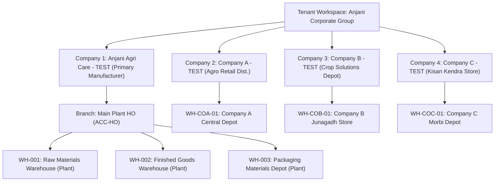
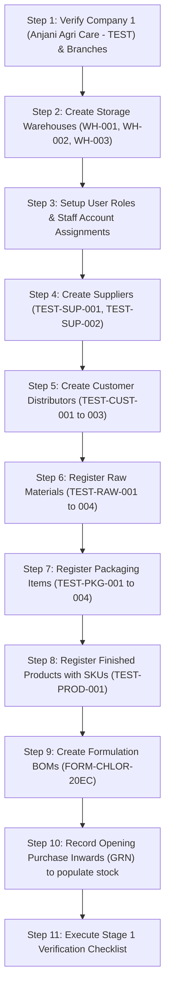

# Agrochemical ERP — Master Test Environment & Test Dataset Setup Guide

> [!IMPORTANT]
> **Safety Notice:** Never perform destructive testing, inventory resets, or schema modifications on live business transactions. This document establishes an isolated, repeatable test environment and standardized fictional dataset designed specifically for manual and automated verification of the Agrochemical ERP.

---

## 1. Test Environment Setup & Baseline Safety

### 1.1 Local Server Verification
Ensure the local development environment is running:
* **Local Web Server URL:** `http://localhost:5174` (or port configured in Vite)
* **Supported Test Browsers:** Google Chrome (recommended for DevTools), Microsoft Edge, Mozilla Firefox.
* **Inspect Viewports:**
  * **Desktop:** $1920 \times 1080\text{px}$ (Standard enterprise workstation)
  * **Laptop:** $1366 \times 768\text{px}$ & $1440 \times 900\text{px}$ (Common field laptops)
  * **Tablet / Mobile:** $768\text{px}$ & $375\text{px}$ (Godown operator touchscreens)

### 1.2 Non-Destructive Backup & Restore Point
Before conducting any manual test runs, extract a full JSON backup of your current database state:
1. Navigate to `pages/exports.html`.
2. Click **"Download JSON Backup"** to save a snapshot (`erp_backup_YYYY-MM-DD.json`).
3. If you ever need to restore your initial clean state, use the **JSON Restore** tool on `pages/exports.html`.
4. **Never** run `DROP TABLE` or `TRUNCATE` queries directly in production database consoles.

---

## 2. Multi-Company & Organizational Hierarchy

### 2.1 Authorized Legal Entities (Companies)

| Company ID | Legal Entity Name | Code | Entity Type | GSTIN | Registered City | Currency | Primary Role |
| :---: | :--- | :---: | :---: | :--- | :--- | :---: | :--- |
| **1** | **Anjani Agri Care - TEST** | `ACC` | Manufacturer | `24AAACA0000A1Z5` | Rajkot, Gujarat | INR (₹) | Central manufacturing, chemical synthesis, formulation, and primary bulk dispatch. |
| **2** | **Company A - TEST (Agro Retail)** | `CO-A` | Trading / Retail | `24AAACA0001B1Z4` | Ahmedabad, Gujarat | INR (₹) | Regional retail distribution subsidiary receiving finished goods via transfer. |
| **3** | **Company B - TEST (Crop Solutions)** | `CO-B` | Trading / Retail | `24AAACA0002C1Z3` | Junagadh, Gujarat | INR (₹) | District dealer receiving consignment inventory from manufacturer. |
| **4** | **Company C - TEST (Kisan Kendra)** | `CO-C` | Trading / Retail | `24AAACA0003D1Z2` | Morbi, Gujarat | INR (₹) | Farmer-facing cooperative retail store. |

### 2.2 Storage Warehouses & Depots

| Warehouse Code | Warehouse Name | Company Owner | Storage Category | Physical Location | Capacity |
| :---: | :--- | :---: | :--- | :--- | :---: |
| `TEST-WH-001` | Main Plant Raw Material Store | `ACC` (ID: 1) | Raw Chemicals & Solvents | Virva Plant, Sector A | 50,000 KG |
| `TEST-WH-002` | Main Plant Finished Goods Store | `ACC` (ID: 1) | Packaged Finished Goods | Virva Plant, Sector B | 100,000 Units |
| `TEST-WH-003` | Main Plant Packaging Store | `ACC` (ID: 1) | Bottles, Caps, Cartons | Virva Plant, Sector C | 200,000 Units |
| `WH-COA-01` | Company A Central Depot | `CO-A` (ID: 2) | Finished Retail Stock | Naroda GIDC, Ahmedabad | 40,000 Units |
| `WH-COB-01` | Company B Junagadh Store | `CO-B` (ID: 3) | Finished Retail Stock | Station Road, Junagadh | 25,000 Units |
| `WH-COC-01` | Company C Morbi Depot | `CO-C` (ID: 4) | Finished Retail Stock | Sanala Road, Morbi | 20,000 Units |

---

## 3. Test User Accounts & RBAC Persona Matrix

Use these standard fictional user accounts to test role-based access control, approval hierarchies, and company isolation:

| User Email | Full Name | Assigned System Role | Role Code | Scope Level | Operational Responsibility |
| :--- | :--- | :--- | :---: | :--- | :--- |
| `admin@anjani.test` | Rajesh Vora | Software Super Admin | `super_admin` | Global (All Companies) | Full system governance, user onboarding, role editing, audit review. |
| `owner@anjani.test` | Jayesh Patel | Company Owner / Director | `company_owner` | Company 1 (`ACC`) | Executive oversight, financial ledgers, intercompany agreements. |
| `production@anjani.test` | Dr. Haresh Joshi | Production & Plant Manager | `production_manager` | Company 1 (`ACC`) | Formulation BOM, synthesis batch launching, shop-floor consumption. |
| `store@anjani.test` | Mukesh Dave | Warehouse & Store Manager | `store_manager` | Company 1 (`ACC`) | Raw material GRN receipt, stock transfers, physical bin balance. |
| `qc@anjani.test` | Priya Mehta | Quality Control Officer | `qc_officer` | Company 1 (`ACC`) | Batch chemical analysis, specific gravity tests, quarantine approvals. |
| `sales@anjani.test` | Amit Trivedi | Sales & Dispatch Executive | `sales_executive` | Company 1 (`ACC`) | Customer orders, commercial invoices, dispatch challans. |
| `accounts@anjani.test` | Bharat Shah | Senior Commercial Accountant| `accountant` | Company 1 (`ACC`) | Cash & bank ledger, expense booking, customer receipts, tax reconciliation. |
| `godown@anjani.test` | Ramesh Koli | Packaging & Godown Operator | `godown_operator` | Company 1 (`ACC`) | Bottling runs, loose unit packing, physical vehicle loading. |
| `operator@anjani.test` | Sanjay Rathod | Factory Operator (Shift A) | `factory_operator` | Company 1 (`ACC`) | Mixer operations, daily raw chemical addition logs. |
| `auditor@anjani.test` | Ketan Parikh | Statutory Auditor | `viewer_auditor` | Company 1 (`ACC`) | Strict read-only inspection of reports, ledgers, and audit trails. |
| `retail_owner@compb.test`| Bhavesh Zala | Company B Director | `company_owner` | Company 3 (`CO-B`) | Isolated retail store operations (used to verify multi-company security). |

*Standard Test Password for all test personas:* `Test@Agro2026!`

---

## 4. Materials, Packaging & Products Master Dataset

### 4.1 Raw Materials (Active Ingredients, Solvents & Emulsifiers)

| Item Code | Material Name | Chemical Category | Physical State | Unit | Reorder Level | Standard Cost (₹) |
| :---: | :--- | :---: | :---: | :---: | :---: | :---: |
| `TEST-RAW-001` | Chlorpyrifos Technical (98% Tech Grade) | Active Ingredient | Liquid | KG | 1,000 | ₹650.00 / KG |
| `TEST-RAW-002` | Solvent C-IX (Aromatic Hydrocarbon) | Solvent / Carrier | Liquid | LTR | 2,500 | ₹85.00 / LTR |
| `TEST-RAW-003` | Emulsifier Blend Poly-70 (Calcium Blend) | Emulsifier | Liquid | LTR | 500 | ₹195.00 / LTR |
| `TEST-RAW-004` | Thiamethoxam Technical (95% Tech Grade) | Active Ingredient | Powder | KG | 500 | ₹1,450.00 / KG |
| `TEST-RAW-005` | Tebuconazole Technical (97% Tech Grade) | Active Ingredient | Powder | KG | 400 | ₹1,850.00 / KG |

### 4.2 Packaging Materials

| Item Code | Packaging Material Name | Material Category | Packing Specs | Unit | Reorder Level | Standard Cost (₹) |
| :---: | :--- | :---: | :--- | :---: | :---: | :---: |
| `TEST-PKG-001` | 500ml HDPE Amber Bottle | Container | 500ml Neck 28mm | UNITS | 5,000 | ₹12.50 / Unit |
| `TEST-PKG-002` | 28mm ROPP Induction Wadded Cap | Seal Closure | Induction Foil Wadded | UNITS | 5,000 | ₹2.20 / Unit |
| `TEST-PKG-003` | Anjani Chlor-20 500ml Self-Adhesive Label | Label | Waterproof Multi-Color | UNITS | 5,000 | ₹1.80 / Unit |
| `TEST-PKG-004` | 5-Ply Corrugated Master Box (10x500ml) | Master Shipper | Holds 10 x 500ml Bottles | BOXES | 500 | ₹32.00 / Box |
| `TEST-PKG-005` | 1 Litre Co-Ex Fluorinated Bottle | Container | 1,000ml Neck 32mm | UNITS | 3,000 | ₹24.00 / Unit |
| `TEST-PKG-006` | 5-Ply Corrugated Master Box (10x1L) | Master Shipper | Holds 10 x 1L Bottles | BOXES | 300 | ₹45.00 / Box |

### 4.3 Finished Products & SKU Packaging Configurations

#### Product 1: `TEST-PROD-001` — Anjani Chlor-20 EC
* **Technical Name:** Chlorpyrifos 20% EC
* **Category:** Insecticide
* **GST Rate:** 18%
* **SKU Configurations:**
  * **SKU-500ML:** 500ml HDPE Bottle | Box Capacity: 10 bottles/box | Unit MRP: ₹350.00 | Unit Selling Price: ₹280.00
  * **SKU-1000ML:** 1 Litre Co-Ex Bottle | Box Capacity: 10 bottles/box | Unit MRP: ₹650.00 | Unit Selling Price: ₹520.00

#### Product 2: `TEST-PROD-002` — Anjani Thiamethoxam 25 WG
* **Technical Name:** Thiamethoxam 25% WG
* **Category:** Insecticide
* **GST Rate:** 18%
* **SKU Configurations:**
  * **SKU-250G:** 250g Pouch | Box Capacity: 20 pouches/box | Unit MRP: ₹450.00 | Unit Selling Price: ₹360.00
  * **SKU-500G:** 500g Pouch | Box Capacity: 10 pouches/box | Unit MRP: ₹850.00 | Unit Selling Price: ₹680.00

#### Product 3: `TEST-PROD-003` — Anjani Tebuconazole 25.9% EC
* **Technical Name:** Tebuconazole 25.9% m/m EC
* **Category:** Fungicide
* **GST Rate:** 18%
* **SKU Configurations:**
  * **SKU-500ML:** 500ml Bottle | Box Capacity: 10 bottles/box | Unit MRP: ₹700.00 | Unit Selling Price: ₹560.00
  * **SKU-1000ML:** 1 Litre Bottle | Box Capacity: 10 bottles/box | Unit MRP: ₹1,300.00 | Unit Selling Price: ₹1,040.00

---

## 5. Approved Formulations & BOM Recipes

### Formulation 1: `FORM-CHLOR-20EC` — Chlorpyrifos 20% EC
* **Target Product:** `TEST-PROD-001` (Anjani Chlor-20 EC)
* **Standard Batch Volume:** 1,000 Litres
* **Target Specific Gravity / Density:** $1.075\text{ g/ml}$
* **Standard Bill of Materials (BOM):**
  1. `TEST-RAW-001` (Chlorpyrifos Tech 98%): $204.08\text{ KG}$ (Provides $200.0\text{ KG}$ active ingredient = 20% w/v)
  2. `TEST-RAW-003` (Emulsifier Blend Poly-70): $80.00\text{ LTR}$ ($8.0\%\text{ v/v}$)
  3. `TEST-RAW-002` (Solvent C-IX): $715.92\text{ LTR}$ (Balance to make 1,000 Litres)

### Formulation 2: `FORM-TEBU-25EC` — Tebuconazole 25.9% EC
* **Target Product:** `TEST-PROD-003` (Anjani Tebuconazole 25.9% EC)
* **Standard Batch Volume:** 1,000 Litres
* **Standard Bill of Materials (BOM):**
  1. `TEST-RAW-005` (Tebuconazole Tech 97%): $267.01\text{ KG}$
  2. `TEST-RAW-003` (Emulsifier Blend Poly-70): $100.00\text{ LTR}$
  3. `TEST-RAW-002` (Solvent C-IX): $632.99\text{ LTR}$

---

## 6. Commercial Partners: Suppliers & Customers

### 6.1 Raw Material & Packaging Suppliers

| Supplier ID | Vendor Company Name | Contact Person | Phone & Email | GSTIN | Material Specialty |
| :---: | :--- | :--- | :--- | :--- | :--- |
| `TEST-SUP-001` | Gujarat Chemicals & Synthetics Ltd | Arvindbhai Mehta | `98250 11223` / `orders@gujchem.test` | `24AAACG1122A1Z8` | Technical grade active ingredients & aromatic solvents. |
| `TEST-SUP-002` | Apex Polymer Containers Ltd | Nitinbhai Shah | `98251 44556` / `sales@apexpoly.test` | `24AAACP4455B1Z7` | HDPE bottles, caps, induction wads & corrugated boxes. |

### 6.2 Customer Distributors & Retailers

| Customer ID | Distributor Firm Name | Contact Person | City, State | Phone | GSTIN | Credit Limit | Payment Terms |
| :---: | :--- | :--- | :--- | :--- | :--- | :---: | :---: |
| `TEST-CUST-001` | Kisan Agro Agency | Ramesh Patel | Rajkot, Gujarat | `98252 77889` | `24AAAFK1122D1Z5` | ₹5,00,000 | 30 Days Net |
| `TEST-CUST-002` | Sardar Patel Krishi Kendra | Nilesh Gondalia | Junagadh, Gujarat | `98253 88990` | `24AAAFS3344E1Z4` | ₹3,50,000 | 15 Days Net |
| `TEST-CUST-003` | Shree Ram Fertilizer & Agro | Bharatbhai Vora | Morbi, Gujarat | `98254 99001` | `24AAAFR5566F1Z3` | ₹2,00,000 | Advance / Immediate |

---

## 7. Baseline Opening Inventory Balances

Before launching end-to-end tests, confirm that the starting inventory matches these baseline figures in Company 1 (`Anjani Agri Care - TEST`):

### 7.1 Raw Chemical Store (`TEST-WH-001`)

| Item Code | Item Description | Batch Number | Available Qty | Unit | Unit Cost (₹) | Total Valuation (₹) |
| :---: | :--- | :---: | :---: | :---: | :---: | :---: |
| `TEST-RAW-001` | Chlorpyrifos Tech 98% | `BAT-RAW-CHLOR-01` | $2,500.00$ | KG | ₹650.00 | ₹16,25,000.00 |
| `TEST-RAW-002` | Solvent C-IX | `BAT-RAW-SOLV-01` | $8,000.00$ | LTR | ₹85.00 | ₹6,80,000.00 |
| `TEST-RAW-003` | Emulsifier Blend Poly-70 | `BAT-RAW-EMUL-01` | $1,200.00$ | LTR | ₹195.00 | ₹2,34,000.00 |
| `TEST-RAW-004` | Thiamethoxam Tech 95% | `BAT-RAW-THIAM-01` | $800.00$ | KG | ₹1,450.00 | ₹11,60,000.00 |

### 7.2 Packaging Material Depot (`TEST-WH-003`)

| Item Code | Packaging Description | Batch Number | Available Qty | Unit | Unit Cost (₹) | Total Valuation (₹) |
| :---: | :--- | :---: | :---: | :---: | :---: | :---: |
| `TEST-PKG-001` | 500ml HDPE Amber Bottle | `LOT-BTL-500-01` | $10,000$ | UNITS | ₹12.50 | ₹1,25,000.00 |
| `TEST-PKG-002` | 28mm ROPP Cap | `LOT-CAP-28-01` | $12,000$ | UNITS | ₹2.20 | ₹26,400.00 |
| `TEST-PKG-003` | Chlor-20 500ml Label | `LOT-LBL-C20-01` | $15,000$ | UNITS | ₹1.80 | ₹27,000.00 |
| `TEST-PKG-004` | 5-Ply Outer Carton (10x500ml) | `LOT-BOX-10-01` | $1,200$ | BOXES | ₹32.00 | ₹38,400.00 |

### 7.3 Finished Goods Warehouse (`TEST-WH-002`)

| Product Code | Product SKU | Batch Number | Physical Boxes | Loose Units | Total Units | Equivalent Litres |
| :---: | :--- | :---: | :---: | :---: | :---: | :---: |
| `TEST-PROD-001` | Anjani Chlor-20 EC (500ml) | `BAT-2026-CHLOR-001` | 100 Boxes | 0 Bottles | 1,000 Bottles | 500.0 Litres |

---

## 8. Step-by-Step Test Setup & Dependency Sequence

Follow this strict chronological order when setting up test records from scratch. Setting up child records before parent records will cause foreign key and reference errors:

### Pre-Testing Readiness Checklist
* [ ] Topbar displays **Anjani Agri Care (ACC)** with active green dot.
* [ ] `pages/inventory.html` shows all raw materials with status pill `In Stock` (Green).
* [ ] `pages/products.html` lists `TEST-PROD-001` with both 500ml and 1L SKU badges.
* [ ] `pages/formulations.html` displays `FORM-CHLOR-20EC` with status `Approved`.
* [ ] `pages/user-roles.html` displays 10 system roles in primary dark green `#0C3925`.
* [ ] Database backup is safely stored on local disk.

---

## 9. Safe Test Teardown & Reset Procedure

When test cycles are finished and you want to clean up or reset transactional test data without corrupting master records:

1. **Delete Transactional Records in Reverse Order:**
   * Orders & Dispatches (`pages/orders.html` -> Cancel/Delete test orders)
   * Production Batches (`pages/production.html` -> Delete test batch runs)
   * Daily Stock Entries (`pages/daily-transactions.html` -> Clear test usage entries)
   * Purchase Inwards (`pages/purchases.html` -> Cancel test purchase receipts)
2. **Preserve Master Records:** Never delete `TEST-PROD-001`, `TEST-RAW-001`, or `Anjani Agri Care` root company.
3. **Restore Clean Snapshot:** If significant testing was conducted, simply use **Restore JSON Backup** on `pages/exports.html` using the baseline snapshot created in Section 1.2.
